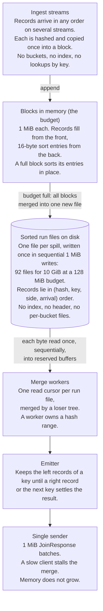

# Bucket architecture evaluation

Nov 16, 2026

> Markdown copy of the evaluation report. The report's two charts are given here as tables, and its diagram as Mermaid.

## Recommendation

Adopt sorted runs with a streaming merge join. At 10 GiB under a 128 MiB memory budget it finishes ingest plus join in 50 s against 73 s for the current design, writes 92 files instead of 150,716, and holds that time when page cache is scarce.

- **Why this one.** It is the only design that both ends the file explosion and stops loading buckets into memory. A Join holds one key at a time, so bucket sizing, re-partitioning and the unit-sized `HOT_KEY` limit go away. The segmented log is as fast, but it keeps the current join and its limits.
- **The value log with a B-tree index is not recommended.** The index cannot fit the budget: 1.9 GB of entries at 10 GiB. The Join still has to load every value. Rebuilt as sorted key runs over value logs it takes 56 s with ample page cache and 107 s without.
- **Two of its ideas carry over.** Sorted runs should check a Match's size before holding its values, and should read large values separately from their keys.
- **Memory is a setting, not an outcome.** Every design on the Go heap peaked near 300 MiB resident for a 128 MiB budget. What sorted runs changes is what the budget is needed for: 68 MiB reserved during the 10 GiB join, instead of all of it.
- **It is not ready to merge.** The prototype must pass six conditions first, chiefly direct I/O for run writes and large-value handling. Its join also slows when data far outgrows the budget: 67.5 s at 10 GiB under 32 MiB.
- **A low-risk step is available first.** Three patches to the current design cut 150,716 files to 2,048 with no change a client can see.

## What a bucket is judged on

**The budget** is the size of the sidecar's memory pool, set by `RECON_MEMORY_LIMIT_BYTES` and shared by every run. Anything that holds run data reserves from the pool before it allocates, and releases afterwards: decoded Ingest messages, buffered records, a Join's working set and its output batches. When a reservation does not fit, the sidecar spills records to disk to make room. It fails the request with `MEMORY_EXHAUSTED` only if nothing can be spilled.

- **By default it is 70% of the container's memory limit:** 358 MiB in a 512 MiB container. This evaluation pinned it at 128 MiB in a 512 MiB container instead, so that 10 GiB of data is 80 times the budget and every design spills heavily.
- **It is not the process's memory.** Garbage-collector headroom sits on top of it, so a 128 MiB budget peaked near 300 MiB resident. At the default budget, `GOMEMLIMIT` must be set to about 90% of the container limit, or the container is OOM-killed.
- **What the process leaves of the container limit is page cache,** which spill writes and reads pass through. It was about 200 MiB in this evaluation's main runs, about 25 MiB in the 256 MiB container, and about 50 MiB at the default budget in a 512 MiB container.

A bucket's memory is therefore a setting, not an outcome: the sidecar holds one fixed budget however large the run is. An architecture cannot "use less memory". It can only change what the budget buys, and what the disk pays for it.

The workload is narrow, and every candidate is judged against it:

- **Written once, in arrival order.** Four ingest streams append records; nothing is updated or looked up by key during ingest.
- **Read once or a few times, then deleted.** A Join reads everything. Runs are ephemeral: no durability, no fsync, wiped at restart.
- **Small keys, larger values.** Keys are 18 bytes and values average 226 bytes in the main profile. 10 GiB is 43.9 million records.
- **A full outer join with duplicates.** One `both` match per key with every value from each side, a one-sided result per unmatched record, and empty keys that never match.
- **Disk may be a network volume.** Bytes written, files created and whether reads are sequential matter as much as speed on NVMe.

Each architecture is scored on five things:

1. **Budget per record at Join.** This decides how much data a join unit covers, how often a bucket must be re-partitioned, and how large one key may grow before `HOT_KEY`.
2. **Ingest and join throughput** on the same data, in the same 512 MiB container limits.
3. **Disk work:** bytes and files written, and the number and pattern of reads.
4. **Real memory against the budget:** peak resident set next to what the pool reserved.
5. **Complexity and risk:** code, failure modes, dependencies, and fit with the rest of the sidecar.

## Current architecture, re-evaluated

The current design is sound and predictable, and its two most visible faults are incidental: about 200 lines of patches remove them without changing anything a client sees. What the patches cannot change is that spills are small, and that one key's whole records must fit a join unit.

**How it works today.** Records hash into N buckets per side, and each bucket buffers encoded records in chunks. When the budget is full the largest buffers spill, each as a new file. The Join groups buckets into units whose bytes times 2 fit a worker's share, loads each unit whole, sorts a 16-byte index and emits.

| Finding | Measured | Incidental or inherent |
| --- | --- | --- |
| One file per spill | 150,716 files and 768,760 write calls at 10 GiB; 3.7 s to delete them | Incidental. Appending to one file per (side, bucket) leaves 2,048 files at any size |
| A file list outside the budget | The list of spill files is not reserved. At 10 GiB under a 32 MiB budget the process held 299 MiB resident | Incidental. The same patch brings it to 107 MiB |
| A planning factor of 2 | The real working set is 1.06 to 1.10 times the record bytes, so 46% of each unit budget sits idle. With 64 buckets the Join rewrote all 1.17 GB | Incidental. Plan from bytes plus 16 per record |
| Output batches missing from the plan | The Join fails with `MEMORY_EXHAUSTED` at an 8 MiB budget | Incidental. Subtract them from the unit budget |
| Spill pieces shrink as data grows | A piece is about 0.55 × budget / buckets: 73 KiB at a 128 MiB budget, 16 KiB at a 32 MiB budget. Ingest streams spend 93 to 95% of their time in the store waiting on spills | Inherent to per-bucket buffers |
| Whole values in the join working set | One key's records must fit 16 MiB at a 128 MiB budget. A key on one side only fails with `HOT_KEY`, though it needs no Match | Inherent to loading units |
| Slack in chunks | A full 128 MiB pool holds about 86 MiB of records | Inherent to per-bucket buffers |

**What it is good at.** An alternative has to match these, and most of the candidates gave one up.

- Every record is written at most once and read once per Join, with sequential I/O only.
- At most 5 files are open at a time, and no file needs recovery.
- The join working set is one unit, whatever the data size.
- Output order is deterministic, and errors are typed and name the key.
- It was never killed for memory in any configuration a reviewer tried.

**With three patches** (append with block alignment, an exact planner, output batches counted in the plan):

- 10 GiB takes 68 s against 73 s, in 2,048 files, with half the garbage-collector CPU (4.9 s against 10.3 s).
- A reviewer found no regression in 59 scenarios, and nothing a client sees changes.
- Alignment is not optional. Unaligned appends made the kernel read file tails back, and 10 GiB ingest took 63 s against 49 s in the evaluator's runs.
- The patches buy hygiene, not speed: ingest still makes 914,278 small writes at 10 GiB.

## Candidate architectures

Five alternatives were built as working prototypes behind one interface, next to the current design and a patched copy of it. All seven return identical join results in every scenario that completes, so they differ only in cost and in where they refuse.

| Candidate | In memory during ingest | On disk | Join |
| --- | --- | --- | --- |
| Current | Whole records, in chunks per (side, bucket) | One new file per spill per bucket | Load a unit of buckets whole, sort a 16-byte index, emit |
| Current, patched | Same | One appended file per (side, bucket) | Same, planned from exact sizes |
| Value log + key index | Keys and value offsets only | A value log per (side, bucket), sorted key runs per side | Merge the key runs, load the bucket's value logs whole |
| Key log + value log | Whole records, keys and values in separate chunks | A key file and a value file per (side, bucket) | Load keys and the smaller side's values, stream the other side |
| Sorted runs | Whole records in 1 MiB blocks, plus 16-byte sort entries | One sorted file per spill for the whole run | Streaming merge of the files; nothing is loaded |
| Segmented log | Same as current | One log for the run, extents per bucket | Same as current |
| Embedded engine | The engine's memtables (Pebble) | The engine's sorted tables | The engine's merging iterator over hash ranges |

### Value log with a B-tree key index

The idea this evaluation started from does not hold as proposed, but two parts of it are worth keeping. It was built as stated, then changed where measurements forced it.

**The index does not fit the budget, and a B-tree is the costliest way to hold it.**

- At 10 GiB the index of 43.9 million records needs 1.9 GB at its tightest, 43 bytes per entry. The budget is 128 MiB.
- Two B-tree libraries measured 72 to 104 heap bytes per entry, 1.7 to 2.4 times a sorted array. Ingest CPU at 1 GiB was 11.7 to 12.8 s with a tree and 7.3 to 9.5 s with the array.
- The index must therefore spill. As an on-disk B+tree (bbolt) the 1 GiB run's index alone took 92 s and 16 GiB of device writes, about one random page write per insert.
- Nothing looks a key up during ingest, so an array sorted only when it spills does the same job. The prototype's default became that: sorted key runs over value logs.

**Memory is not saved at the Join.** A full outer join returns every value, in key order, from a log written in arrival order. The Join therefore loads a bucket's whole value log, or issues one read per value.

- Loading whole logs held 13.1 MiB per worker at 10 GiB. The current design holds about 11 MiB for the same bucket.
- Reading value by value took 4.39 million reads per GiB. Sorting each batch's reads left all 4.39 million. Merging neighbouring reads cut them to 97,363 but re-read the log: 14.8 GB read for 1.08 GB of data.
- That per-value path is also the fallback for any bucket too large to load. A reviewer measured 37 to 66 times the data in reads on skewed keys.

**For small records there is nothing to separate.** An index entry reserves 52 to 65 bytes. A whole small record in the current encoding is 51 bytes.

What the premise gets right, for the main profile:

- An index entry is about a fifth of a record, so the budget covers far more records between spills. At 10 GiB that meant 32,382 index runs instead of 150,519 spill files.
- A Match's size is known from the index before any value is read. A key on one side only streams at any size: 40 MiB of one key passed under an 8 MiB budget, where the current design returns `HOT_KEY`.

What stays fragile in the built form: 2,050 files stay open for the life of a run, and the value logs grow in small unaligned appends. Its ingest speed depends on page cache, as the comparison shows.

### Key log and value log, index built at Join

Deferring the index to the Join works only after the lazy value fetch is dropped. The prototype's default ended as something narrower: small join units with one side's values in memory.

- **Lazy fetch fails on arrival order.** Values are read where they lie, so one side's reads are random unless both sides arrive in the same key order. With one side shuffled it took 1,868,019 reads per GiB: 2.0 s with the page cache and 24.6 s without it. The default the prototype ended with takes 1.1 s.
- **What it kept:** a key file and a value file per (side, bucket), and 4 MiB units holding the keys plus the smaller side's values. The working set fell to 138 to 148 bytes per record, from 271.
- **What it costs:** output order follows arrival, so two Joins of one run return results in a different order. Its `HOT_KEY` errors do not name the key. Oversized buckets fall back to one read per value.

### Sorted runs with a streaming merge join

This is the recommended design, described in its own section below. Records are sorted when they spill, into one file per spill, and the Join merges those files without loading a bucket.

- **It removes mechanisms instead of adding them:** no per-bucket buffers, no unit planner, no re-partitioning, no hot-key scan, and no writes during the Join of a spilled run.
- **The sort is not extra work.** `PROPOSAL.md` section 18 rejected sort-merge because it needs an external sort of both inputs. The current Join already sorts every unit; the comparison shows that sorting at spill time costs less CPU in total.
- **Its inherent limit is fan-in.** Join read memory grows with data over budget. At 4 GiB under a 16 MiB budget it had 326 files, one worker, and a 53.4 s join.
- **The prototype has two defects to fix first.** Values of 1 to 4 MiB fail its Join. Buffered run writes were OOM-killed on a throttled disk with little spare memory, 4 runs of 4; with direct I/O all 4 completed.

### Segmented spill log

Keeping the current join and changing only the file layout shows where the current design's ingest time goes. All spills go into one log in bucket order, and each bucket keeps a list of extents.

- **What it proves:** the file-per-spill layout, not the join model, is what slows the current ingest. Deleting a 10 GiB run took 0.013 s instead of 3.7 s.
- **What it leaves alone:** the join still loads whole units, so bucket sizing and the hot-key limit are unchanged.
- **Defects as built:** its reserved extent list fails a 16 MiB budget at 1 GiB. Its spill-everything policy fails skewed runs that the current design passes. It was OOM-killed in 6 of 8 runs on a throttled disk with little spare memory.

### Embedded key-value engine

An engine is rejected: the only configuration that competes is Pebble with its write-ahead log and compaction switched off, which is hand-built sorted runs with a large dependency.

- **Defaults are unusable here.** With them, 1 GiB took 83 s to ingest and wrote 9.3 times the data. With compaction tuned and left on, 4 GiB wrote 2.5 times the data and ingest doubled.
- **Its memory is outside the pool.** In the lab's cgo build the 10 GiB join held 376 MiB resident with 79 MiB reserved. Built without cgo, as the sidecar is, its live heap reached 178 MiB on small records. A reviewer saw it OOM-killed at 10 GiB in a 256 MiB container.
- **It fails where the others slow down.** 4 GiB under a 16 MiB budget fails after rewriting the data. Values of 1 to 4 MiB fail at ingest. A Close during a Join crashes the process.
- **It ties the design to Go:** 22 modules and 103,000 lines, against the proposal's preference for Rust. Badger did not finish 1 GiB in 20 minutes, and bbolt wrote 30 times the data.

Section 18 of the proposal is confirmed on the log and on compaction. It is not confirmed on one point: a sorted layout is not overhead, as the sorted-runs result shows.

## Comparison

At 10 GiB the two designs that write the budget out in large sequential pieces finish in about 50 s, against 73 s for the current design, and neither slows when page cache is scarce. Every design built on per-bucket files slows there, and the two that separate keys from values slow the most.

**Sorted runs and the segmented log finish 10 GiB in about 50 s, with or without page cache.** Seconds for 10 GiB of records at a 128 MiB budget, from the official rerun: median of 3 runs (2 runs in the 256 MiB container and for direct I/O). The 512 MiB container leaves about 200 MiB of page cache, the 256 MiB container about 25 MiB.

| Design | 512 MiB: ingest + seal | 512 MiB: join | 512 MiB: total | 256 MiB: ingest + seal | 256 MiB: join | 256 MiB: total |
| --- | ---: | ---: | ---: | ---: | ---: | ---: |
| Segmented log | 31.2 | 19.9 | **51** | 23.9 | 20.9 | **45** |
| **Sorted runs** | 35.0 | 14.8 | **50** | 35.4 | 15.7 | **51** |
| **Sorted runs, direct I/O** | 30.4 | 16.8 | **47** | 35.5 | 17.5 | **53** |
| Current, patched | 47.5 | 20.2 | **68** | 51.4 | 21.0 | **72** |
| Current | 50.9 | 22.4 | **73** | 62.5 | 23.1 | **86** |
| Value log + key index | 36.7 | 18.8 | **56** | 86.2 | 21.2 | **107** |
| Key log + value log | 53.8 | 15.8 | **70** | 96.1 | 17.8 | **114** |
| Embedded engine | 37.1 | 25.3 | **62** | killed | killed | out of memory in both runs |

- **Why the two leaders hold.** They write a full budget at a time, in writes of 1 MiB or more. Ingest took 10,734 write calls for sorted runs and 1,040 for the segmented log, against 768,760 for the current design.
- **Why key/value separation slows.** Both prototypes append small unaligned pieces to thousands of files. With little page cache the kernel reads each file's tail back before appending: 1.7 GiB of read-back for the value log, 1.0 GiB for the key log.
- **The join gap is larger than the times show.** The driver's single sender floors join time. Join CPU at 10 GiB was 31 CPU-seconds for sorted runs, 38 for the value log, 49 for the segmented log and 61 for the current design. Ingest and join together cost 90 CPU-seconds for sorted runs against 139 for the current design.
- **Real memory does not separate them.** Every Go-heap design peaked at 285 to 332 MiB resident for a 128 MiB pool, and at 223 to 232 MiB with `GOMEMLIMIT` at 230 MiB. The gap is garbage-collector headroom, which the setting controls and the architecture does not.

At 1 GiB and below the seven finish within a few seconds of each other. The exception is a small budget: at 1 GiB under 32 MiB, sorted runs and the segmented log take 5 s against 12 s for the current design.

### What each design holds, and where it breaks

| Design | Files at 10 GiB | Write calls at ingest | What a Join holds in memory | Limit on one key | Weakest point found |
| --- | --- | --- | --- | --- | --- |
| Current | 150,716 | 768,760 | A unit of buckets as whole records; the budget stays full | Its records must fit 16 MiB, even when one-sided | Files and an uncounted file list grow with data over budget |
| Current, patched | 2,048 | 914,278 | Same | About 29 MiB of records | No faster: the small appends remain |
| Value log + key index | 2,050 | 645,605 | A bucket's value logs, whole | Only the Match size | One read per value when a bucket does not fit; leans on page cache |
| Key log + value log | 4,096 | 266,537 | Keys plus one side's values | About 570,000 records | Output order not deterministic; leans on page cache |
| Sorted runs | 92 | 10,734 | One key at a time plus read buffers: 68 MiB reserved | Only the Match size | Join slows as data over budget grows |
| Segmented log | 43 | 1,040 | Same as current | Same as current | Its extent list fails at high data over budget |
| Embedded engine | 268 | 44,165 | The engine's blocks, outside the pool | Only the Match size | Killed for memory; fails at high data over budget |

### When the data far outgrows the budget

Sorted runs is not the fastest once data is 320 times the budget: its ingest stays fast, but its join drops to one worker. These are single runs of 10 GiB under a 32 MiB budget, in a container that leaves about 400 MiB of page cache.

| Design | Ingest + seal (s) | Join (s) | What happened |
| --- | --- | --- | --- |
| Value log + key index | 52.0 | 30.1 | 16 GB read in the join for 10 GiB of data |
| Key log + value log | 66.2 | 16.5 | Completed normally |
| Sorted runs | 35.9 | 67.5 | 403 files, one merge worker with 40 KiB read buffers |
| Current, patched | 86.6 | 22.2 | Re-partitioned every bucket: 10.8 GB written during the join |
| Current | 89.5 | 67.8 | 685,682 files and 299 MiB resident at a 32 MiB budget |
| Segmented log | Failed | Failed | Memory exhausted during ingest: the extent list outgrew the budget |

### On a slow disk

On a disk throttled like a network volume the designs converge at a 128 MiB budget, because every one of them writes and reads the data once. They separate again at a small budget, where the current design's spill pieces become IOPS-bound.

**On a throttled disk sorted runs lead by 8% at a 128 MiB budget, 2.6 times at a tight budget**, against the current design. Seconds, with the disk limited to 3,000 IOPS and 125 MiB/s: a reviewer's single runs under a cgroup I/O throttle.

| Design | 4 GiB at 128 MiB: ingest | 4 GiB at 128 MiB: join | 4 GiB at 128 MiB: total | 1 GiB at 32 MiB: ingest | 1 GiB at 32 MiB: join | 1 GiB at 32 MiB: total |
| --- | ---: | ---: | ---: | ---: | ---: | ---: |
| Segmented log | 39.0 | 38.5 | **77.5** | 9.4 | 7.9 | **17.3** |
| **Sorted runs** | 43.0 | 35.8 | **78.7** | 9.5 | 8.0 | **17.6** |
| Value log + key index | 49.0 | 42.6 | **91.6** | 11.9 | 9.1 | **21.0** |
| Current, patched | 48.8 | 36.6 | **85.4** | 13.7 | 8.5 | **22.2** |
| Key log + value log | 50.9 | 35.1 | **86.0** | 16.5 | 14.8 | **31.3** |
| Current | 48.7 | 36.5 | **85.2** | 24.4 | 21.8 | **46.2** |
| Embedded engine | not run | not run | not run | 8.9 | 42.6 | **51.5** |

So the speed lead holds where the disk is fast or the budget is tight. At a 128 MiB budget on a slow volume, the case for sorted runs is what it removes and what it survives, not time.

## Recommended architecture in detail

Sorted runs replace the bucket with one mechanism: when the budget fills, sort what is in memory, write it as one file, and merge the files at Join.



*Records are sorted when they spill, so the join is one streaming merge.*

Memory holds arrivals, disk holds sorted files, and the Join holds one key at a time.

### How it works

1. **Ingest.** A record is hashed and copied once into a 1 MiB block. Its bytes grow from the front, and a 16-byte sort entry (hash, offset, arrival ticket) grows from the back. The goroutine that fills a block sorts its entries.
2. **Spill.** When a reservation fails, every block is merged in key order into one new file, in sequential 1 MiB writes. Ingest streams wait while it runs.
3. **Seal.** A run that spilled writes its remaining blocks as the last file, then holds about 1.2 MiB of the pool. A run that never spilled stays in memory and joins from there, unless the Join needs the room and spills it first.
4. **Join.** Each worker takes a hash range and merges that range of every file through one read cursor per file. Left records of a key are held until a right record, or the next key, settles the result.

The sort order is (hash, key, side, arrival), so each side's values reach a Match in ingest order. Empty keys hash to 0 and are emitted first, as one-sided results.

### What changes in the sidecar

- **Replaced:** `internal/buffer` becomes the block memtable, `internal/spill` becomes run files, and `internal/join` becomes a merger and an emitter.
- **Deleted:** the unit planner and `ExpansionFactor`, re-partitioning and its scratch files, the hot-key counting scan, and the empty-key partition.
- **Kept:** `mem.Pool` unchanged, the run state machine in `internal/run`, and the join's shape of workers plus one sender.
- **Size:** the prototype is 2,371 lines against the 1,725 it replaces. About 350 of those are measurement options.

### What a client sees

Every visible change is a relaxation, with two exceptions. Seal and spills now take time, and with no match limit set a Match is capped at budget / (4 × parallelism).

| Today | With sorted runs |
| --- | --- |
| `bucket_count` must be sized to the data | Accepted and ignored |
| `HOT_KEY` when one key's records exceed half a unit budget (16 MiB at a 128 MiB budget), even for a one-sided key | `HOT_KEY` only when a Match exceeds `RECON_MAX_MATCH_BYTES`; a one-sided key streams at any size once condition 3 below is met |
| A Join may write: leftover spills and re-partitioned buckets | A Join of a spilled run never writes. A run that just fits in memory may be written once at Join |
| `SealRun` returns at once | `SealRun` writes the last file: up to 0.65 s measured |
| Many short ingest stalls behind per-bucket spills | One stall per spill, for all streams at once: about 0.2 s, 92 times, at 10 GiB on NVMe with spare page cache; about 1 s each on a 125 MiB/s volume |

### The sizing rule that replaces `bucket_count`

Join read memory is files × workers × read buffer, and the number of files grows with data over budget. A join runs at full speed while:

```
budget ≥ sqrt(0.3 MiB × workers × data)
```

That is about 110 MiB for 10 GiB with 4 workers. Below it read buffers shrink first, then the join gives up workers, then Seal merges files. It slows down instead of failing: 4 GiB under a 16 MiB budget completed with one worker and a 53.4 s join.

The rule is arithmetic from the prototype's read-buffer plan. Measured points: 10 GiB at 128 MiB (92 files, full speed), 10 GiB at 32 MiB (403 files, one worker, 67.5 s join) and 4 GiB at 16 MiB (326 files, one worker, 53.4 s join).

### Conditions for adoption

Each condition comes from a reviewer's finding on the prototype. Conditions 2, 3 and 5 have tests that fail today, condition 1 is a reproduced failure, and condition 4 is a measurement with no multi-run test yet.

1. **Direct I/O for run writes.** Buffered, a spill dirties up to a budget of page cache at once. On a throttled disk with little spare memory it was OOM-killed in 4 runs of 4; with direct I/O all 4 completed.
2. **Large values read at emit time.** Values of 1 to 4 MiB fail the Join today, at a 128 MiB budget too. A cursor should hold only the key and read a large value when it is emitted. This is key/value separation, used where it pays.
3. **A chunked arena.** A growing Match needs up to twice its size today. Chunks make it need its size once, and make an over-limit Match return `HOT_KEY` instead of `MEMORY_EXHAUSTED`.
4. **A pool-owned free list.** After a spill, up to a whole budget of blocks stays allocated but unreserved: 126.9 of 128 MiB measured. That is safe for one run per pool and wrong for several.
5. **Close cancels a Join.** Today Close waits, so `DeleteRun` would hang behind a stuck reader.
6. **A wider conformance suite first.** Today's suite cannot detect wrong value order, and never reaches a hot key, a large value, a cancellation or a budget under 8 MiB.

## Risks, open questions and next steps

The recommendation rests on a prototype with known defects and on a lab that could not test everything, so adoption should pass the six conditions above rather than follow from this report alone.

**Risks in the recommended design**

- **The join slows at high data over budget.** At 10 GiB under 32 MiB it took 67.5 s on one worker, against 22 s for the patched current design. Read-ahead on the cursor that runs dry first, or the intermediate merge, are the known remedies. The merge has run once at scale.
- **Spills stall every stream.** A spill is one write of about 124 MB. In the lab it cost 0.2 s each time; at 125 MiB/s it is about 1 s. An overlapped or half-budget spill would hide it and was not built.
- **Tiny records ingest slower.** 275 MiB of 41-byte records took 2.5 s to ingest against 1.8 s today, because a spill sorts on one goroutine while the streams wait.
- **The speed lead depends on the machine.** A reviewer measured the ingest lead over the patched current design at 41% on 32 cores with NVMe, 5% with two CPUs, and about 10% on a throttled disk.
- **Integration is unbuilt.** Several runs in one pool, the disk limit, the states filter and `DeleteRun` during a Join exist in no prototype. A reviewer estimates 5 to 8 weeks to production, against 1 to 2 for the patches.

**Open questions**

- **Are values of 1 MiB and more in scope?** If so, condition 2 is mandatory before adoption.
- **Should the three patches ship first?** They are low-risk and fix the file count now, but they are discarded when sorted runs lands.
- **How many runs share a pool?** Eight runs in a 128 MiB pool leave each about 16 MiB, which is the regime where the join slows.
- **Does spill compression come first?** The README measures 1.8 times with zstd. On a 125 MiB/s volume that gains more than any candidate here, and it favours large sequential blocks.

**Next steps**

1. Extend the conformance suite with the reviewers' scenarios: value order, hot keys, large values, cancellation, tiny budgets, and live heap against the pool.
2. Settle the open questions above.
3. Take the sorted-runs prototype through the six conditions, then measure its join at high fan-in with read-ahead.
4. Re-measure on a real network volume, with several runs sharing a pool and with skewed keys at benchmark scale.
5. Rewrite `PROPOSAL.md` sections 8 and 18 to match what is adopted.

## Method

Every number in the two main comparison tables comes from one driver doing the same work on each architecture under the same limits, rerun back to back after the evaluation. Other figures are single runs by an evaluator or a reviewer, and estimates are labelled as such.

**The lab.** Each architecture implements one interface that sits where `run.Manager` sits: ingest decoded records, seal, stream the join. The driver generates the repository's realistic profile (Payment against BankLine, protobuf, typical mix, seed 20) and ingests it on 4 streams in 1 MiB messages. It marshals and fingerprints every result, and a run counts only if its fingerprint matches a verified reference.

**The limits.** A 512 MiB memory cgroup with no swap, `GOMEMLIMIT` at 460 MiB, a 128 MiB budget, 1,024 buckets and parallelism 4. Data is on NVMe (btrfs, compression off), and the machine has 32 cores.

| Scenario | Data | What it stresses |
| --- | --- | --- |
| G1 | 1 GiB, 4.4 million records | The README's reference point |
| G2 | 1 GiB at a 32 MiB budget | A small budget per bucket |
| G3 | 275 MiB of tiny records, 7.0 million | Per-record overhead |
| G4 | 512 MiB, stress mix | Duplicates and one-sided keys |
| G5 | 10 GiB, 43.9 million records | Scale: the data is 80 times the budget |
| G5T | G5 in a 256 MiB container | Scarce page cache: about 25 MiB instead of about 200 MiB |

**The process.** Six evaluators each built and measured one prototype. Three reviewers then attacked the results from three sides: memory accounting, behaviour under hostile data, and production fit. They made more than a thousand runs of their own, including skewed keys, large values, tiny budgets and a throttled disk. Finally every architecture was rerun three times per scenario (twice for G5T), interleaved, and the medians are reported.

**What the evidence cannot show.**

- Join time is floored by the driver's single sender, at about 1.3 to 2.0 s per GiB. That compresses join differences; join CPU separates the designs better.
- CPU figures include the driver: 54 CPU-seconds of data generation at 10 GiB.
- Benchmark keys are uniform. Skew and hot-key findings rest on reviewer scenarios and unit tests, not on benchmark-scale data.
- One run per pool. Several runs sharing a budget, two Joins at once and `DeleteRun` during a Join were not exercised.
- Slow-disk figures are single runs under a cgroup I/O throttle on btrfs, not a real network volume.
- Four evaluators first compared against a baseline measured with result verification on, which doubles join time. The reviewers caught it, and the comparison here uses the rerun instead.

**Where the code is.** Prototypes, harness, evaluator and reviewer reports, and raw results are outside the repository, in /var/tmp/recon-bucketlab/lab-snapshot. Nothing in the repository was changed apart from adding this file.
