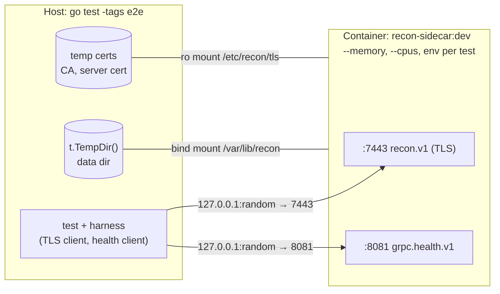

# Plan: recon-sidecar POC in Go on humus

| | |
|---|---|
| **Status** | Draft |
| **Date** | 2026-11-12 |
| **Revised** | 2026-11-18: the engine follows sorted runs and a streaming merge join, as [BUCKET_ARCHITECTURE_EVALUATION.md](BUCKET_ARCHITECTURE_EVALUATION.md) recommends and PROPOSAL.md §8 now describes (§6, §8, §9) |
| **Implements** | [PROPOSAL.md](PROPOSAL.md), API `recon.v1` (`proto/recon/v1/reconciler.proto`, messages unchanged; comments updated for sorted runs) |
| **Stack** | Go 1.27, `github.com/z5labs/humus` v0.16.0, `github.com/z5labs/humus/grpc` v0.16.0 |
| **Code** | `poc/`, Go module `poc` |

---

## 1. Goal and scope

The POC is a working sidecar that implements the proposal's API and engine, built into a container image and tested as a running container on a developer machine. It should answer two questions:

1. **Does the design hold?** Full outer join semantics, control totals, spilling to sorted run files, the streaming merge join, hot-key detection and one-sided keys of any size, all behind the unchanged `recon.v1` API.
2. **Can Go keep to a memory budget?** §16.1 leaves the language open (§20 Q1) because of garbage-collector headroom. The POC measures how far real memory use drifts from the pool's accounting.

**In scope:** milestones M1 and M2 (§16.3), plus the parts of M3 that a container needs: health probes, configuration validation and the image.

**Out of scope:** spill compression (the proposal chooses it by benchmark in M3), Prometheus, Kubernetes manifests, per-language client helpers (M4) and the cross-language conformance suite. The e2e harness's Go client helpers (§7.2) are a first version of the Go helper.

---

## 2. Deviations from the proposal

Most of these follow from humus's design; the rest keep the POC small.

| Proposal | POC | Why |
|---|---|---|
| Unix socket, no TLS (§13, `RECON_LISTEN`) | TCP with TLS, through `grpcserver` | `grpcserver` serves only TLS, and only on `host:port`. A plaintext client fails to connect. |
| TCP only on loopback (§11) | Defaults to `127.0.0.1:7443`, but loopback isn't enforced. The image sets `:7443`. | Tests on the host reach the container through a published port, and that needs a non-loopback bind inside the container. The harness publishes only to the host's `127.0.0.1`. |
| — | New `RECON_TLS_CERT_FILE` and `RECON_TLS_KEY_FILE`, both required | `grpcserver.Settings.TLS` has no default |
| Prometheus `/metrics` on `RECON_METRICS_ADDR` (§14) | OpenTelemetry metrics on the humus `Setup`'s `MeterProvider`, exported as `none`, `console` or `otlp` | humus's telemetry package has no Prometheus exporter |
| DuckDB oracle driven from Python (§17) | A naive full outer join in Go, test-only | Keeps a single toolchain. DuckDB can be added later. |
| LZ4/ZSTD blocks in run files (§8.3) | Uncompressed records | The codec is chosen by benchmark in M3 |
| `GOMEMLIMIT` required for a garbage-collected implementation (§11) | Not set by the sidecar; the deployment sets it | The measurements (§8.5) show it is needed at the default budget. Setting it from the cgroup limit is a small change the POC leaves out. |

Everything else (states, errors, limits, run IDs, the file layout and the join algorithm) follows the proposal as written.

---

## 3. Dependencies

| Module | Use |
|---|---|
| `github.com/z5labs/humus` v0.16.0 | `humus.Main`, `Setup`, `Host`, `telemetry`, `humustest` |
| `github.com/z5labs/humus/grpc` v0.16.0 (the same version, as humus requires) | `grpcserver` (API), `grpchealth` (probes port), `grpcservertest` |
| `github.com/z5labs/bedrock` v0.25.0 | `config.Env`, `config.Struct` for settings |
| `google.golang.org/grpc`, `google.golang.org/protobuf` | Generated stubs, status details |
| `github.com/zeebo/xxh3` | XXH3-64 with seed (§8.1) |
| `github.com/google/uuid` | `NewV7` for run IDs |
| `golang.org/x/sys/unix` | `O_DIRECT` and `fadvise` for run files, `statfs` for the default disk limit |
| `pgregory.net/rapid` (tests only) | Property-based tests with shrinking |

Code generation uses `protoc` with `protoc-gen-go` and `protoc-gen-go-grpc`. The proto file has no `go_package`, so the Makefile reads it from `../proto` and maps it with `--go_opt=Mrecon/v1/reconciler.proto=poc/gen/recon/v1;reconv1` (and the same `M` option for `--go-grpc_opt`), leaving the file untouched. The generated code is committed, so the image build doesn't need `protoc`.

---

## 4. Repository layout

The POC lives in a new `poc/` folder next to the proposal, and its Go module is named `poc`. The proto file stays where it is, so the proposal and the POC share one copy.

```
PROPOSAL.md
PLAN.md
proto/recon/v1/reconciler.proto    existing; read by `make proto`
poc/
  go.mod                           module poc
  Makefile
  Containerfile
  .containerignore
  gen/recon/v1/                    generated *.pb.go, *_grpc.pb.go (committed)
  cmd/recon-sidecar/main.go        humus.Main(app.Init, humus.WithTelemetry(app.Telemetry))
  internal/app/                    Init, settings, telemetry builder
  internal/api/                    ReconcilerServer: validation, state checks, error mapping
  internal/run/                    run manager, state machine, limits, run IDs
  internal/mem/                    reservation pool, idle blocks, spill trigger
  internal/record/                 record encoding, hash, fences
  internal/merge/                  loser-tree merge of sorted sources
  internal/buffer/                 a run's blocks (the memtable) and its run files
  internal/spill/                  run file writer and cursor, disk accounting, wipe
  internal/join/                   plan, merge workers, emitter, hot keys, merge at Seal
  internal/oracle/                 naive full outer join (used by tests only)
  e2e/                             container tests (build tag e2e)
  e2e/harness/                     container driver, certs, client helpers
  e2e/gen/                         synthetic data generator, verifier, fingerprint
```

From here on, paths are relative to `poc/` and commands run from there.

---

## 5. Wiring the service with humus

### 5.1 `main` and `Init`

The sidecar uses `humus.Main`, not `grpcserver.Main`. `grpcserver.Main` adds a 5 s drain so that a load balancer can stop routing to a terminating pod, and no load balancer routes to a sidecar. humus.Main's 20 s grace period applies as is.

```go
func main() {
	humus.Main(app.Init, humus.WithTelemetry(app.Telemetry))
}

func Init(ctx context.Context, s *humus.Setup) ([]humus.Service, error) {
	cfg, err := readSettings(ctx, s) // *config.Error on a bad value → exit 78
	if err != nil {
		return nil, err
	}
	if err := spill.Wipe(s.Host.FS, cfg.DataDir); err != nil { // §10: wipe at startup
		return nil, err
	}
	pool := mem.NewPool(cfg.MemoryLimit)
	runs, err := run.NewManager(s.Host.FS, pool, spill.NewDisk(s.Host.FS, cfg.DiskLimit), run.Config{
		DataDir: cfg.DataDir, MaxRuns: cfg.MaxRuns, MaxBuckets: cfg.MaxBuckets, // and the other §11 limits
	})
	if err != nil { // the pool can't hold the spill write buffer
		return nil, err
	}
	s.OnStop(runs.Close)

	api, err := grpcserver.NewService(s, cfg.GRPC, grpc.MaxRecvMsgSize(cfg.MaxRecvMessageBytes))
	if err != nil {
		return nil, err
	}
	reconv1.RegisterReconcilerServer(api, apiserver.New(s, runs))

	probes, err := grpchealth.NewService(s, grpchealth.Settings{Addr: cfg.HealthAddr})
	if err != nil {
		return nil, err
	}
	return []humus.Service{api, probes}, nil
}
```

- **Probes.** `grpchealth.NewService` serves gRPC health v1 in plaintext on `RECON_HEALTH_ADDR`, which is what §12's startup probe needs. It owns readiness: ready once Serve starts, and not ready once shutdown begins.
- **Filesystem.** All file access goes through `s.Host.FS`, so in-process tests run against `humustest`'s temp-dir filesystem. There are two exceptions. Free disk space is read with `unix.Statfs`, because `humus.FS` has no `Statfs`. In tests, `RECON_DISK_LIMIT_BYTES` is always set explicitly instead.
- **Wipe.** `spill.Wipe` removes the *contents* of the data directory, not the directory itself, because it is usually a mount point.
- **Shutdown.** On SIGTERM, grpcserver ends open Ingest and Join streams with `UNAVAILABLE "server is shutting down"`. The sidecar's own data is then lost to the restart wipe, so this just becomes §10's "sidecar restarts" row.

### 5.2 Settings

Settings come from the variables in §11, through `config.Struct` and `config.Env(s.Process.Environment, …)`. Every check runs as a `.Validate` in the value's chain, so a bad value fails Init with a `*config.Error` that names the variable, and the process exits 78 (`humus.ExitConfig`). That covers §11's "refuses to start": the memory limit above the cgroup limit, a data directory that isn't writable (checked by creating and removing a probe file through `Host.FS`), and a bucket maximum below 1.

| Variable | POC behavior |
|---|---|
| `RECON_LISTEN` | `host:port`, checked with `grpcserver.CheckAddr`. Default `127.0.0.1:7443`; the image sets `:7443`. |
| `RECON_TLS_CERT_FILE`, `RECON_TLS_KEY_FILE` | Required. PEM files, read through `Host.FS` and built into a `*tls.Config` checked with `grpcserver.CheckTLS`. |
| `RECON_HEALTH_ADDR` | Default `:8081`. Checked with `grpchealth.CheckAddr`. |
| `RECON_MEMORY_LIMIT_BYTES` | Default 70% of `/sys/fs/cgroup/memory.max`, read through `Host.FS`. If the cgroup reports `max` (no limit), the variable is required. |
| `RECON_JOIN_PARALLELISM` | Default `min(runtime.GOMAXPROCS(0), 4)`. Since Go 1.25, GOMAXPROCS follows the container's CPU limit. |
| `RECON_METRICS_EXPORTER` | Replaces `RECON_METRICS_ADDR`: `none` (the default), `console` or `otlp` |
| `RECON_LOG_LEVEL` | Mapped onto `telemetry.Settings.LogLevel`. Logs go to stdout as JSON through humus's console exporter. |
| All the others in §11 | As specified |

`app.Telemetry` is a `telemetry.Builder` that starts from `telemetry.DefaultSettings()`, sets `ServiceName` to `recon-sidecar`, and applies the two telemetry variables above.

At startup the sidecar logs one INFO record with the effective memory, disk, parallelism and bucket limits. The e2e tests read it to check the defaults.

---

## 6. Engine implementation notes

These are the parts of the proposal where the Go implementation needs a decision the proposal doesn't make. The engine follows PROPOSAL.md §8: sorted runs and a streaming merge join. It replaced the partitioned hash join this plan first built (§9).

### 6.1 Runs and the API layer (`internal/run`, `internal/api`)

- **Run IDs.** Generated with `uuid.NewV7()`. A request ID is valid only if it parses, is version 7, and is already in canonical lowercase form. Anything else is `INVALID_REQUEST`. The run directory name is always `uuid.String()` of the generated value (§13).
- **States.** `OPEN → SEALED | FAILED` follows §5.2, under a per-run mutex. Each run has its own context, which DeleteRun cancels.
- **Ingest.** The first message is validated before any record is accepted: the run must be known and `OPEN`, and the batch must be set. Failures at that point leave the run unaffected (§10). An `IngestRequest` naming a different run later in the stream, or a stream error after records were accepted, moves the run to `FAILED`.
  - **Receiving.** grpcserver doesn't unblock `Recv` when a context is cancelled, so the handler calls `Recv` in a goroutine and selects on the stream context and the run context. That lets DeleteRun end an idle stream with `ABORTED`.
- **`bucket_count`** is checked against `RECON_MAX_BUCKETS` and then ignored.
- **Seal.** Each stream adds its counts to the run's totals only when it commits. Seal fails with `INGEST_IN_PROGRESS` while any stream is open, and stores the totals so a second Seal returns the same response. `committed_ingests` counts committed streams. A run that spilled writes its last file and merges files if there are too many (§6.3), with the run marked as sealing so that no stream begins meanwhile. If that fails, the run stays `OPEN` with every record, and Seal may be called again.
- **Each run is one spillable** of the pool, and the Manager owns the one aligned write buffer every spill goes through, reserved for its life.
- **Errors.** Every failure goes through one function: `status.New(code, msg).WithDetails(&reconv1.ReconError{...})`, using the code table in §6.4.

### 6.2 Memory pool (`internal/mem`)

- **Accounting.** One `Pool` holds `limit` and `used`. `Reserve(n)` and `Release(n)` take a mutex but never do I/O while holding it.
- **Idle blocks.** A spill puts the blocks it empties on the pool's idle list, still reserved. Any run takes them for new records, and any reservation that doesn't fit drops them first. That is the evaluation's "pool-owned free list": exact for any number of runs sharing the pool.
- **Spilling.** When a reservation still fails, the reserving goroutine itself spills: it collects every spillable run, sorts them by the memory spilling would release, spills the largest until usage less the idle blocks is below a low-water mark (80% of the limit), and retries once. Spilling happens on the goroutine that needs the memory, so the sidecar still has no background work. If the retry also fails, the result is `MEMORY_EXHAUSTED`.
- **Pinning.** A run whose blocks a Join is reading is pinned, and the spiller skips it. Otherwise the pool would credit memory that the Join still holds.
- **Decoded messages.** grpc-go decodes a message before the handler sees it, so Ingest reserves `proto.Size(msg)` only after `Recv` returns. Peak usage can therefore exceed the budget by up to one message per open stream.

### 6.3 Blocks and run files (`internal/record`, `internal/buffer`, `internal/spill`)

- **Encoding.** One encoding in memory and on disk: `hash u64 | uvarint(key len << 1 | side) | uvarint value len | key | value`. An empty key's hash is 0. The hash's top byte is the record's fence.
- **Blocks.** A record is copied once into a block of 1 MiB, or a 32nd of a small budget. Records grow from the front, a 16-byte entry `(hash, offset, ticket)` per record from the back. The ticket is that of the Append section that wrote it, so a stream's records keep their order. The goroutine that fills a block sorts its entries by (hash, key, side, ticket). A record larger than a block gets a block of its own size.
- **Spilling.** A spill takes every block of the run, merges their sorted entries with the loser tree, and writes the records in that order to `runs/<run_id>/<seq>.run`, through the Manager's write buffer. Appends go on into new blocks meanwhile, as far as the pool lets them. The new file's fence table (about 2 KiB) is reserved from the first block the spill frees, since a spill runs inside a reservation and can't reserve.
- **Writing.** Files are created with `O_CREATE|O_EXCL`, written with `O_DIRECT` in whole aligned buffers, padded at the end and truncated to size. A filesystem that refuses `O_DIRECT` at open or at the first write falls back to the page cache. Runs don't survive restarts, so there is no fsync.
- **Reading.** A cursor reads a fence range of a file with `pread` through a read buffer, with `FADV_RANDOM` so the kernel doesn't read ahead. A record larger than the buffer isn't read whole: the cursor holds its header and key, and the value is read when it is needed.
- **Seal's merge.** If one worker couldn't read all the files with 16 KiB buffers, Seal merges the window of neighbouring files whose bytes are fewest, until it could, copying large values through the cursor. A merge the pool has no memory for is skipped.
- **Disk limit.** A global atomic counter tracks bytes on disk. A file's bytes are reserved before it is written; a spill that would exceed `RECON_DISK_LIMIT_BYTES` fails with `DISK_EXHAUSTED`. If that happens during Ingest, the run fails; at Seal, it stays `OPEN`.
- **Data volume.** The data directory must not be a tmpfs. tmpfs pages are charged to the container's memory cgroup, so spilling there would count against the very limit it is meant to relieve.

### 6.4 Join (`internal/join`, `internal/merge`)

- **Planning** follows PROPOSAL.md §8.4. The bytes per fence come from the files' tables and the blocks in memory, and the 256 fences are cut into tasks of about equal bytes, eight per worker.
- **Reserving.** The workers' arenas and a probe for their Matches and read buffers are reserved before the run is pinned, so a run still in memory that doesn't fit next to them is spilled first. Then the read buffers are sized from what the pool can give (`Pool.Free`, which counts what it could reclaim), with an eighth of the budget kept spare: up to 256 KiB each, in at most half the budget. Fewer workers run if buffers would fall below 32 KiB, or if each worker's batch and twice its largest `Match` would take more than three quarters of the budget.
- **Merging.** Each worker merges its task's segment of every file and block with a loser tree, in (hash, key, side, ord) order, where a file's ord is its place in the run and a block record's is its ticket after every file's.
- **Emitting.** Left records of a key are copied into the worker's arena, a list of chunks that never move, until a right record or the next key settles them. A batch holds slab-allocated result structs, reused once it is sent, and is sent when its encoded size or its structs' memory reaches `RECON_OUTPUT_BATCH_BYTES`, and at the end of each task.
- **Hot keys.** A key whose `Match` would pass `RECON_MAX_MATCH_BYTES`, or whose held values would take more than twice that in memory, is scanned to its end without being held. A `Match` over the maximum fails with `HOT_KEY`, naming the key and its counts. A key with no right records is emitted as held, the sources are rewound, and the rest is streamed. A `Match` within the maximum is rewound and held anyway. With `RECON_MAX_MATCH_BYTES` unset in tests, the maximum is a quarter of `budget / parallelism`.
- **Empty keys** hash to 0, sort first, and are one-sided results.
- **Output.** Workers hand finished batches to a single sender, since grpc-go doesn't allow concurrent `SendMsg` calls on one stream. Backpressure from gRPC flow control then reaches the workers through that sender. A batch is valid only until `Send` returns, which grpc-go's encoding before returning allows.
- **Errors.** Tasks are taken in plan order; when tasks fail, the error is that of the first failing task in the plan, so it doesn't depend on which worker got there first.
- **States filter.** Results filtered out by `states` are still counted, and values that no wanted result needs aren't copied.
- **Control totals.** The stream ends `OK` only if the per-side counts equal the Seal totals. Otherwise it fails with `INTERNAL`. An unexported test hook can drop a record, so the `INTERNAL` path can be tested.
- **Cancellation.** DeleteRun cancels a Join and doesn't wait for it; the Join frees the run's memory when it ends, and sends nothing more once cancelled. If the client stops reading while a send is blocked, the Join's goroutine ends only once the client reads again or disconnects.

---

## 7. Container image and local workflow

### 7.1 Image

```dockerfile
FROM docker.io/library/golang:1.27 AS build
WORKDIR /src
COPY go.mod go.sum ./
RUN --mount=type=cache,target=/go/pkg/mod go mod download
COPY . .
RUN --mount=type=cache,target=/go/pkg/mod --mount=type=cache,target=/root/.cache/go-build \
    CGO_ENABLED=0 go build -trimpath -ldflags="-s -w" -o /out/recon-sidecar ./cmd/recon-sidecar \
 && mkdir -p /out/data

FROM gcr.io/distroless/static-debian12:nonroot
COPY --from=build /out/recon-sidecar /recon-sidecar
COPY --from=build --chown=65532:65532 /out/data /var/lib/recon
ENV RECON_LISTEN=:7443 RECON_HEALTH_ADDR=:8081 RECON_DATA_DIR=/var/lib/recon
EXPOSE 7443 8081
USER 65532:65532
ENTRYPOINT ["/recon-sidecar"]
```

Both base images are pinned by digest in the committed file. The build context is `poc/`, so the image builds from the committed `gen/` and never needs `../proto`.

### 7.2 Makefile

`ENGINE ?= $(shell command -v podman || command -v docker)`. On this machine, `docker` is podman's compatibility shim.

| Target | Does |
|---|---|
| `make proto` | Regenerates `gen/` from `../proto/` |
| `make test` | `go test -race ./...`: unit, property and in-process humus tests |
| `make image` | `$(ENGINE) build -f Containerfile -t recon-sidecar:dev .` |
| `make e2e` | `make image`, then `go test -tags e2e -count=1 -timeout 45m ./e2e/...` with `RECON_E2E_IMAGE` and `RECON_E2E_ENGINE` set |
| `make e2e-short` | The same with `-short`, which skips the multi-GiB tests |
| `make run` | Generates certificates into `.local/tls/` and runs the image with ports published on `127.0.0.1`, for manual testing |

For manual calls, use `grpcurl`. The server has no reflection, so pass the proto file: `grpcurl -cacert .local/tls/ca.pem -import-path ../proto -proto recon/v1/reconciler.proto -d '{"bucket_count":64}' localhost:7443 recon.v1.Reconciler/CreateRun`.

**Preflight.** `make e2e` checks that the engine can enforce memory limits. Under rootless podman, `podman info --format '{{.Host.CgroupControllers}}'` must list `memory`. If it doesn't, the memory tests can't mean anything, so the target fails early.

---

## 8. Testing

### 8.1 Layers

| Layer | Runs | Covers |
|---|---|---|
| Unit | `make test` | Pool accounting, idle blocks and spill selection; record encoding; the loser-tree merge; block sorting and ingest order; run file round trips by fence, direct I/O, cursors and large values; the plan; the emitter's batches; run ID validation; error mapping |
| Property vs oracle | `make test` | The engine called directly, without gRPC, on random data from `rapid`: sizes, duplicates, a hot key, empty keys, binary keys, keys differing only in their last byte. Spills at random points, budgets from 128 KiB, parallelism 1–4 and random batch sizes. Output must equal `internal/oracle` as a multiset, with each `Match`'s values in ingest order for runs ingested on one stream (`oracle.DiffOrdered`), or fail with `HOT_KEY` naming the first key in the plan whose `Match` is over the maximum. Totals must match, and spilling must change no batch. Further tests cover one-sided keys many times the budget, Matches just under and over the maximum, values of 1–4 MiB, DeleteRun during a Join and during Seal, and the live heap during a Join. |
| In-process App | `make test` | `grpcservertest.Start(t, app.Init, …)` inside a `testing/synctest` bubble, with `humustest.NewHost`, a `humustest.NewCA` certificate and `humustest.WithEnv`. Covers the state machine and error codes over real gRPC, Recv cancellation on DeleteRun, the `INTERNAL` control-totals path through the test hook, and metrics recorded through `humustest.NewTelemetry`. |
| Container e2e | `make e2e` | The built image, running in podman or docker, driven from `go test` on the host (§8.2–8.4) |

### 8.2 e2e harness (`e2e/harness`)

The harness drives the engine's CLI through `os/exec` rather than using testcontainers-go. That avoids testcontainers' reaper and socket setup under rootless podman, and it works the same with docker.



- **Start.** `harness.Start(t, opts...)` runs `$ENGINE run -d -p 127.0.0.1::7443 -p 127.0.0.1::8081`, with per-test `--memory`, `--cpus`, environment and mounts. It finds the published ports with `$ENGINE port`.
- **Readiness.** It polls `grpc.health.v1.Health/Check` on the health port until the answer is `SERVING`, which mirrors §12's startup probe, and only then dials the API with TLS.
- **Certificates.** `TestMain` generates a CA and a server certificate for `localhost` and `127.0.0.1` with `crypto/x509`, into a temp directory that is mounted read-only. `make run` uses the same code through `go run ./e2e/harness/cmd/gencert`.
- **Data directory.** The data directory is a bind-mounted `t.TempDir()`, so tests can inspect run files directly. The container runs as the host's UID and GID (`--user`, plus `--userns=keep-id` on rootless podman) so those files belong to the test user.
- **Control.** `Stop(timeout)` sends SIGTERM and returns the exit code. `Kill()` sends SIGKILL. `Restart()` starts the same container again. `State()` returns `OOMKilled`, `ExitCode` and `Running` from `$ENGINE inspect`. `Logs()` returns the parsed JSON log records.
- **Memory sampling.** A background sampler polls `$ENGINE stats --no-stream` every 500 ms and logs the peak, for information only. cgroup usage includes reclaimable page cache from spill writes, so it isn't asserted.
- **Cleanup and failures.** A test that fails dumps the container's logs. `t.Cleanup` runs `$ENGINE rm -f`.
- **Parallelism.** Light tests call `t.Parallel()`. Memory-heavy tests run serially.
- **Client helpers.** `Ingest` batches records into messages of about 1 MiB. `Join` collects or streams results, with a callback. `ReconError(err)` extracts the status detail.

### 8.3 Test data

- **Small runs**, up to about 100k records, are checked against `internal/oracle`. Results are canonicalized by sorting the values inside each `Match`, because value order within a key follows ingest order, and concurrent streams make that order vary. Then they are compared as multisets. A run ingested on one stream is compared with its values in order.
- **Large runs** use `e2e/gen`. Data is generated from a seed, and each key's expected result can be computed from the key alone. Key `k` gets `lm(k)` left and `rm(k)` right records (0–3 each, plus optional hot keys), with values derived from `(side, k, j)` at configurable sizes. A streaming verifier checks each result against its key's expectation and marks the key in a bitset, then checks at the end that every key was seen exactly once and the totals match. A 10 M-key run needs about 1.25 MB of verifier state. The test process never holds the dataset.
- **Fingerprints** compare configurations without storing results. A fingerprint is an order-independent sum and XOR of XXH3 over each canonical result, plus a count. Equal fingerprints across memory budgets, bucket counts (accepted and ignored) and parallelism settings is §16.3's M2 exit criterion: "output is identical under tiny and huge memory budgets".

### 8.4 e2e test catalogue

| Test | Container config | Asserts |
|---|---|---|
| `TestHealth` | defaults | Health port answers `SERVING` in plaintext. The API port refuses a plaintext client and accepts TLS with the test CA. |
| `TestConfigValidation` | Bad environment, one variable per subtest: missing TLS files, memory limit above `--memory`, unwritable data dir, `RECON_MAX_BUCKETS=0` | Container exits 78, and the logs name the variable |
| `TestConfigDefaults` | `--memory=512m`, no `RECON_MEMORY_LIMIT_BYTES`; `--cpus=2` | The startup record shows a budget of 70% of 512 MiB and parallelism 2 |
| `TestLifecycle` | defaults | Create → two Ingest streams (both sides interleaved) → Seal totals → Join equals the oracle → a second Join gives the same multiset → Delete removes `runs/<id>/` |
| `TestStatesFilter` | defaults | `states=[LEFT_ONLY, RIGHT_ONLY]` returns only breaks, and the stream still ends `OK` (filtered results are counted) |
| `TestEmptyKeys` | defaults, and again with a 16 MiB budget | Empty-key records come back one-sided, never match one another, appear in `empty_key_records`, and never cause `HOT_KEY` |
| `TestErrors` | `RECON_MAX_RUNS=2`, `RECON_MAX_BUCKETS=64` | Every `ErrorReason` reachable from outside, each with the right code and `ReconError` detail: `INVALID_REQUEST` (bucket count 0 and 65, a malformed ID, an uppercase ID, two runs in one stream, an unset batch); `RUN_NOT_FOUND`; `RUN_WRONG_STATE`; `INGEST_IN_PROGRESS`; `JOIN_IN_PROGRESS`; `TOO_MANY_RUNS` |
| `TestIngestCancel` | defaults | Cancelling a stream after one accepted batch leaves the run `FAILED`. Seal and Join give `RUN_FAILED`. Delete succeeds and removes the files. A stream rejected before any record leaves the run `OPEN`. |
| `TestConcurrentIngest` | defaults | 16 streams in parallel, each mixing sides. The totals and the oracle check pass. |
| `TestDeleteAbortsStreams` | defaults | DeleteRun ends an idle open Ingest stream and an active Join with `ABORTED` |
| `TestJoinRetry` | defaults | A Join cancelled halfway, then retried, has the same fingerprint as an uninterrupted Join |
| `TestLargerThanMemory` | `--memory=512m`, `RECON_MEMORY_LIMIT_BYTES=128MiB`, 2 GiB of synthetic data (`-short` skips it) | All of it is in run files after Seal. The verifier passes. The container wasn't OOM-killed and is still running. The join-finished log record reports pool peak ≤ budget. |
| `TestBudgetInvariance` | About 40 MiB of the same data: budget 32 MiB vs 4 GiB; `bucket_count` of 1, 64 and 4096; parallelism 1 vs 4 | All fingerprints are equal, and only the tiny budget spills |
| `TestRealisticSpill` | 4 MiB budget, parallelism 64, realistic Payment and BankLine records of 15–19 MiB | The run is in several run files after Seal, the Join runs fewer than 64 workers, and its fingerprint equals that of a sidecar with memory to spare |
| `TestOneSidedHotKey` | 32 MiB budget, 64 MiB of one key on one side, a subtest per side | The Join succeeds, the key's results come in ingest order, and the left key is logged as streamed |
| `TestHotKey` | 32 MiB budget, one key with 1M records on both sides | `HOT_KEY` with the key and its per-side counts. The run stays `SEALED`, and a retry fails the same way. A second subtest exceeds `RECON_MAX_MATCH_BYTES` of 1 MiB with a 3 MiB `Match` instead. |
| `TestLargeValues` | 32 MiB budget, values of 1–1.8 MiB in Matches of two | The Join equals the oracle, values in order, reading files through buffers smaller than the values |
| `TestValueOrder` | 8 MiB budget, 400k records on one stream | Several run files, and each `Match` holds each side's values in ingest order |
| `TestMemoryExhausted` | Budget smaller than one ingest message | `MEMORY_EXHAUSTED` |
| `TestDiskExhausted` | 32 MiB memory, `RECON_DISK_LIMIT_BYTES=64MiB`, 256 MiB ingested | `DISK_EXHAUSTED`. The run is `FAILED`, and Delete frees the disk (the files are gone). A second run that needs the freed disk succeeds. |
| `TestBackpressure` | 64 MiB budget, 1 GiB of output, a client reading at 5 MiB/s | The Join completes, and the container is never OOM-killed |
| `TestSIGTERMDuringJoin` | defaults | `Stop(30s)` mid-Join ends the stream with `UNAVAILABLE` "server is shutting down", and the container exits 0 |
| `TestKillDuringJoin` | defaults | `Kill()` mid-Join gives the client `UNAVAILABLE`. After `Restart()`, the run is `RUN_NOT_FOUND` and the data directory is empty. |

### 8.5 Measurements the POC reports

The last phase writes `POC-RESULTS.md` with:

- **Memory.** The pool's peak reservation against Go's peak heap (`runtime/metrics`, `/memory/classes/total:bytes`), both logged in the join-finished record. The gap between the two is the unaccounted memory that §19 lists as a risk. It is measured with `GOMEMLIMIT` unset and with it set to 90% of the container limit. These numbers feed §20 Q1.
- **Join plan.** Files, workers, read buffer size, `pread` calls and batches, from the join-finished record, and spills and Seal's merges from the run-sealed record. These check PROPOSAL.md §8.4's sizing rule. (The bucket design's measurement here was its expansion factor, which sorted runs don't have.)
- **Throughput.** Ingest, Seal and join throughput at 1 GiB and 10 GiB on this machine, plus run files, bytes on disk and the disk peak. These are a starting point for M3's targets, not targets themselves.
- **Against the bucket design**, on the same data and machine, from the bucket design's own measurements.

---

## 9. Phases

Each phase ends with `make test` and `make e2e` passing.

| Phase | Builds | Tests added | Exit criteria |
|---|---|---|---|
| **P0: Skeleton** | The `poc/` folder with `go.mod` (`module poc`), code generation, `main`/`Init` with grpcserver and grpchealth, every RPC returning `UNIMPLEMENTED`, settings and validation, Containerfile, Makefile, harness | `TestHealth`, `TestConfigValidation`, `TestConfigDefaults` | `make e2e` passes from a clean checkout on podman |
| **P1: Core (M1)** | Run manager and states, errors, in-memory blocks, the join of a run in memory, control totals, DeleteRun abort, `MEMORY_EXHAUSTED` without spilling, oracle | Unit and property tests (no spill), in-process App tests, `TestLifecycle`, `TestStatesFilter`, `TestEmptyKeys`, `TestErrors`, `TestIngestCancel`, `TestConcurrentIngest`, `TestDeleteAbortsStreams`, `TestJoinRetry`, `TestMemoryExhausted` | The full API works against the oracle within the memory limit |
| **P2: Spill (M2)** | Pool spilling, pinning and idle blocks, blocks and sorted run files with direct I/O, the disk limit, Seal writing the last file and merging files, the merge join reading from files and blocks, startup wipe | Property tests with tiny budgets, `TestLargerThanMemory`, `TestBudgetInvariance` (budget and `bucket_count`), `TestRealisticSpill`, `TestDiskExhausted`, `TestKillDuringJoin`, `TestValueOrder` | Output is identical under tiny and huge budgets, and the container is never OOM-killed |
| **P3: Skew and large values (M2)** | The chunked arena, `HOT_KEY` for a `Match` over the maximum, streaming of one-sided keys, large values read when emitted | `TestOneSidedHotKey`, `TestHotKey`, `TestLargeValues`, skewed property tests | Skewed data either joins correctly or fails with `HOT_KEY`, deterministically |
| **P4: Parallel join and results** | Parallel workers over fence-range tasks with a single sender, the plan's choice of workers and read buffers, peak-memory logging, the `GOMEMLIMIT` comparison | `TestBudgetInvariance` (parallelism), `TestBackpressure`, `TestSIGTERMDuringJoin` | Every test in §8.4 passes, and `POC-RESULTS.md` is written |

P2 and P3 were first built as the proposal's original partitioned hash join: per-(side, bucket) buffers, a unit planner, sub-partitioning of oversized buckets and a hot-key scan. [BUCKET_ARCHITECTURE_EVALUATION.md](BUCKET_ARCHITECTURE_EVALUATION.md) compared it with five alternatives and recommended sorted runs, which replaced it with its six conditions for adoption built in, and `POC-RESULTS.md` was remeasured (commits `fdedbb0` and `2592900`; the bucket design is in the history before them).
