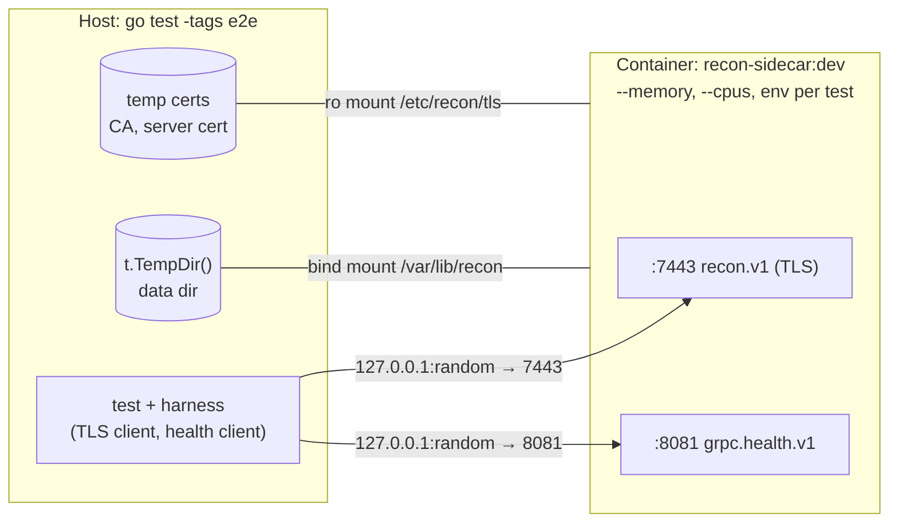

# Plan: recon-sidecar POC in Go on humus

| | |
|---|---|
| **Status** | Draft |
| **Date** | 2026-11-12 |
| **Implements** | [PROPOSAL.md](PROPOSAL.md), API `recon.v1` (`proto/recon/v1/reconciler.proto`, unchanged) |
| **Stack** | Go 1.27, `github.com/z5labs/humus` v0.16.0, `github.com/z5labs/humus/grpc` v0.16.0 |
| **Code** | `poc/`, Go module `poc` |

---

## 1. Goal and scope

The POC is a working sidecar that implements the proposal's API and engine, built into a container image and tested as a running container on a developer machine. It should answer two questions:

1. **Does the design hold?** Full outer join semantics, control totals, spilling, coalescing, sub-partitioning and hot-key detection, all behind the unchanged `recon.v1` API.
2. **Can Go keep to a memory budget?** §16.1 leaves the language open (§20 Q1) because of garbage-collector headroom. The POC measures how far real memory use drifts from the pool's accounting.

**In scope:** milestones M1 and M2 (§16.3), plus the parts of M3 that a container needs: health probes, configuration validation and the image.

**Out of scope:** spill compression (the proposal chooses it by benchmark in M3), Prometheus, Kubernetes manifests, per-language client helpers (M4) and the cross-language conformance suite. The e2e harness's Go client helpers (§7.2) are a first version of the Go helper.

---

## 2. Deviations from the proposal

Most of these follow from humus's design; the rest keep the POC small.

| Proposal | POC | Why |
|---|---|---|
| Unix socket, no TLS (§13, `RECON_LISTEN`) | TCP with TLS, through `grpcserver` | `grpcserver` serves only TLS, and only on `host:port`. A plaintext client fails to connect. |
| TCP only on loopback (§11) | Defaults to `127.0.0.1:7443`, but loopback isn't enforced. The image sets `:7443`. | Tests on the host reach the container through a published port, and that needs a non-loopback bind inside the container. The harness publishes only to the host's `127.0.0.1`. |
| — | New `RECON_TLS_CERT_FILE` and `RECON_TLS_KEY_FILE`, both required | `grpcserver.Settings.TLS` has no default |
| Prometheus `/metrics` on `RECON_METRICS_ADDR` (§14) | OpenTelemetry metrics on the humus `Setup`'s `MeterProvider`, exported as `none`, `console` or `otlp` | humus's telemetry package has no Prometheus exporter |
| DuckDB oracle driven from Python (§17) | A naive full outer join in Go, test-only | Keeps a single toolchain. DuckDB can be added later. |
| LZ4/ZSTD spill blocks (§8.3) | Uncompressed, length-prefixed records | The codec is chosen by benchmark in M3 |

Everything else (states, errors, limits, run IDs, the file layout and the join algorithm) follows the proposal as written.

---

## 3. Dependencies

| Module | Use |
|---|---|
| `github.com/z5labs/humus` v0.16.0 | `humus.Main`, `Setup`, `Host`, `telemetry`, `humustest` |
| `github.com/z5labs/humus/grpc` v0.16.0 (the same version, as humus requires) | `grpcserver` (API), `grpchealth` (probes port), `grpcservertest` |
| `github.com/z5labs/bedrock` v0.25.0 | `config.Env`, `config.Struct` for settings |
| `google.golang.org/grpc`, `google.golang.org/protobuf` | Generated stubs, status details |
| `github.com/zeebo/xxh3` | XXH3-64 with seed (§8.1) |
| `github.com/google/uuid` | `NewV7` for run IDs |
| `golang.org/x/sync/errgroup` | Parallel join units |
| `pgregory.net/rapid` (tests only) | Property-based tests with shrinking |

Code generation uses `protoc` with `protoc-gen-go` and `protoc-gen-go-grpc`. The proto file has no `go_package`, so the Makefile reads it from `../proto` and maps it with `--go_opt=Mrecon/v1/reconciler.proto=poc/gen/recon/v1;reconv1` (and the same `M` option for `--go-grpc_opt`), leaving the file untouched. The generated code is committed, so the image build doesn't need `protoc`.

---

## 4. Repository layout

The POC lives in a new `poc/` folder next to the proposal, and its Go module is named `poc`. The proto file stays where it is, so the proposal and the POC share one copy.

```
PROPOSAL.md
PLAN.md
proto/recon/v1/reconciler.proto    existing; read by `make proto`
poc/
  go.mod                           module poc
  Makefile
  Containerfile
  .containerignore
  gen/recon/v1/                    generated *.pb.go, *_grpc.pb.go (committed)
  cmd/recon-sidecar/main.go        humus.Main(app.Init, humus.WithTelemetry(app.Telemetry))
  internal/app/                    Init, settings, telemetry builder
  internal/api/                    ReconcilerServer: validation, state checks, error mapping
  internal/run/                    run manager, state machine, limits, run IDs
  internal/mem/                    reservation pool, spill trigger
  internal/buffer/                 per-(side, bucket) record arenas
  internal/spill/                  record file format, writer, reader, manifest
  internal/join/                   planner, loader, executor, sub-partitioning
  internal/oracle/                 naive full outer join (used by tests only)
  e2e/                             container tests (build tag e2e)
  e2e/harness/                     container driver, certs, client helpers
  e2e/gen/                         synthetic data generator, verifier, fingerprint
```

From here on, paths are relative to `poc/` and commands run from there.

---

## 5. Wiring the service with humus

### 5.1 `main` and `Init`

The sidecar uses `humus.Main`, not `grpcserver.Main`. `grpcserver.Main` adds a 5 s drain so that a load balancer can stop routing to a terminating pod, and no load balancer routes to a sidecar. humus.Main's 20 s grace period applies as is.

```go
func main() {
	humus.Main(app.Init, humus.WithTelemetry(app.Telemetry))
}

func Init(ctx context.Context, s *humus.Setup) ([]humus.Service, error) {
	cfg, err := readSettings(ctx, s) // *config.Error on a bad value → exit 78
	if err != nil {
		return nil, err
	}
	if err := spill.Wipe(s.Host.FS, cfg.DataDir); err != nil { // §10: wipe at startup
		return nil, err
	}
	pool := mem.NewPool(cfg.MemoryLimit)
	runs := run.NewManager(s, pool, cfg)
	s.OnStop(runs.Close)

	api, err := grpcserver.NewService(s, cfg.GRPC, grpc.MaxRecvMsgSize(cfg.MaxRecvMessageBytes))
	if err != nil {
		return nil, err
	}
	reconv1.RegisterReconcilerServer(api, apiserver.New(s, runs))

	probes, err := grpchealth.NewService(s, grpchealth.Settings{Addr: cfg.HealthAddr})
	if err != nil {
		return nil, err
	}
	return []humus.Service{api, probes}, nil
}
```

- **Probes.** `grpchealth.NewService` serves gRPC health v1 in plaintext on `RECON_HEALTH_ADDR`, which is what §12's startup probe needs. It owns readiness: ready once Serve starts, and not ready once shutdown begins.
- **Filesystem.** All file access goes through `s.Host.FS`, so in-process tests run against `humustest`'s temp-dir filesystem. There are two exceptions. Free disk space is read with `unix.Statfs`, because `humus.FS` has no `Statfs`. In tests, `RECON_DISK_LIMIT_BYTES` is always set explicitly instead.
- **Wipe.** `spill.Wipe` removes the *contents* of the data directory, not the directory itself, because it is usually a mount point.
- **Shutdown.** On SIGTERM, grpcserver ends open Ingest and Join streams with `UNAVAILABLE "server is shutting down"`. The sidecar's own data is then lost to the restart wipe, so this just becomes §10's "sidecar restarts" row.

### 5.2 Settings

Settings come from the variables in §11, through `config.Struct` and `config.Env(s.Process.Environment, …)`. Every check runs as a `.Validate` in the value's chain, so a bad value fails Init with a `*config.Error` that names the variable, and the process exits 78 (`humus.ExitConfig`). That covers §11's "refuses to start": the memory limit above the cgroup limit, a data directory that isn't writable (checked by creating and removing a probe file through `Host.FS`), and a bucket maximum below 1.

| Variable | POC behavior |
|---|---|
| `RECON_LISTEN` | `host:port`, checked with `grpcserver.CheckAddr`. Default `127.0.0.1:7443`; the image sets `:7443`. |
| `RECON_TLS_CERT_FILE`, `RECON_TLS_KEY_FILE` | Required. PEM files, read through `Host.FS` and built into a `*tls.Config` checked with `grpcserver.CheckTLS`. |
| `RECON_HEALTH_ADDR` | Default `:8081`. Checked with `grpchealth.CheckAddr`. |
| `RECON_MEMORY_LIMIT_BYTES` | Default 70% of `/sys/fs/cgroup/memory.max`, read through `Host.FS`. If the cgroup reports `max` (no limit), the variable is required. |
| `RECON_JOIN_PARALLELISM` | Default `min(runtime.GOMAXPROCS(0), 4)`. Since Go 1.25, GOMAXPROCS follows the container's CPU limit. |
| `RECON_METRICS_EXPORTER` | Replaces `RECON_METRICS_ADDR`: `none` (the default), `console` or `otlp` |
| `RECON_LOG_LEVEL` | Mapped onto `telemetry.Settings.LogLevel`. Logs go to stdout as JSON through humus's console exporter. |
| All the others in §11 | As specified |

`app.Telemetry` is a `telemetry.Builder` that starts from `telemetry.DefaultSettings()`, sets `ServiceName` to `recon-sidecar`, and applies the two telemetry variables above.

At startup the sidecar logs one INFO record with the effective memory, disk, parallelism and bucket limits. The e2e tests read it to check the defaults.

---

## 6. Engine implementation notes

These are the parts of the proposal where the Go implementation needs a decision the proposal doesn't make.

### 6.1 Runs and the API layer (`internal/run`, `internal/api`)

- **Run IDs.** Generated with `uuid.NewV7()`. A request ID is valid only if it parses, is version 7, and is already in canonical lowercase form. Anything else is `INVALID_REQUEST`. The run directory name is always `uuid.String()` of the generated value (§13).
- **States.** `OPEN → SEALED | FAILED` follows §5.2, under a per-run mutex. Each run has its own context, which DeleteRun cancels.
- **Ingest.** The first message is validated before any record is accepted: the run must be known and `OPEN`, and the batch must be set. Failures at that point leave the run unaffected (§10). An `IngestRequest` naming a different run later in the stream, or a stream error after records were accepted, moves the run to `FAILED`.
  - **Receiving.** grpcserver doesn't unblock `Recv` when a context is cancelled, so the handler calls `Recv` in a goroutine and selects on the stream context and the run context. That lets DeleteRun end an idle stream with `ABORTED`.
- **Seal.** Each stream adds its counts to the run's totals only when it commits. Seal fails with `INGEST_IN_PROGRESS` while any stream is open, and stores the totals so a second Seal returns the same response. `committed_ingests` counts committed streams.
- **Errors.** Every failure goes through one function: `status.New(code, msg).WithDetails(&reconv1.ReconError{...})`, using the code table in §6.4.

### 6.2 Memory pool (`internal/mem`)

- **Accounting.** One `Pool` holds `limit` and `used`. `Reserve(n, kind)` and `Release(n)` take a mutex but never do I/O while holding it.
- **Spilling.** When a reservation fails, the reserving goroutine itself spills: it collects every spillable buffer across all runs, sorts them by size, spills the largest until usage is below a low-water mark (80% of the limit), and retries once. Spilling happens on the goroutine that needs the memory, so the sidecar still has no background work. If the retry also fails, the result is `MEMORY_EXHAUSTED`.
- **Pinning.** A buffer that a running join unit is reading is pinned, and the spiller skips pinned buffers. Otherwise the pool would credit memory that the join still holds.
- **Decoded messages.** grpc-go decodes a message before the handler sees it, so Ingest reserves `proto.Size(msg)` only after `Recv` returns. Peak usage can therefore exceed the budget by up to one message per open stream. The POC measures how much (§8.5).

### 6.3 Buffers and spill files (`internal/buffer`, `internal/spill`)

- **Buffer format.** Each (side, bucket) buffer is a list of byte chunks holding records already in spill-file encoding: `hash u64 | uvarint key len | uvarint value len | key | value`. A spill is then one sequential write of the chunks.
- **Chunk sizes.** Chunks start at 4 KiB and double up to 1 MiB. With N = 4096, a fixed 1 MiB chunk per buffer would need 8 GiB before a single record arrived. Each new chunk reserves its capacity from the pool.
- **Writing.** The spiller swaps the chunks out under the bucket lock and writes them with the lock released. Files are created with `O_CREATE|O_EXCL` at `runs/<run_id>/<side>/<bucket>/<seq>.rec`, closed, then added to the manifest. Records are opaque bytes and runs don't survive restarts, so there is no fsync.
- **Disk limit.** A global atomic counter tracks bytes on disk. A spill that would exceed `RECON_DISK_LIMIT_BYTES` fails with `DISK_EXHAUSTED`. If that happens during Ingest, the run fails.
- **Data volume.** The data directory must not be a tmpfs. tmpfs pages are charged to the container's memory cgroup, so spilling there would count against the very limit it is meant to relieve.

### 6.4 Join (`internal/join`)

- **Planning** follows §8.4, using bucket sizes from buffers plus the manifest and the expansion factor (2 to start). Join units are contiguous bucket ranges filled greedily up to `limit / parallelism`.
- **Loading and grouping.** For each unit, the joiner reserves the estimate as unspillable memory, pins the unit's buffers, and reads its spill files into chunks. It then builds one index entry per record, `(hash, side, offset)`, and sorts the entries by hash, then key bytes, then side. A single pass over the sorted entries emits `left_only`, `right_only` and `both` results in the deterministic order §8.5 requires, without a hash map.
- **Oversized buckets.** A bucket that exceeds the unit budget gets a counting scan keyed by hash. A hash whose records exceed the budget or `RECON_MAX_MATCH_BYTES` is read back, to confirm that one key, and not a hash collision, is responsible. Then the Join fails with `HOT_KEY`, naming that key. Otherwise the bucket is re-partitioned with seed `base + depth`, up to depth 3, into `runs/<run_id>/join-<n>/`. That directory is removed when the Join ends, which keeps Join read-only and repeatable.
- **Match size.** A `Match` that would exceed `RECON_MAX_MATCH_BYTES` fails the Join with `HOT_KEY`, even in a unit that fits the budget.
- **Empty keys** are one more unit, streamed as one-sided results with no sort.
- **Output.** Up to `RECON_JOIN_PARALLELISM` units run in an errgroup. grpc-go doesn't allow concurrent `SendMsg` calls on one stream, so units hand finished batches to a single sender. Backpressure from gRPC flow control then reaches the units through that sender. Each worker reserves one output batch (`RECON_OUTPUT_BATCH_BYTES`).
- **States filter.** Results filtered out by `states` are still counted.
- **Control totals.** The stream ends `OK` only if the per-side counts equal the Seal totals. Otherwise it fails with `INTERNAL`. An unexported test hook can drop a record, so the `INTERNAL` path can be tested.
- **Known limitation.** If the client stops reading while a send is blocked, DeleteRun aborts that Join only once the client reads again or disconnects.

---

## 7. Container image and local workflow

### 7.1 Image

```dockerfile
FROM docker.io/library/golang:1.27 AS build
WORKDIR /src
COPY go.mod go.sum ./
RUN --mount=type=cache,target=/go/pkg/mod go mod download
COPY . .
RUN --mount=type=cache,target=/go/pkg/mod --mount=type=cache,target=/root/.cache/go-build \
    CGO_ENABLED=0 go build -trimpath -ldflags="-s -w" -o /out/recon-sidecar ./cmd/recon-sidecar \
 && mkdir -p /out/data

FROM gcr.io/distroless/static-debian12:nonroot
COPY --from=build /out/recon-sidecar /recon-sidecar
COPY --from=build --chown=65532:65532 /out/data /var/lib/recon
ENV RECON_LISTEN=:7443 RECON_HEALTH_ADDR=:8081 RECON_DATA_DIR=/var/lib/recon
EXPOSE 7443 8081
USER 65532:65532
ENTRYPOINT ["/recon-sidecar"]
```

Both base images are pinned by digest in the committed file. The build context is `poc/`, so the image builds from the committed `gen/` and never needs `../proto`.

### 7.2 Makefile

`ENGINE ?= $(shell command -v podman || command -v docker)`. On this machine, `docker` is podman's compatibility shim.

| Target | Does |
|---|---|
| `make proto` | Regenerates `gen/` from `../proto/` |
| `make test` | `go test -race ./...`: unit, property and in-process humus tests |
| `make image` | `$(ENGINE) build -f Containerfile -t recon-sidecar:dev .` |
| `make e2e` | `make image`, then `go test -tags e2e -count=1 -timeout 45m ./e2e/...` with `RECON_E2E_IMAGE` and `RECON_E2E_ENGINE` set |
| `make e2e-short` | The same with `-short`, which skips the multi-GiB tests |
| `make run` | Generates certificates into `.local/tls/` and runs the image with ports published on `127.0.0.1`, for manual testing |

For manual calls, use `grpcurl`. The server has no reflection, so pass the proto file: `grpcurl -cacert .local/tls/ca.pem -import-path ../proto -proto recon/v1/reconciler.proto -d '{"bucket_count":64}' localhost:7443 recon.v1.Reconciler/CreateRun`.

**Preflight.** `make e2e` checks that the engine can enforce memory limits. Under rootless podman, `podman info --format '{{.Host.CgroupControllers}}'` must list `memory`. If it doesn't, the memory tests can't mean anything, so the target fails early.

---

## 8. Testing

### 8.1 Layers

| Layer | Runs | Covers |
|---|---|---|
| Unit | `make test` | Pool accounting and spill selection, buffer encoding, spill file round trip, planner determinism and coalescing, sub-partition seeding, run ID validation, error mapping |
| Property vs oracle | `make test` | The engine called directly, without gRPC, on random data from `rapid`: sizes, duplicates, skew, empty keys, binary keys, keys differing only in their last byte. Random `N` (1–64), memory budgets small enough to force spilling, coalescing and sub-partitioning, and parallelism 1–4. Output must equal `internal/oracle` as a multiset. Totals must match, and every record must appear exactly once. |
| In-process App | `make test` | `grpcservertest.Start(t, app.Init, …)` inside a `testing/synctest` bubble, with `humustest.NewHost`, a `humustest.NewCA` certificate and `humustest.WithEnv`. Covers the state machine and error codes over real gRPC, Recv cancellation on DeleteRun, the `INTERNAL` control-totals path through the test hook, and metrics recorded through `humustest.NewTelemetry`. |
| Container e2e | `make e2e` | The built image, running in podman or docker, driven from `go test` on the host (§8.2–8.4) |

### 8.2 e2e harness (`e2e/harness`)

The harness drives the engine's CLI through `os/exec` rather than using testcontainers-go. That avoids testcontainers' reaper and socket setup under rootless podman, and it works the same with docker.



- **Start.** `harness.Start(t, opts...)` runs `$ENGINE run -d -p 127.0.0.1::7443 -p 127.0.0.1::8081`, with per-test `--memory`, `--cpus`, environment and mounts. It finds the published ports with `$ENGINE port`.
- **Readiness.** It polls `grpc.health.v1.Health/Check` on the health port until the answer is `SERVING`, which mirrors §12's startup probe, and only then dials the API with TLS.
- **Certificates.** `TestMain` generates a CA and a server certificate for `localhost` and `127.0.0.1` with `crypto/x509`, into a temp directory that is mounted read-only. `make run` uses the same code through `go run ./e2e/harness/cmd/gencert`.
- **Data directory.** The data directory is a bind-mounted `t.TempDir()`, so tests can inspect spill files directly. The container runs as the host's UID and GID (`--user`, plus `--userns=keep-id` on rootless podman) so those files belong to the test user.
- **Control.** `Stop(timeout)` sends SIGTERM and returns the exit code. `Kill()` sends SIGKILL. `Restart()` starts the same container again. `State()` returns `OOMKilled`, `ExitCode` and `Running` from `$ENGINE inspect`. `Logs()` returns the parsed JSON log records.
- **Memory sampling.** A background sampler polls `$ENGINE stats --no-stream` every 500 ms and logs the peak, for information only. cgroup usage includes reclaimable page cache from spill writes, so it isn't asserted.
- **Cleanup and failures.** A test that fails dumps the container's logs. `t.Cleanup` runs `$ENGINE rm -f`.
- **Parallelism.** Light tests call `t.Parallel()`. Memory-heavy tests run serially.
- **Client helpers.** `Ingest` batches records into messages of about 1 MiB. `Join` collects or streams results, with a callback. `ReconError(err)` extracts the status detail.

### 8.3 Test data

- **Small runs**, up to about 100k records, are checked against `internal/oracle`. Results are canonicalized by sorting the values inside each `Match`, because value order within a key follows ingest order, and concurrent streams make that order vary. Then they are compared as multisets.
- **Large runs** use `e2e/gen`. Data is generated from a seed, and each key's expected result can be computed from the key alone. Key `k` gets `lm(k)` left and `rm(k)` right records (0–3 each, plus optional hot keys), with values derived from `(side, k, j)` at configurable sizes. A streaming verifier checks each result against its key's expectation and marks the key in a bitset, then checks at the end that every key was seen exactly once and the totals match. A 10 M-key run needs about 1.25 MB of verifier state. The test process never holds the dataset.
- **Fingerprints** compare configurations without storing results. A fingerprint is an order-independent sum and XOR of XXH3 over each canonical result, plus a count. Equal fingerprints across memory budgets, bucket counts and parallelism settings is §16.3's M2 exit criterion: "output is identical under tiny and huge memory budgets".

### 8.4 e2e test catalogue

| Test | Container config | Asserts |
|---|---|---|
| `TestHealth` | defaults | Health port answers `SERVING` in plaintext. The API port refuses a plaintext client and accepts TLS with the test CA. |
| `TestConfigValidation` | Bad environment, one variable per subtest: missing TLS files, memory limit above `--memory`, unwritable data dir, `RECON_MAX_BUCKETS=0` | Container exits 78, and the logs name the variable |
| `TestConfigDefaults` | `--memory=512m`, no `RECON_MEMORY_LIMIT_BYTES`; `--cpus=2` | The startup record shows a budget of 70% of 512 MiB and parallelism 2 |
| `TestLifecycle` | defaults | Create → two Ingest streams (both sides interleaved) → Seal totals → Join equals the oracle → a second Join gives the same multiset → Delete removes `runs/<id>/` |
| `TestStatesFilter` | defaults | `states=[LEFT_ONLY, RIGHT_ONLY]` returns only breaks, and the stream still ends `OK` (filtered results are counted) |
| `TestEmptyKeys` | defaults, and again with a 16 MiB budget | Empty-key records come back one-sided, never match one another, appear in `empty_key_records`, and never cause `HOT_KEY` |
| `TestErrors` | `RECON_MAX_RUNS=2`, `RECON_MAX_BUCKETS=64` | Every `ErrorReason` reachable from outside, each with the right code and `ReconError` detail: `INVALID_REQUEST` (bucket count 0 and 65, a malformed ID, an uppercase ID, two runs in one stream, an unset batch); `RUN_NOT_FOUND`; `RUN_WRONG_STATE`; `INGEST_IN_PROGRESS`; `JOIN_IN_PROGRESS`; `TOO_MANY_RUNS` |
| `TestIngestCancel` | defaults | Cancelling a stream after one accepted batch leaves the run `FAILED`. Seal and Join give `RUN_FAILED`. Delete succeeds and removes the files. A stream rejected before any record leaves the run `OPEN`. |
| `TestConcurrentIngest` | defaults | 16 streams in parallel, each mixing sides. The totals and the oracle check pass. |
| `TestDeleteAbortsStreams` | defaults | DeleteRun ends an idle open Ingest stream and an active Join with `ABORTED` |
| `TestJoinRetry` | defaults | A Join cancelled halfway, then retried, has the same fingerprint as an uninterrupted Join |
| `TestLargerThanMemory` | `--memory=512m`, `RECON_MEMORY_LIMIT_BYTES=128MiB`, 2 GiB of synthetic data (`-short` skips it) | Spill files exist after Seal. The verifier passes. The container wasn't OOM-killed and is still running. The join-finished log record reports pool peak ≤ budget. |
| `TestBudgetInvariance` | Same data: budget 32 MiB vs 4 GiB; `N` of 1, 64 and 4096; parallelism 1 vs 4 | All fingerprints are equal |
| `TestSubpartition` | 32 MiB budget, `N=1`, many distinct keys | The Join succeeds after re-partitioning (logged as a sub-partition event), the verifier passes, and `join-<n>/` is gone after the Join |
| `TestHotKey` | 32 MiB budget, one key with 1M records | `HOT_KEY` with the key and its per-side counts. The run stays `SEALED`, and a retry fails the same way. A second subtest exceeds `RECON_MAX_MATCH_BYTES` with a small budget instead. |
| `TestMemoryExhausted` | Budget smaller than one ingest message | `MEMORY_EXHAUSTED` |
| `TestDiskExhausted` | 32 MiB memory, `RECON_DISK_LIMIT_BYTES=64MiB`, 256 MiB ingested | `DISK_EXHAUSTED`. The run is `FAILED`, and Delete frees the disk (the files are gone). |
| `TestBackpressure` | 64 MiB budget, 1 GiB of output, a client reading at 5 MiB/s | The Join completes, and the container is never OOM-killed |
| `TestSIGTERMDuringJoin` | defaults | `Stop(30s)` mid-Join ends the stream with `UNAVAILABLE` "server is shutting down", and the container exits 0 |
| `TestKillDuringJoin` | defaults | `Kill()` mid-Join gives the client `UNAVAILABLE`. After `Restart()`, the run is `RUN_NOT_FOUND` and the data directory is empty. |

### 8.5 Measurements the POC reports

The last phase writes `POC-RESULTS.md` with:

- **Memory.** The pool's peak reservation against Go's peak heap (`runtime/metrics`, `/memory/classes/total:bytes`), both logged in the join-finished record. The gap between the two is the unaccounted memory that §19 lists as a risk. It is measured with `GOMEMLIMIT` unset and with it set to 90% of the container limit. These numbers feed §20 Q1.
- **Expansion factor.** The measured per-unit working set divided by record bytes. This calibrates §8.4's factor of 2.
- **Throughput.** Ingest and join throughput at 1 GiB and 10 GiB on this machine, plus spill bytes and disk peak. These are a starting point for M3's targets, not targets themselves.

---

## 9. Phases

Each phase ends with `make test` and `make e2e` passing.

| Phase | Builds | Tests added | Exit criteria |
|---|---|---|---|
| **P0: Skeleton** | The `poc/` folder with `go.mod` (`module poc`), code generation, `main`/`Init` with grpcserver and grpchealth, every RPC returning `UNIMPLEMENTED`, settings and validation, Containerfile, Makefile, harness | `TestHealth`, `TestConfigValidation`, `TestConfigDefaults` | `make e2e` passes from a clean checkout on podman |
| **P1: Core (M1)** | Run manager and states, errors, in-memory buffers, single-unit join, control totals, DeleteRun abort, `MEMORY_EXHAUSTED` without spilling, oracle | Unit and property tests (no spill), in-process App tests, `TestLifecycle`, `TestStatesFilter`, `TestEmptyKeys`, `TestErrors`, `TestIngestCancel`, `TestConcurrentIngest`, `TestDeleteAbortsStreams`, `TestJoinRetry`, `TestMemoryExhausted` | The full API works against the oracle within the memory limit |
| **P2: Spill (M2)** | Pool spilling and pinning, spill files and manifest, disk limit, planner with coalescing, loading from files, startup wipe | Property tests with tiny budgets, `TestLargerThanMemory`, `TestBudgetInvariance` (`N` and budget), `TestDiskExhausted`, `TestKillDuringJoin` | Output is identical under tiny and huge budgets, and the container is never OOM-killed |
| **P3: Skew (M2)** | Counting scan, `HOT_KEY`, seeded sub-partitioning, match size limit, the empty-key unit | `TestSubpartition`, `TestHotKey`, skewed property tests | Skewed data either joins correctly or fails with `HOT_KEY`, deterministically |
| **P4: Parallel join and results** | Parallel units with a single sender, peak-memory logging, the `GOMEMLIMIT` comparison | `TestBudgetInvariance` (parallelism), `TestBackpressure`, `TestSIGTERMDuringJoin` | Every test in §8.4 passes, and `POC-RESULTS.md` is written |
