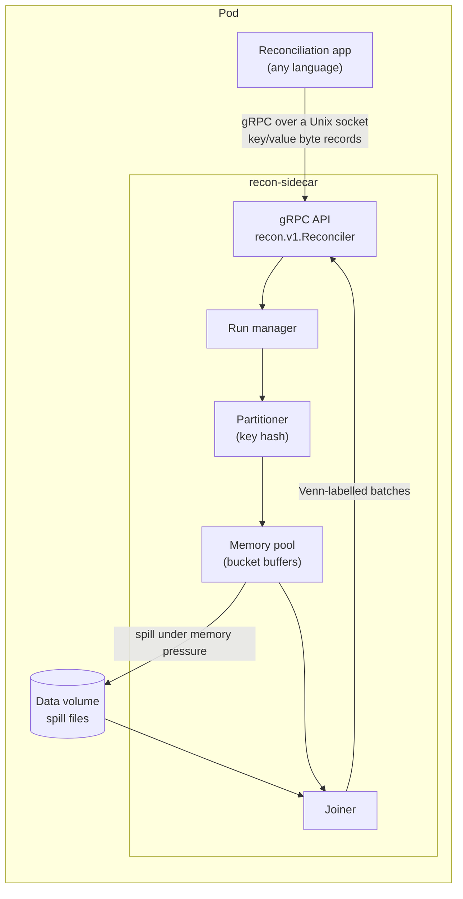
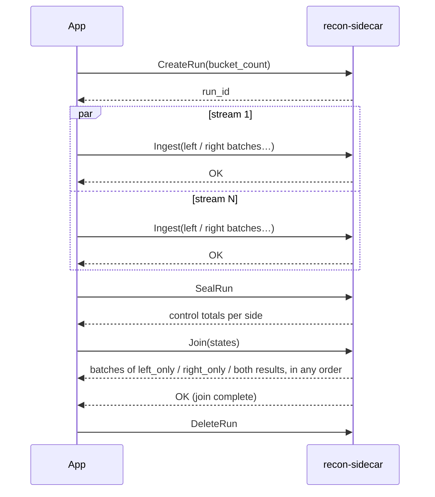
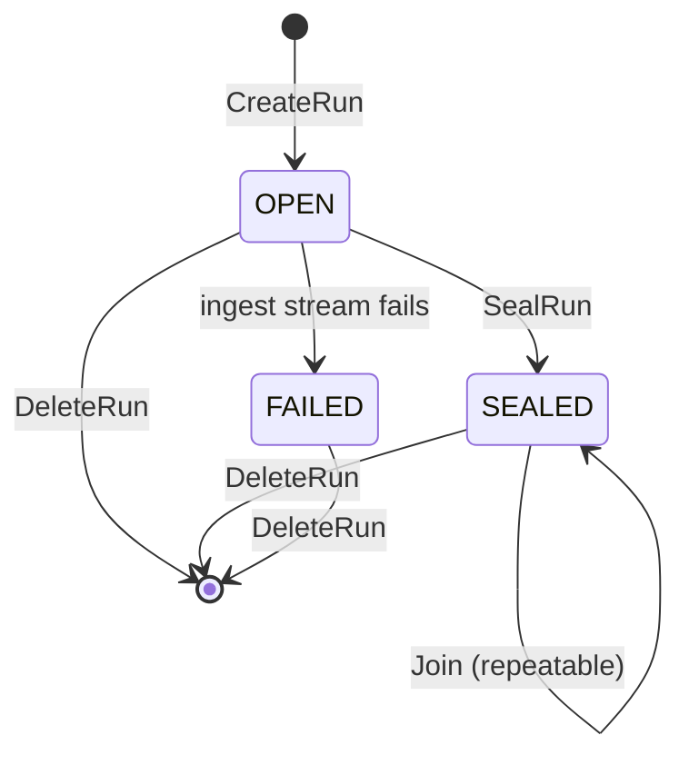

# Proposal: Reconciliation Join Sidecar (`recon-sidecar`)

| | |
|---|---|
| **Status** | Draft |
| **Date** | 2026-11-12 |
| **Author** | _TBD_ |
| **API** | `recon.v1` (Appendix A; also `proto/recon/v1/reconciler.proto`) |

---

## 1. Summary

Many of our reconciliation processes need the same expensive step: a full outer join of two datasets on a common key, so that every record can be classified as *left only*, *right only* or *in both*. These processes are written in different languages, and none of them can rely on a dedicated database.

This document proposes **recon-sidecar**, a small service that runs next to the reconciliation application and does this join behind a gRPC API. The application streams both datasets in as records, each an opaque key and value in bytes. The sidecar returns the joined result as a stream of batches, each labelled with its Venn state. Internally it uses a **partitioned (Grace) hash join**. Records are hashed by key into buckets as they arrive, buckets spill to local disk when memory runs short, and each bucket pair is then joined in memory. That lets it join datasets much larger than its memory budget, with no database and no persistent state.

The join is implemented once, in one place. Each application keeps its own data handling and business logic: encoding keys and records, field comparisons, tolerances and reporting.

---

## 2. Problem

- **Every reconciliation needs the same join, and each one rebuilds it.** Joining two large datasets on a key while handling duplicates and memory limits is the hardest generic part of a reconciliation. Today it gets reimplemented per process and per language, with varying quality.
- **No dedicated database.** Loading data into a database server and running a `FULL OUTER JOIN` isn't available to these processes.
- **The data can be larger than memory.** A naive in-process hash join works until it doesn't, and the failure mode is an out-of-memory kill partway through a run.

---

## 3. Goals and non-goals

### Goals

1. **One implementation** of the two-sided key join, usable from any language that has gRPC.
2. **Correct full outer join semantics** on exact byte keys. Duplicate keys are handled explicitly, and control totals prove that every input record is accounted for.
3. **Bounded memory.** A configurable budget, with datasets larger than memory handled by spilling to a local volume.
4. **No database, no persistent state and no background work.** A single binary with local scratch storage only. The client controls each run's lifetime, and the sidecar does work only inside RPCs.
5. **Deterministic results.** The same input always produces the same results. Only their order in the stream may vary.
6. **A stable, engine-independent API.** Buckets and file formats are internal, so the engine behind the API can be replaced.

### Non-goals (v1)

- **Interpreting data.** Keys and records are opaque bytes; parsing, typing and key normalization stay in the application (§7.1).
- **Field-level comparison**, tolerances or fuzzy matching. These stay in the application.
- **Aggregate matching**, e.g. three payments summing to one invoice.
- **More than two sides** per run.
- **Durability across sidecar restarts.** Runs are ephemeral (§10).
- **Distributed or multi-node operation**, and shared object storage.
- **Authentication or TLS.** The API is reachable only through a Unix socket inside the pod (§13).
- **A query language.**

---

## 4. Background: partitioned hash join

A hash join builds a hash table on one input and probes it with the other. It needs memory proportional to the input it builds on. A **partitioned** hash join (the "Grace" hash join, Kitsuregawa et al., 1983) removes that limit:

1. Hash every record's join key and assign the record to one of *N* partitions. Do this for both inputs **with the same function**, so equal keys always end up in the same partition number on both sides.
2. Join partition *i* of the left input with partition *i* of the right input, independently for each *i*. Keys in different partitions can never match, so no pair of partitions ever needs to see another pair.

Each partition pair only needs to fit in memory on its own. A **hybrid** hash join (DeWitt et al., 1984) adds one refinement: partitions stay in memory and are written to disk only when memory runs short, so small inputs never touch the disk at all.

This proposal uses a hybrid partitioned hash join. Partitioning happens **at ingest**, which overlaps the expensive pass with the data arriving, so the join phase reads each byte once.

---

## 5. Design overview

### 5.1 Architecture



| Component | Responsibility |
|---|---|
| **gRPC API** | Request validation, the streaming protocol, error mapping. |
| **Run manager** | Run lifecycle and state, limits, cleanup. Holds each run's in-memory manifest of buffers and spill files. |
| **Partitioner** | Hashes each record's key and appends the record to its (side, bucket) buffer. |
| **Memory pool** | Tracks every reservation against one global budget. Spills the largest buffers to disk when a reservation fails. |
| **Joiner** | Plans join units, loads bucket data, groups by key, emits labelled batches, checks control totals. |

### 5.2 Run lifecycle

A **run** is one reconciliation: one join of one left dataset with one right dataset.





A run lives until the client deletes it or the sidecar restarts (§10). Runs don't expire. The sidecar runs no background tasks or timers: apart from wiping the data directory at startup, all of its work happens inside an RPC. The client is therefore responsible for deleting every run it creates.

---

## 6. API

The complete definition is in Appendix A. This section specifies its behavior.

### 6.1 Conventions

- **Records are bytes.** Each record is a key and a value, both opaque bytes (§7.1). Records travel in batches of about 1 MiB per message in both directions.
- **Streams carry only data.** There are no header, progress or summary messages. A stream's outcome is its final gRPC status, and `OK` means it completed.
- **Errors** use standard gRPC status codes. A `ReconError` (reason, detail and, for hot keys, the offending key) is attached as a status detail. Clients that ignore details still get a meaningful code and message.
- **Run IDs** are generated by the sidecar in `CreateRun`. Each is a UUIDv7 (RFC 9562), which is time-ordered, so logs and spill directories sort by creation. The ID travels in a dedicated `RunId` message rather than a bare string. That keeps it distinct from every other string in the API, and its representation can change without touching each request. Clients treat the value as opaque and pass it back unchanged. A malformed ID fails with `INVALID_REQUEST`, and a well-formed but unknown one with `RUN_NOT_FOUND`. IDs are never reused, so a stale ID can't reach a newer run.
- **Retries** are safe wherever an RPC is idempotent (table below). Ingest isn't: a client whose Ingest stream fails deletes the run and reruns it (§10).

### 6.2 RPC semantics

| RPC | Valid in state | Idempotent | Behavior |
|---|---|---|---|
| `CreateRun` | (none) | No | Validates `bucket_count` and limits, creates the run in `OPEN`, and returns its generated `run_id`. Each call creates a new run. |
| `Ingest` | `OPEN` | No | Each message is a `run_id` and one `left` or `right` batch. Every message in a stream must name the same run, and one stream may interleave both sides in any order. Any number of streams may run concurrently. The stream commits when the client half-closes and the server closes it with `OK`. In v1, a stream that fails after any of its records were accepted moves the run to `FAILED`. |
| `SealRun` | `OPEN`, `SEALED` | Yes | Ends ingest for both sides and returns per-side control totals: the number of records, and how many of them have an empty key (§7.1), so bad records are counted before the join. It is the only point where the sides are synchronized, so the client is free to ingest them in whatever order and concurrency suits it. Fails with `INGEST_IN_PROGRESS` while streams are open. Sealing again returns the same totals. |
| `Join` | `SEALED` | Yes (read-only) | Streams the full outer join as result batches in no particular order (§8.5). The join is complete only when the stream closes with `OK`. On any other status the results are incomplete, so the client discards them and calls Join again. One active Join per run; a second gets `JOIN_IN_PROGRESS`. A failed Join (for example `HOT_KEY`) leaves the run `SEALED`. |
| `DeleteRun` | Any | Yes | Aborts the run's open streams (`ABORTED`), frees its memory and deletes its files. Deleting an unknown run succeeds. |

### 6.3 Join request options

- **`states`** limits which Venn states are returned, for example only `LEFT_ONLY` and `RIGHT_ONLY` for a breaks-only pass.

### 6.4 Errors

| Reason | gRPC code | Raised when |
|---|---|---|
| `INVALID_REQUEST` | `INVALID_ARGUMENT` | Malformed request or `run_id`, missing or out-of-range `bucket_count`, an Ingest stream naming more than one run |
| `RUN_NOT_FOUND` | `NOT_FOUND` | Unknown run (including after a sidecar restart or `DeleteRun`) |
| `RUN_WRONG_STATE` | `FAILED_PRECONDITION` | For example, Ingest after Seal, or Join before Seal |
| `RUN_FAILED` | `FAILED_PRECONDITION` | Any RPC other than DeleteRun on a `FAILED` run |
| `INGEST_IN_PROGRESS` | `FAILED_PRECONDITION` | Seal while ingest streams are open |
| `JOIN_IN_PROGRESS` | `FAILED_PRECONDITION` | Second concurrent Join on a run |
| `MEMORY_EXHAUSTED` | `RESOURCE_EXHAUSTED` | A reservation can't be satisfied even after spilling |
| `DISK_EXHAUSTED` | `RESOURCE_EXHAUSTED` | The disk limit is reached |
| `TOO_MANY_RUNS` | `RESOURCE_EXHAUSTED` | `CreateRun` beyond `RECON_MAX_RUNS` |
| `HOT_KEY` | `RESOURCE_EXHAUSTED` | A single key's records exceed the join memory budget or the maximum match size (§8.4) |

---

## 7. Data model

### 7.1 Records

A record is a **key** and a **value**, both opaque bytes. The sidecar hashes the key to partition records, compares keys byte for byte, and returns values exactly as it received them. It never parses, validates or normalizes either one. Choosing the key fields, normalizing them, and encoding keys and values are all the application's job.

- **Byte equality.** Two keys match only if their bytes are identical. If two systems format the same key differently (`"123"` vs `123`, trailing spaces, case), the application must turn both into the same bytes before ingest.
- **Composite keys** must be encoded unambiguously, for example by length-prefixing each part, so that `("ab","c")` and `("a","bc")` stay distinct.
- **Empty keys never match.** An empty key means the source record is missing its key, which in a reconciliation is a data problem to report, not a match. Such a record never matches anything, including other empty-key records, and comes back as a `left_only` or `right_only` result, so it shows up as a break. The application can tell these results apart by their empty key.
- **Exact equality only.** Hash partitioning requires keys to match exactly. A tolerant rule such as "dates within ±1 day" can't be part of the key. Put only the exact parts (for example account and currency) in the key, and apply tolerant rules in the application, inside each `both` match.

### 7.2 Output

Each `JoinResponse` is a batch of `JoinResult`s. The `oneof` case of each result is its Venn state:

| Case | Message | One per |
|---|---|---|
| `left_only` | `Record`: key and value | Left record whose key is empty or has no right records |
| `right_only` | `Record`: key and value | Right record whose key is empty or has no left records |
| `both` | `Match`: the key, plus explicit `left` and `right` fields holding the value of every record each side has for that key | Key present on both sides |

- **The Venn state and the multiplicity are separate.** A key with 3 left records and 4 right records is still `both`, delivered as one `Match` with 3 `left` and 4 `right` values, never as 12 pairs. 1:1, 1:N and N:M share one shape, and the application sees everything about a key at once.
- **Values are returned exactly as received**, so the application can compare any field it encoded in them, for example `customer_name` when joining customers on `customer_id`.
- **Duplicates in one-sided states** appear as separate results with the same key.

---

## 8. Engine internals

### 8.1 Partitioning

- **Hash:** XXH3-64 with a fixed seed over the key bytes, and `bucket = hash mod N`. The hash is computed only inside the sidecar, so clients never need a compatible implementation, and because runs are ephemeral it can change between sidecar versions.
- **Stored hash:** the 64-bit hash is stored with each buffered or spilled record, so later stages don't recompute it.
- **Empty keys** skip hashing and go into a separate empty-key partition per side (§7.1).
- **Bucket count `N`:** required in `CreateRun`, from 1 to `RECON_MAX_BUCKETS`. There's no sidecar default, so sizing is always an explicit choice of the application, which is the only party that knows the data volume. §15 gives a sizing rule. Choosing `N` generously is cheap, because small buckets are coalesced at join time (§8.4).
- **No consistent hashing.** Consistent hashing minimizes how many keys move when the number of partitions changes. `N` is fixed for a run's whole life, so there's nothing to rebalance.

### 8.2 Memory management

- **One global budget**, `RECON_MEMORY_LIMIT_BYTES`, shared by all runs. It defaults to 70% of the container's memory limit as read from cgroups, which leaves headroom for allocator overhead, gRPC buffers and the runtime.
- **Reservation-based accounting.** Every buffer, decoded batch, hash table and output batch reserves its size before allocating and releases it when freed.
- **Two kinds of memory:**
  - *Spillable:* ingest buffers.
  - *Unspillable:* the working set of the join unit in progress.
- **Spill policy.** When a reservation fails, the pool spills the largest ingest buffers, across all runs, until usage drops below a low-water mark, then retries the reservation. If it still fails, the operation fails with `MEMORY_EXHAUSTED`.

### 8.3 Spill storage

- **Layout:** `$RECON_DATA_DIR/runs/<run_id>/<side>/<bucket>/<seq>.rec`. The `<run_id>` directory name is the sidecar's own rendering of the ID it generated, never text taken from a request.
- **Immutable files.** Each spill writes one complete file from one buffer. No file is ever appended to, so no long-lived writers stay open and file-handle use doesn't grow with `N`.
- **The manifest is authoritative.** Each run keeps an in-memory manifest of its spill files, recording each file's record count and uncompressed size at write time. A file becomes visible only once it has been written, closed and recorded. Runs don't survive restarts, so the manifest never needs to be persisted.
- **Format:** a sequence of length-prefixed records (hash, key, value), compressed in blocks with LZ4 or ZSTD; the codec will be chosen by benchmark (M3). Records are opaque bytes, so a columnar format such as Parquet would add a dependency and buy nothing. A spill file is written once and read back in one sequential scan, which is all the join needs.
- **Disk limit:** `RECON_DISK_LIMIT_BYTES`. Exceeding it during ingest fails the stream (and therefore the run) with `DISK_EXHAUSTED`.

### 8.4 Join planning

After seal, the sizes of all buckets are known exactly from the buffers and the manifest. The joiner then makes a deterministic plan:

1. **Estimate memory per bucket:** record bytes for both sides × an expansion factor for the grouping structures. The factor starts at 2 and will be calibrated in M2.
2. **Form join units.** Contiguous bucket ranges are filled greedily up to the unit budget, `RECON_MEMORY_LIMIT_BYTES / RECON_JOIN_PARALLELISM`. Keys in different buckets never match, so any set of buckets is a valid join unit. This coalescing lets one generous `N` serve both tiny and huge runs.
3. **Oversized buckets.** A single bucket that exceeds the unit budget gets a scan that counts records per key:
   - If one key's records exceed the budget, or its `Match` would exceed `RECON_MAX_MATCH_BYTES`, the Join fails with `HOT_KEY` and the error names the key and its record counts. In reconciliation this almost always means a bad key choice or junk values (`"N/A"`, `0`).
   - Otherwise the bucket is re-partitioned into sub-buckets using **a different seed**, written to disk and joined in order. Re-using the same seed would put every record back into one sub-bucket. Recursion is capped at depth 3.
4. **The empty-key partition** is planned as one more unit. Its records are emitted as one-sided results without grouping, so they never cause `HOT_KEY`, however many there are.

### 8.5 Join execution

For each join unit:

1. Load both sides' records: in-memory buffers plus spill files.
2. Group each side's records by key.
3. Visit keys in a deterministic order (hash, then key bytes) and add results to the output batch:
   - **left only:** one `left_only` result per left record;
   - **right only:** one `right_only` result per right record;
   - **both:** one `both` result, a `Match` holding the key and every left and right value.
4. Send the batch as a `JoinResponse` whenever it reaches `RECON_OUTPUT_BATCH_BYTES` (1 MiB by default), and at the end of the unit.

When every unit has finished, the sidecar checks the control totals (§9) and closes the stream with `OK`.

- **Parallelism.** Up to `RECON_JOIN_PARALLELISM` units run concurrently, and each sends its batches as soon as they're ready, so batches from different units interleave. The stream has no ordering guarantee, which is what lets units run without waiting on each other. gRPC flow control applies backpressure: a slow client stalls the joiner instead of growing memory.
- **Determinism.** The plan, the key order within a unit and the flush thresholds are all deterministic, so the same input and configuration produce the same batches. Only the interleaving of units varies.
- **Match size limit.** No single `Match` may exceed `RECON_MAX_MATCH_BYTES`, which defaults to 3 MiB to stay under gRPC's common 4 MiB client receive limit. Raise it together with the clients' receive limit.

---

## 9. Correctness guarantees

1. **Completeness.** Every ingested record appears exactly once in the output of a Join that closes with `OK`: as a `left_only` or `right_only` result, or inside one `both` match.
2. **Control totals.** `SealRunResponse` reports records per side. Before closing a Join with `OK`, the sidecar checks that the join accounted for exactly that many records per side, including records in states the request filtered out. If the counts disagree it fails the stream with `INTERNAL`, so an engine bug can never silently drop records.
3. **Hash/equality consistency.** Hashing and equality both use the raw key bytes, so equal keys can't land in different buckets.
4. **Determinism** as described in §8.5.

---

## 10. Failure semantics

The data volume exists for **capacity, not durability**. That keeps v1 simple:

| Failure | Outcome | Client action |
|---|---|---|
| Ingest stream fails or is cancelled after any of its records were accepted | Run → `FAILED` | Delete and rerun |
| Ingest rejected before any records are accepted (unknown run, run not `OPEN`) | Run unaffected | Fix and retry |
| Join fails (client disconnect, `DISK_EXHAUSTED`, transient error) | Run stays `SEALED` | Discard the partial results and call Join again |
| Join fails with `HOT_KEY` | Run stays `SEALED`; deterministic, so a retry fails the same way | Fix the key or data and rerun |
| Sidecar restarts | Data dir wiped at startup; all runs gone (`RUN_NOT_FOUND`) | Rerun |
| Client abandons a run | Kept until `DeleteRun` or a sidecar restart | Delete runs when done |

Reconciliations are rerunnable batch jobs, so rerunning on failure is acceptable for v1. That rules out a whole class of partial-state bugs. Per-stream retry, which discards only the files of a failed stream, is future work (§21).

---

## 11. Configuration

All configuration is through environment variables. The defaults are proposals, to be revisited after benchmarking.

| Variable | Default | Meaning |
|---|---|---|
| `RECON_LISTEN` | `unix:///var/run/recon/recon.sock` | API endpoint. TCP is allowed but only on loopback. |
| `RECON_HEALTH_ADDR` | `0.0.0.0:8081` | gRPC health service only (for probes) |
| `RECON_METRICS_ADDR` | `0.0.0.0:9090` | Prometheus `/metrics` |
| `RECON_DATA_DIR` | `/var/lib/recon` | Spill directory; wiped at startup |
| `RECON_MAX_BUCKETS` | `4096` | Upper bound for `bucket_count` |
| `RECON_MEMORY_LIMIT_BYTES` | 70% of cgroup limit | Global memory budget |
| `RECON_DISK_LIMIT_BYTES` | 90% of volume free space at startup | Global spill budget |
| `RECON_JOIN_PARALLELISM` | `min(CPUs, 4)` | Join units processed concurrently |
| `RECON_MAX_RUNS` | `8` | Concurrent runs |
| `RECON_MAX_RECV_MESSAGE_BYTES` | `16MiB` | Server receive limit for ingest messages |
| `RECON_OUTPUT_BATCH_BYTES` | `1MiB` | Target size of output batches |
| `RECON_MAX_MATCH_BYTES` | `3MiB` | Maximum size of one `Match` |
| `RECON_LOG_KEYS` | `false` | Whether key values may appear in logs |
| `RECON_LOG_LEVEL` | `info` | Log verbosity |

The sidecar validates its configuration at startup and refuses to start if it's invalid, for example if the memory limit exceeds the cgroup limit or the data directory isn't writable.

---

## 12. Deployment

**Kubernetes (primary target):**

- **Run as a native sidecar container**: an init container with `restartPolicy: Always`, stable since Kubernetes 1.33. It starts before the application container, and it doesn't keep a `Job` alive after the application exits.
- **Give it a gRPC startup probe** on `RECON_HEALTH_ADDR`. The kubelet waits for a native sidecar's startup probe to pass before starting the application container, so the API is ready before the application first calls it.
- **Two `emptyDir` volumes:**
  - *socket* (tiny), mounted by both containers, holding the Unix socket;
  - *data*, mounted only by the sidecar, with `sizeLimit` set. Exceeding ephemeral-storage limits gets the pod evicted, and the sidecar's own disk limit should stay below `sizeLimit`.
- **Resources.** Set the sidecar's memory limit from capacity planning (§15) and let `RECON_MEMORY_LIMIT_BYTES` default from it. Memory isolation is a deliberate benefit: a join that exhausts its budget fails cleanly or, at worst, OOM-kills the sidecar, never the application.

**Elsewhere** (VMs, Docker Compose, systemd): the same binary and configuration, with the socket on a path both processes can reach.

**Versioning.** The API package is `recon.v1`. Changes within v1 are additive only. Breaking changes go in `recon.v2`, served side by side during migration. Sidecar images follow semver.

---

## 13. Security

- **Network exposure.** The API is reachable only through a Unix socket on a pod-local volume. Socket permissions are `0660` with a group shared by the containers. No TLS or authentication in v1. If TCP is used, it must be loopback-only.
- **Probe and metrics ports** expose no reconciliation data.
- **Path safety.** Spill paths are built only from run IDs the sidecar generated. A run ID in a request is only ever looked up, never used to build a path.
- **Data at rest.** Spill files hold reconciliation data, which is likely financial or personal. They live only on the pod's scratch volume (rely on node disk encryption) and are deleted on `DeleteRun` and at startup.
- **Logs** never contain record data. Key values are redacted unless `RECON_LOG_KEYS=true`. Hot keys are returned to the client in `HOT_KEY` errors and aren't logged by default.
- **Resource exhaustion.** Limits on runs, message size, memory and disk protect the application from a runaway client.

---

## 14. Observability

- **Metrics** (Prometheus):
  - runs by state;
  - records and bytes ingested per side;
  - memory reserved vs limit; buffered vs spilled bytes; disk used vs limit;
  - spill events;
  - join units processed; sub-partitioning events; hot-key failures;
  - RPC counts and latencies by method and status.
- **Structured logs** keyed by `run_id`: lifecycle transitions with totals, spill and sub-partition events, failures with reasons. No record data.

---

## 15. Capacity planning

All figures are in terms of raw record bytes (keys plus values), before spill compression.

- **Ingest memory** is capped by `RECON_MEMORY_LIMIT_BYTES`; anything beyond that spills.
- **Disk:** about the run's data in compressed spill format, plus headroom for sub-partitioning rewrites of oversized buckets (budget 1.5×).
- **Join memory:** about `parallelism × unit budget` + output batches.
- **Bucket count:** `N ≥ total record bytes × expansion factor / unit budget`, rounded up with headroom.

  *Example:* 100 GiB of records across both sides, expansion factor 2, an 8 GiB memory limit and parallelism 4 give a 2 GiB unit budget, so `N ≥ 100`. Choose 256. A 1 GiB run with the same `N` coalesces into one or two units.

Throughput targets will be set from the M3 benchmarks rather than guessed here. The design aims for ingest to be limited by the client's encoding speed and the disk, not by the sidecar.

---

## 16. Implementation plan

### 16.1 Implementation language

**Recommendation: Rust.** The `tonic`, `tokio`, `xxhash-rust`, `lz4_flex` and `zstd` crates are mature. Without a garbage collector, memory accounting is predictable, which matters for a budgeted join. It builds a single static binary.

**Alternative: Go** with `grpc-go`. It's simpler for many teams, but garbage collection adds headroom uncertainty to the memory budget.

This decision is open (§20).

### 16.2 Client helpers

Applications can use the generated gRPC stubs directly. A thin helper per language removes the repetitive parts: batching records to about 1 MiB and decoding `ReconError` details. Helpers are written first for the languages of the first reconciliations to migrate.

### 16.3 Milestones

| Milestone | Scope | Exit criteria |
|---|---|---|
| **M1: Core** | All RPCs, Venn-labelled output, control totals, run lifecycle. Memory limit enforced (`MEMORY_EXHAUSTED`) but no spilling. | Oracle tests pass (§17). A first real reconciliation runs end to end within the memory limit. |
| **M2: Larger than memory** | Bucket buffers and spill, join planning and coalescing, sub-partitioning, hot-key detection, parallel join output. | Output is identical under tiny and huge memory budgets. Peak RSS stays within the container limit. Expansion factor calibrated. |
| **M3: Operability** | Metrics, logs, health, config validation, deployment guide, benchmark suite, spill compression choice. | Deployed alongside one production reconciliation. Throughput targets set. |
| **M4: Adoption** | Client helpers and a cross-language conformance suite for the first 2–3 languages. | Target reconciliations migrated. |

---

## 17. Testing strategy

- **Oracle comparison.** Compare output, as a multiset of (state, key, left values, right values), against an independent, naive full outer join. DuckDB driven from a Python test harness makes a convenient oracle. It's used only in tests, so the product carries no FFI dependency.
- **Property-based tests.** Generate data with random sizes, duplicates, skew, empty keys and keys that differ only in their last byte, then run it with random bucket counts and memory budgets small enough to force spilling, coalescing and sub-partitioning. Output must match the oracle in every configuration.
- **Determinism.** The same input twice produces the same multiset of results, and so do different bucket counts and parallelism settings.
- **Invariants on every test.** Control totals add up, and every record is emitted exactly once.
- **Fault injection.** Client cancellation mid-ingest (run fails), disk full, memory exhaustion, sidecar kill during a Join (restart wipes), and a Join retried after a failed stream (its output equals an uninterrupted one).
- **Cross-language conformance.** A shared scenario suite (input fixtures plus expected output) run by each client helper against a real sidecar.
- **Benchmarks.** Synthetic datasets at 1×, 10× and 100× expected production size, measuring ingest and join throughput, peak RSS against the budget, disk usage, and LZ4 vs ZSTD spill compression.

---

## 18. Alternatives considered

| Alternative | Decision |
|---|---|
| **Embedded DuckDB** (per application or inside the sidecar) | Rejected. FFI bindings would need maintaining, and for a sidecar dedicated to reconciliation its main benefit (a ready-made join engine and SQL) is more than is needed. Because only the gRPC API is exposed, it can still be swapped in behind the API later. |
| **A database server** | Ruled out by the constraint. |
| **A library per language** | Rejected. The join would be implemented N times and drift; a sidecar implements it once. |
| **Arrow IPC payloads, with the sidecar extracting and normalizing keys** | Replaced by opaque key/value bytes. Applications already parse and normalize their own data, the sidecar stays free of a type system, and clients need only gRPC. |
| **Consistent hashing** | Unnecessary. `N` is fixed per run, so there's nothing to rebalance (§8.1). |
| **Sort-merge join** | Rejected. It needs an external sort of both inputs; hash partitioning needs no total order and partitions while ingesting. |
| **Pairs with nullable left/right as output** | Replaced by the Venn-state `oneof` with one `Match` per `both` key. The state is explicit, "neither side" can't be expressed, and duplicates don't turn into cross products. |
| **Client-supplied bucket per record** | Rejected. The sidecar hashes each key itself, so the bucket always follows from the join key. |
| **Single fixed bucket count from an env var** | Replaced by a required per-run `bucket_count`, plus coalescing at join time. There's no default, so sizing is never left to the sidecar. |
| **Client-chosen run IDs** | Replaced by sidecar-generated UUIDv7s. Clients can't collide or supply an unsafe path name, and IDs are never reused, so a stale ID can't reach a newer run. The cost is that `CreateRun` is no longer idempotent (§6.2). |
| **Idle TTL with background cleanup** | Rejected. It needs a background task in the sidecar; run lifetime belongs to the client. |
| **Embedded key-value store for spill storage** (e.g. BadgerDB) | Rejected. Spill files are written once and scanned once, so a sorted index, write-ahead log and compaction are pure overhead, and compaction runs as background work. Persistence goes unused because runs are wiped on restart. Badger would also tie the implementation to Go. |

---

## 19. Risks

| Risk | Impact | Mitigation |
|---|---|---|
| An application encodes keys differently on its two sides | False breaks | Key encoding is documented as the application's job (§7.1) |
| Memory accounting misses allocations | OOM kill mid-run | Reservation discipline, budget at 70% of the cgroup limit, tests with tiny budgets, RSS monitoring against the budget |
| Skew and hot keys | Failed joins | Sub-partitioning with a new seed, a clear `HOT_KEY` error naming the key |
| Client adoption friction (gRPC in every language) | Slow migration | Client helpers, a conformance suite, a short integration guide |
| Long runs lost on sidecar restart | Rework | Acceptable for v1 batch jobs; per-stream retry later (§21) |
| Scope creep toward a general query engine | Complexity, delay | Firm non-goals (§3); new features must be reconciliation-specific |
| Data crosses the process boundary twice | Throughput ceiling for very large runs | Batched messages and state filters |

---

## 20. Open questions

1. **Implementation language:** Rust (recommended) or Go?
2. **Data sizes:** typical and largest records and bytes per side, which set the defaults for memory and disk and the guidance for choosing `bucket_count`.
3. **Key matching:** does any current reconciliation need more than exact equality on its key?
4. **Duplicates:** is a duplicate key a break in itself, and will aggregate (N:1) matching ever be needed?
5. **Three-way reconciliations:** needed, or always two sides?
6. **Client languages:** which ones get helpers first?
7. **Retention:** do audit or compliance rules require keeping reconciliation inputs? If so, that belongs outside the sidecar, which deletes everything.

---

## 21. Future work

- **Per-stream ingest retry:** discard only a failed stream's data instead of failing the run.
- **Split `both` into two cases:** a flat 1:1 case and a grouped duplicates case, if repeated `left` and `right` fields prove awkward for clients in the common 1:1 case.
- **Shared storage** (object store) for runs that outgrow a node's scratch volume.
- **More than two sides** per run.

---

## Appendix A: `recon.v1` API

Also in `proto/recon/v1/reconciler.proto`. It compiles with `protoc` and has no imports.

```proto
// Reconciliation join sidecar, API v1.
//
// Lifecycle: CreateRun -> Ingest (any number of concurrent streams, each
//            carrying either side) -> SealRun -> Join (repeatable) -> DeleteRun.
//
// Records are opaque bytes: a key, compared byte for byte, and a value,
// returned exactly as received. The sidecar never interprets either one.
//
// Streams carry only data. A stream's outcome is its final gRPC status, and OK
// means it completed.
//
// Errors use standard gRPC status codes. A ReconError is attached as a status
// detail so clients can branch on a machine-readable reason.

syntax = "proto3";

package recon.v1;

service Reconciler {
  // Creates a run and returns its sidecar-generated ID. Not idempotent: each
  // call creates a new run.
  rpc CreateRun(CreateRunRequest) returns (CreateRunResponse);

  // Uploads records. Each message is a batch for either side of one run, and
  // one stream may interleave both sides. Any number of streams may run
  // concurrently. A stream commits when the client half-closes and the server
  // closes it with OK. In v1, a stream that fails after any of its records
  // were accepted fails the run.
  rpc Ingest(stream IngestRequest) returns (IngestResponse);

  // Ends ingest for both sides and returns control totals. This is the only
  // point where the sides are synchronized. Idempotent.
  rpc SealRun(SealRunRequest) returns (SealRunResponse);

  // Streams the full outer join of a sealed run, in no particular order. The
  // join is complete only when the stream closes with OK. Read-only and
  // repeatable.
  rpc Join(JoinRequest) returns (stream JoinResponse);

  // Deletes a run's data and cancels its open streams. Idempotent. Runs never
  // expire, so clients must delete every run they create.
  rpc DeleteRun(DeleteRunRequest) returns (DeleteRunResponse);
}

// ---------------------------------------------------------------------------
// Identifiers
// ---------------------------------------------------------------------------

// Identifies a run. Generated by the sidecar in CreateRun and passed back
// unchanged in every later request. A dedicated type rather than a bare
// string, so a run ID can't be confused with any other string field and its
// representation can change without touching each request message.
message RunId {
  // A UUIDv7 (RFC 9562) in canonical lowercase hyphenated form, e.g.
  // "019a7a3e-5c4b-7d2e-8f10-3b6c9e2a4d51". Clients treat it as opaque.
  string value = 1;
}

// ---------------------------------------------------------------------------
// Records
// ---------------------------------------------------------------------------

// One record. The sidecar hashes and compares the key byte for byte, and
// returns the value exactly as received. An empty key means the key is
// missing: the record never matches and is returned as left_only or
// right_only.
message Record {
  bytes key = 1;
  bytes value = 2;
}

message RecordBatch {
  repeated Record records = 1;
}

// ---------------------------------------------------------------------------
// Create
// ---------------------------------------------------------------------------

message CreateRunRequest {
  // Required. Number of hash buckets, from 1 to the sidecar's maximum.
  // There is no default: size it from the expected data volume. Small
  // buckets are coalesced at join time, so erring high is cheap.
  uint32 bucket_count = 1;
}

message CreateRunResponse {
  RunId run_id = 1;
}

// ---------------------------------------------------------------------------
// Ingest
// ---------------------------------------------------------------------------

// One batch for one side of a run. Every message in a stream must name the
// same run. A stream may mix left and right batches in any order.
message IngestRequest {
  RunId run_id = 1;
  // Aim for ~1 MiB per message. The oneof case is the side of every record
  // in the batch.
  oneof batch {
    RecordBatch left = 2;
    RecordBatch right = 3;
  }
}

// Empty: closing the stream with OK means its records are committed.
message IngestResponse {}

// ---------------------------------------------------------------------------
// Seal
// ---------------------------------------------------------------------------

message SealRunRequest {
  RunId run_id = 1;
}

message SealRunResponse {
  SideTotals left = 1;
  SideTotals right = 2;
  uint32 committed_ingests = 3;
}

message SideTotals {
  uint64 records = 1;            // all records, including empty-key ones
  uint64 empty_key_records = 2;  // records with an empty (missing) key
}

// ---------------------------------------------------------------------------
// Join
// ---------------------------------------------------------------------------

enum JoinState {
  JOIN_STATE_UNSPECIFIED = 0;
  JOIN_STATE_LEFT_ONLY = 1;
  JOIN_STATE_RIGHT_ONLY = 2;
  JOIN_STATE_BOTH = 3;
}

message JoinRequest {
  RunId run_id = 1;
  // States to return. Empty = all.
  repeated JoinState states = 2;
}

// A batch of join results, about 1 MiB.
message JoinResponse {
  repeated JoinResult results = 1;
}

// One join result. The oneof case is its Venn state.
message JoinResult {
  oneof result {
    Record left_only = 1;   // a left record whose key is empty or has no right records
    Record right_only = 2;  // a right record whose key is empty or has no left records
    Match both = 3;         // a key present on both sides
  }
}

// One key present on both sides, with the value of every record each side
// has for it. A key with 3 left and 4 right records is one Match with 3 left
// and 4 right values, never 12 pairs.
message Match {
  bytes key = 1;
  repeated bytes left = 2;   // at least one
  repeated bytes right = 3;  // at least one
}

// ---------------------------------------------------------------------------
// Cleanup
// ---------------------------------------------------------------------------

message DeleteRunRequest {
  RunId run_id = 1;
}

message DeleteRunResponse {}

// ---------------------------------------------------------------------------
// Errors (attached as a gRPC status detail)
// ---------------------------------------------------------------------------

enum ErrorReason {
  ERROR_REASON_UNSPECIFIED = 0;
  ERROR_REASON_INVALID_REQUEST = 1;      // INVALID_ARGUMENT
  ERROR_REASON_RUN_NOT_FOUND = 2;        // NOT_FOUND
  ERROR_REASON_RUN_WRONG_STATE = 3;      // FAILED_PRECONDITION
  ERROR_REASON_RUN_FAILED = 4;           // FAILED_PRECONDITION
  ERROR_REASON_INGEST_IN_PROGRESS = 5;   // FAILED_PRECONDITION (seal with open streams)
  ERROR_REASON_JOIN_IN_PROGRESS = 6;     // FAILED_PRECONDITION
  ERROR_REASON_MEMORY_EXHAUSTED = 7;     // RESOURCE_EXHAUSTED
  ERROR_REASON_DISK_EXHAUSTED = 8;       // RESOURCE_EXHAUSTED
  ERROR_REASON_TOO_MANY_RUNS = 9;        // RESOURCE_EXHAUSTED
  ERROR_REASON_HOT_KEY = 10;             // RESOURCE_EXHAUSTED
}

message ReconError {
  ErrorReason reason = 1;
  string detail = 2;
  HotKey hot_key = 3;  // set for HOT_KEY
}

message HotKey {
  bytes key = 1;
  uint64 left_records = 2;
  uint64 right_records = 3;
}
```
