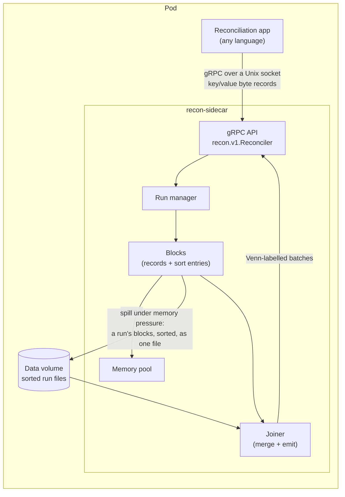
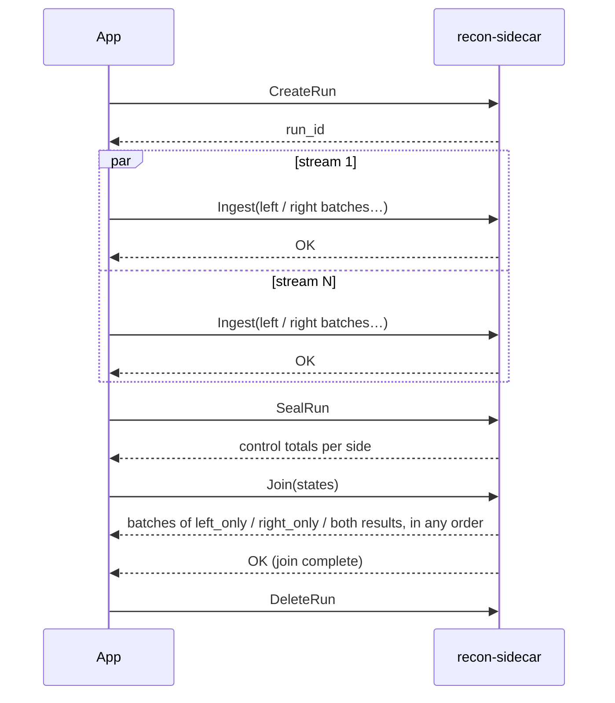
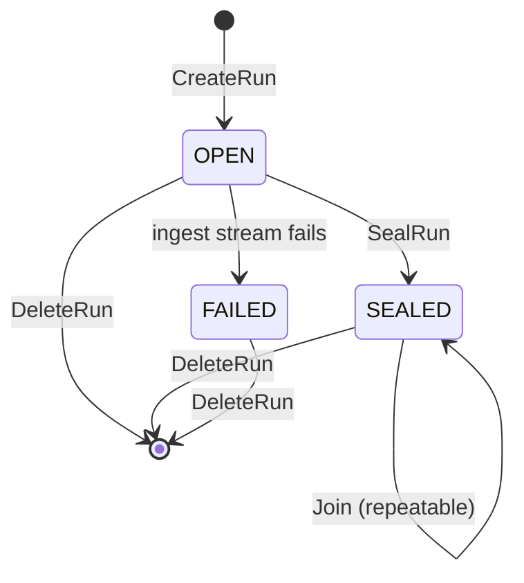

# Proposal: Reconciliation Join Sidecar (`recon-sidecar`)

| | |
|---|---|
| **Status** | Draft |
| **Date** | 2026-11-12 |
| **Revised** | 2026-11-18: sorted runs and a streaming merge join replace the partitioned hash join (§4, §8, §18) |
| **Author** | _TBD_ |
| **API** | `recon.v1` (Appendix A; also `proto/recon/v1/reconciler.proto`) |

---

## 1. Summary

Many of our reconciliation processes need the same expensive step: a full outer join of two datasets on a common key, so that every record can be classified as *left only*, *right only* or *in both*. These processes are written in different languages, and none of them can rely on a dedicated database.

This document proposes **recon-sidecar**, a small service that runs next to the reconciliation application and does this join behind a gRPC API. The application streams both datasets in as records, each an opaque key and value in bytes. The sidecar returns the joined result as a stream of batches, each labelled with its Venn state. Internally it uses **sorted runs and a streaming merge join**. Records are copied into memory as they arrive. When memory runs short, the sidecar sorts what it holds by key and writes it to local disk as one file, and at Join time it merges those files in key order, holding one key at a time. That lets it join datasets much larger than its memory budget, with no database and no persistent state.

The join is implemented once, in one place. Each application keeps its own data handling and business logic: encoding keys and records, field comparisons, tolerances and reporting.

---

## 2. Problem

- **Every reconciliation needs the same join, and each one rebuilds it.** Joining two large datasets on a key while handling duplicates and memory limits is the hardest generic part of a reconciliation. Today it gets reimplemented per process and per language, with varying quality.
- **No dedicated database.** Loading data into a database server and running a `FULL OUTER JOIN` isn't available to these processes.
- **The data can be larger than memory.** A naive in-process hash join works until it doesn't, and the failure mode is an out-of-memory kill partway through a run.

---

## 3. Goals and non-goals

### Goals

1. **One implementation** of the two-sided key join, usable from any language that has gRPC.
2. **Correct full outer join semantics** on exact byte keys. Duplicate keys are handled explicitly, and control totals prove that every input record is accounted for.
3. **Bounded memory.** A configurable budget, with datasets larger than memory handled by spilling to a local volume.
4. **No database, no persistent state and no background work.** A single binary with local scratch storage only. The client controls each run's lifetime, and the sidecar does work only inside RPCs.
5. **Deterministic results.** The same input always produces the same results. Only their order in the stream may vary.
6. **A stable, engine-independent API.** The sort order and file formats are internal, so the engine behind the API can be replaced. This proposal's engine has already been replaced once, from a partitioned hash join to sorted runs, without a change to the API (§18).

### Non-goals (v1)

- **Interpreting data.** Keys and records are opaque bytes; parsing, typing and key normalization stay in the application (§7.1).
- **Field-level comparison**, tolerances or fuzzy matching. These stay in the application.
- **Aggregate matching**, e.g. three payments summing to one invoice.
- **More than two sides** per run.
- **Durability across sidecar restarts.** Runs are ephemeral (§10).
- **Distributed or multi-node operation**, and shared object storage.
- **Authentication or TLS.** The API is reachable only through a Unix socket inside the pod (§13).
- **A query language.**

---

## 4. Background: external sort and merge join

A **merge join** reads both inputs sorted by the join key and walks them together: equal keys meet side by side, so one pass emits every match, and nothing needs to be held but the key at hand. It needs no memory proportional to its inputs, only that they are sorted.

Sorting data larger than memory is an **external sort** (Knuth, *TAOCP* vol. 3, §5.4): fill memory, sort it, write it out as one sorted **run**, and repeat; then merge the runs. A k-way merge with a **loser tree** takes each next record with one comparison per level of the tree. If there are too many runs to merge at once, merging neighbouring runs first (an intermediate pass) brings their number down.

This proposal does both in one: both sides go into the same runs, sorted by (hash of the key, key, side, arrival), so a single merge of a run's files is the join. Sorting by a hash of the key, not the key itself, keeps comparisons cheap, since keys are compared only when hashes are equal, and lets the hash's range be cut into equal slices for parallel workers. Small inputs never touch the disk: runs are written only when memory runs short.

The proposal first chose a partitioned (Grace) hash join instead, which hashes records into buckets at ingest and joins each bucket pair in memory. §18 gives why sorted runs replaced it.

---

## 5. Design overview

### 5.1 Architecture



| Component | Responsibility |
|---|---|
| **gRPC API** | Request validation, the streaming protocol, error mapping. |
| **Run manager** | Run lifecycle and state, limits, cleanup. Holds each run's in-memory manifest of blocks and run files. |
| **Blocks** | Hash each record's key and copy the record into a block, with a sort entry beside it. A full block sorts its entries. |
| **Memory pool** | Tracks every reservation against one global budget. Drops idle blocks, then spills the largest runs to disk, when a reservation fails. |
| **Joiner** | Plans tasks over hash ranges, merges each range of a run's files and blocks, emits labelled batches, checks control totals. |

### 5.2 Run lifecycle

A **run** is one reconciliation: one join of one left dataset with one right dataset.





A run lives until the client deletes it or the sidecar restarts (§10). Runs don't expire. The sidecar runs no background tasks or timers: apart from wiping the data directory at startup, all of its work happens inside an RPC. The client is therefore responsible for deleting every run it creates.

---

## 6. API

The complete definition is in Appendix A. This section specifies its behavior.

### 6.1 Conventions

- **Records are bytes.** Each record is a key and a value, both opaque bytes (§7.1). Records travel in batches of about 1 MiB per message in both directions.
- **Streams carry only data.** There are no header, progress or summary messages. A stream's outcome is its final gRPC status, and `OK` means it completed.
- **Errors** use standard gRPC status codes. A `ReconError` (reason, detail and, for hot keys, the offending key) is attached as a status detail. Clients that ignore details still get a meaningful code and message.
- **Run IDs** are generated by the sidecar in `CreateRun`. Each is a UUIDv7 (RFC 9562), which is time-ordered, so logs and spill directories sort by creation. The ID travels in a dedicated `RunId` message rather than a bare string. That keeps it distinct from every other string in the API, and its representation can change without touching each request. Clients treat the value as opaque and pass it back unchanged. A malformed ID fails with `INVALID_REQUEST`, and a well-formed but unknown one with `RUN_NOT_FOUND`. IDs are never reused, so a stale ID can't reach a newer run.
- **Retries** are safe wherever an RPC is idempotent (table below). Ingest isn't: a client whose Ingest stream fails deletes the run and reruns it (§10).

### 6.2 RPC semantics

| RPC | Valid in state | Idempotent | Behavior |
|---|---|---|---|
| `CreateRun` | (none) | No | Validates `bucket_count`, which is otherwise ignored (§8.1), and limits, creates the run in `OPEN`, and returns its generated `run_id`. Each call creates a new run. |
| `Ingest` | `OPEN` | No | Each message is a `run_id` and one `left` or `right` batch. Every message in a stream must name the same run, and one stream may interleave both sides in any order. Any number of streams may run concurrently. The stream commits when the client half-closes and the server closes it with `OK`. In v1, a stream that fails after any of its records were accepted moves the run to `FAILED`. |
| `SealRun` | `OPEN`, `SEALED` | Yes | Ends ingest for both sides and returns per-side control totals: the number of records, and how many of them have an empty key (§7.1), so bad records are counted before the join. It is the only point where the sides are synchronized, so the client is free to ingest them in whatever order and concurrency suits it. Fails with `INGEST_IN_PROGRESS` while streams are open. A run that spilled writes its last records to disk here (§8.3); if that fails, the run stays `OPEN` with every record and Seal may be retried. Sealing again returns the same totals. |
| `Join` | `SEALED` | Yes (read-only) | Streams the full outer join as result batches in no particular order (§8.5). The join is complete only when the stream closes with `OK`. On any other status the results are incomplete, so the client discards them and calls Join again. One active Join per run; a second gets `JOIN_IN_PROGRESS`. A failed Join (for example `HOT_KEY`) leaves the run `SEALED`. |
| `DeleteRun` | Any | Yes | Aborts the run's open streams and any Join in progress (`ABORTED`), frees its memory and deletes its files, without waiting for a Join to notice. Deleting an unknown run succeeds. |

### 6.3 Join request options

- **`states`** limits which Venn states are returned, for example only `LEFT_ONLY` and `RIGHT_ONLY` for a breaks-only pass.

### 6.4 Errors

| Reason | gRPC code | Raised when |
|---|---|---|
| `INVALID_REQUEST` | `INVALID_ARGUMENT` | Malformed request or `run_id`, missing or out-of-range `bucket_count`, an Ingest stream naming more than one run |
| `RUN_NOT_FOUND` | `NOT_FOUND` | Unknown run (including after a sidecar restart or `DeleteRun`) |
| `RUN_WRONG_STATE` | `FAILED_PRECONDITION` | For example, Ingest after Seal, or Join before Seal |
| `RUN_FAILED` | `FAILED_PRECONDITION` | Any RPC other than DeleteRun on a `FAILED` run |
| `INGEST_IN_PROGRESS` | `FAILED_PRECONDITION` | Seal while ingest streams are open |
| `JOIN_IN_PROGRESS` | `FAILED_PRECONDITION` | Second concurrent Join on a run |
| `MEMORY_EXHAUSTED` | `RESOURCE_EXHAUSTED` | A reservation can't be satisfied even after spilling, for example a Join's read buffers under a budget too small for its files (§8.4) |
| `DISK_EXHAUSTED` | `RESOURCE_EXHAUSTED` | The disk limit is reached, during Ingest (the run fails) or SealRun (the run stays `OPEN`) |
| `TOO_MANY_RUNS` | `RESOURCE_EXHAUSTED` | `CreateRun` beyond `RECON_MAX_RUNS` |
| `HOT_KEY` | `RESOURCE_EXHAUSTED` | A single key's `Match` would exceed the maximum match size (§8.4). A key on one side only never fails this way |

---

## 7. Data model

### 7.1 Records

A record is a **key** and a **value**, both opaque bytes. The sidecar hashes the key to order records, compares keys byte for byte, and returns values exactly as it received them. It never parses, validates or normalizes either one. Choosing the key fields, normalizing them, and encoding keys and values are all the application's job.

- **Byte equality.** Two keys match only if their bytes are identical. If two systems format the same key differently (`"123"` vs `123`, trailing spaces, case), the application must turn both into the same bytes before ingest.
- **Composite keys** must be encoded unambiguously, for example by length-prefixing each part, so that `("ab","c")` and `("a","bc")` stay distinct.
- **Empty keys never match.** An empty key means the source record is missing its key, which in a reconciliation is a data problem to report, not a match. Such a record never matches anything, including other empty-key records, and comes back as a `left_only` or `right_only` result, so it shows up as a break. The application can tell these results apart by their empty key.
- **Exact equality only.** Ordering by a hash of the key requires keys to match exactly. A tolerant rule such as "dates within ±1 day" can't be part of the key. Put only the exact parts (for example account and currency) in the key, and apply tolerant rules in the application, inside each `both` match.

### 7.2 Output

Each `JoinResponse` is a batch of `JoinResult`s. The `oneof` case of each result is its Venn state:

| Case | Message | One per |
|---|---|---|
| `left_only` | `Record`: key and value | Left record whose key is empty or has no right records |
| `right_only` | `Record`: key and value | Right record whose key is empty or has no left records |
| `both` | `Match`: the key, plus explicit `left` and `right` fields holding the value of every record each side has for that key | Key present on both sides |

- **The Venn state and the multiplicity are separate.** A key with 3 left records and 4 right records is still `both`, delivered as one `Match` with 3 `left` and 4 `right` values, never as 12 pairs. 1:1, 1:N and N:M share one shape, and the application sees everything about a key at once.
- **Values are returned exactly as received**, so the application can compare any field it encoded in them, for example `customer_name` when joining customers on `customer_id`.
- **Duplicates in one-sided states** appear as separate results with the same key.

---

## 8. Engine internals

The engine stores a run as **sorted runs** and joins them with a **streaming merge**. When memory runs short, it sorts what it holds and writes it to disk as one file. At Join time it merges a run's files in key order, holding one key at a time. This replaces the partitioned hash join first proposed here. [BUCKET_ARCHITECTURE_EVALUATION.md](BUCKET_ARCHITECTURE_EVALUATION.md) measured both, with five other designs, and §18 gives the reasons.

### 8.1 Hashing and order

- **Hash:** XXH3-64 with a fixed seed over the key bytes. The hash is computed only inside the sidecar, so clients never need a compatible implementation, and because runs are ephemeral it can change between sidecar versions.
- **Sort order:** records sort by (hash, key bytes, side, ingest order). A key's records are therefore together, its left records before its right ones, and each side's in the order they arrived. Sorting by hash first keeps comparisons cheap, since keys are compared only when hashes are equal.
- **Stored hash:** the 64-bit hash is stored with each record, in memory and on disk, so later stages don't recompute it.
- **Fences:** the hash's top byte splits its range into 256 equal fences. A sorted file is a sequence of fences, and each file records where each one starts, so the join can cut its work into hash ranges without reading the file.
- **Empty keys** hash to 0, so they sort first and never compare equal to a non-empty key. They never match one another (§7.1).
- **No partitioning.** Nothing is split into buckets, so nothing must be sized to the data. `bucket_count` is still accepted by `CreateRun`, which checks it against `RECON_MAX_BUCKETS` so that v1 clients keep working, and then ignores it.

### 8.2 Memory management

- **One global budget**, `RECON_MEMORY_LIMIT_BYTES`, shared by all runs. It defaults to 70% of the container's memory limit as read from cgroups, which leaves headroom for allocator overhead, gRPC buffers and the runtime. A garbage-collected implementation also needs its runtime's soft limit set, at about 90% of the container limit.
- **Reservation-based accounting.** Every block, decoded batch, read buffer, output arena and output batch reserves its size before allocating and releases it when freed.
- **Blocks.** Each record is copied once into a fixed-size block, 1 MiB, or a 32nd of a small budget. Records fill a block from the front and a small sort entry per record (hash, offset, ingest order) from the back. The writer that fills a block sorts its entries, never moving the records. Nothing is indexed or looked up by key during ingest.
- **Two kinds of memory:**
  - *Reclaimable:* a run's blocks, by spilling them, unless a Join is reading them; and idle blocks, by dropping them.
  - *Not reclaimable:* decoded messages, a Join's read buffers and output arenas, and each file's table of fences.
- **Idle blocks.** The blocks a spill empties stay reserved and take the next records, of any run, so a budget of blocks isn't freed and reallocated on every spill. Any reservation that doesn't fit drops idle blocks first.
- **Spill policy.** When a reservation fails, the pool drops idle blocks, then spills the largest runs, each whole, until usage drops below a low-water mark, and retries the reservation. If it still fails, the operation fails with `MEMORY_EXHAUSTED`. A spill takes every block of a run, merges their sorted entries and writes the records in order. The run's writers wait while it runs.

### 8.3 Run files

- **Layout:** `$RECON_DATA_DIR/runs/<run_id>/<seq>.run`, one file per spill. The `<run_id>` directory name is the sidecar's own rendering of the ID it generated, never text taken from a request.
- **Immutable files.** Each file is written once, sequentially, by the spill that made it, and is never appended to. A run of 80 times the budget has about 90 files, whatever its keys.
- **Direct I/O.** Files are written through one aligned buffer with direct I/O where the filesystem supports it, so a spill of a whole budget doesn't fill the page cache with dirty pages: buffered, the evaluation's prototype was OOM-killed on a slow disk in a container with little spare memory. The last write is padded and the file cut back to size.
- **Reads** use positioned reads into buffers the Join reserves, with the kernel's readahead turned off. Each byte of a file is read once, sequentially.
- **The manifest is authoritative.** Each run keeps an in-memory list of its files, recording each file's size, record count and fence table (about 2 KiB) at write time. A file becomes visible only once it has been written, closed and recorded. Runs don't survive restarts, so the manifest never needs to be persisted.
- **Format:** records back to back, each the hash, the key's length with the side, the value's length, the key and the value. No header, no index and no footer: the fence table stays in memory. Block compression with LZ4 or ZSTD remains planned, with the codec chosen by benchmark (M3); large sequential files suit it.
- **Seal.** A run that spilled writes what it still holds as its last file, so that a sealed run holds only its fence tables in memory. If one join worker couldn't read all of a run's files with buffers of a reasonable size (16 KiB), Seal first merges neighbouring files: the intermediate pass of an external sort. If the pool has no memory for that merge, it is skipped, and the Join reads the files as they are. A run that never spilled stays in memory, sorted, and is joined from there; it stays spillable.
- **Disk limit:** `RECON_DISK_LIMIT_BYTES`. A file's bytes are reserved before it is written. Exceeding the limit during ingest fails the stream, and therefore the run, with `DISK_EXHAUSTED`. At Seal it fails SealRun but leaves the run `OPEN` with every record, so Seal can be retried once there is room.

### 8.4 Join planning

After seal, the bytes in each fence are known exactly from the files' tables and the blocks in memory. The joiner then makes a deterministic plan:

1. **Cut the fences into tasks** of about equal bytes, eight per worker. Keys in different fences never match, so any fence range is a valid task. A hash range with more data is simply a longer task.
2. **Choose workers and read buffers.** Each worker reads every file through one buffer of its own. Buffers are as large as the budget allows, up to 256 KiB, in at most half of it. Fewer workers run than `RECON_JOIN_PARALLELISM` if their buffers would fall below 32 KiB, or if the room each needs for its largest `Match` would take more than three quarters of the budget. A Join that can't give one worker buffers of 4 KiB fails with `MEMORY_EXHAUSTED`.
3. **Reserve before pinning.** The workers' memory is reserved before the run's blocks are pinned. If a run still in memory doesn't fit next to it, the reservation spills the run, and the Join reads the file instead.
4. **Hot keys.** No key needs to fit anywhere except in its `Match`:
   - A `Match` larger than `RECON_MAX_MATCH_BYTES` fails the Join with `HOT_KEY`, and the error names the key and its record counts. In reconciliation this almost always means a bad key choice or junk values (`"N/A"`, `0`).
   - A key on one side only needs no `Match`, so it streams as one-sided results at any size.
   - With no maximum set, a `Match` is capped at a worker's share of the budget, a quarter of `budget / parallelism`.

**Sizing.** Join read memory is files × workers × read buffer, and the number of files grows with the data over the budget. A join runs at full speed while `budget ≥ sqrt(0.3 MiB × workers × data)`: about 110 MiB for 10 GiB with 4 workers. Below that, read buffers shrink, then the join gives up workers, then Seal merges files. It slows down instead of failing.

### 8.5 Join execution

For each task, a worker:

1. **Merges** the task's fence range of every file, and of every block still in memory, with a loser tree, in (hash, key, side, ingest) order.
2. **Emits results as the records go by**, holding one key at a time:
   - **left only:** a key's left records are held until its first right record, or the next key, shows that it has none: then one `left_only` result per left record;
   - **right only:** a right record with no left records before it is a `right_only` result at once;
   - **both:** one `both` result, a `Match` holding the key and every left and right value, each side in ingest order;
   - **empty keys:** one one-sided result per record.
3. **Holds values in an arena of chunks** that never move, so a `Match` needs its size in memory once. A key on one side only that outgrows the maximum `Match` is scanned to its end without being held: if it has no right records, the values held are emitted, the merge goes back, and the rest are streamed one by one. If a scan finds a `Match` within the maximum whose many small values need more memory than twice the maximum, the values are held anyway, as far as the pool allows.
4. **Reads a large value when it is emitted.** A record larger than its read buffer isn't read whole: the worker holds its key, and reads the value straight into the arena when its result is sent.
5. **Sends the batch** as a `JoinResponse` when it reaches `RECON_OUTPUT_BATCH_BYTES` (1 MiB by default), in encoded bytes or in the memory of its result structs, and at the end of the task. A batch's memory is reused once it is sent.

When every task has finished, the sidecar checks the control totals (§9) and closes the stream with `OK`.

- **Parallelism.** Up to `RECON_JOIN_PARALLELISM` workers run at once, each taking the next task when it finishes one, and batches from different tasks interleave. The stream has no ordering guarantee, which is what lets workers run without waiting on each other. All batches go through a single sender, so gRPC flow control applies backpressure: a slow client stalls the workers instead of growing memory.
- **Determinism.** The plan, the merge order and the flush thresholds depend only on the data and the configuration, so the same input produces the same batches, whether or not the run spilled. Only the interleaving of tasks varies. When tasks fail, the error is that of the first failing task in the plan.
- **A Join never writes,** unless the pool needs the memory of a run it is about to read and spills it. DeleteRun cancels a Join in progress without waiting for it.
- **Match size limit.** No single `Match` may exceed `RECON_MAX_MATCH_BYTES`, which defaults to 3 MiB to stay under gRPC's common 4 MiB client receive limit. Raise it together with the clients' receive limit.

---

## 9. Correctness guarantees

1. **Completeness.** Every ingested record appears exactly once in the output of a Join that closes with `OK`: as a `left_only` or `right_only` result, or inside one `both` match.
2. **Control totals.** `SealRunResponse` reports records per side. Before closing a Join with `OK`, the sidecar checks that the join accounted for exactly that many records per side, including records in states the request filtered out. If the counts disagree it fails the stream with `INTERNAL`, so an engine bug can never silently drop records.
3. **Hash/equality consistency.** Hashing, ordering and equality all use the raw key bytes, so equal keys are always next to each other in the merge.
4. **Determinism** as described in §8.5.

---

## 10. Failure semantics

The data volume exists for **capacity, not durability**. That keeps v1 simple:

| Failure | Outcome | Client action |
|---|---|---|
| Ingest stream fails or is cancelled after any of its records were accepted | Run → `FAILED` | Delete and rerun |
| Ingest rejected before any records are accepted (unknown run, run not `OPEN`) | Run unaffected | Fix and retry |
| SealRun fails writing the run's last file (`DISK_EXHAUSTED`, an I/O error) | Run stays `OPEN` with every record | Free disk, then call SealRun again, or delete and rerun |
| Join fails (client disconnect, `MEMORY_EXHAUSTED`, transient error) | Run stays `SEALED` | Discard the partial results and call Join again |
| Join fails with `HOT_KEY` | Run stays `SEALED`; deterministic, so a retry fails the same way | Fix the key or data and rerun |
| Sidecar restarts | Data dir wiped at startup; all runs gone (`RUN_NOT_FOUND`) | Rerun |
| Client abandons a run | Kept until `DeleteRun` or a sidecar restart | Delete runs when done |

Reconciliations are rerunnable batch jobs, so rerunning on failure is acceptable for v1. That rules out a whole class of partial-state bugs. Per-stream retry, which discards only the files of a failed stream, is future work (§21).

---

## 11. Configuration

All configuration is through environment variables. The defaults are proposals, to be revisited after benchmarking.

| Variable | Default | Meaning |
|---|---|---|
| `RECON_LISTEN` | `unix:///var/run/recon/recon.sock` | API endpoint. TCP is allowed but only on loopback. |
| `RECON_HEALTH_ADDR` | `0.0.0.0:8081` | gRPC health service only (for probes) |
| `RECON_METRICS_ADDR` | `0.0.0.0:9090` | Prometheus `/metrics` |
| `RECON_DATA_DIR` | `/var/lib/recon` | Spill directory; wiped at startup |
| `RECON_MAX_BUCKETS` | `4096` | Upper bound for `bucket_count`, which is otherwise ignored |
| `RECON_MEMORY_LIMIT_BYTES` | 70% of cgroup limit | Global memory budget |
| `RECON_DISK_LIMIT_BYTES` | 90% of volume free space at startup | Global spill budget |
| `RECON_JOIN_PARALLELISM` | `min(CPUs, 4)` | Join merge workers, at most (§8.4) |
| `RECON_MAX_RUNS` | `8` | Concurrent runs |
| `RECON_MAX_RECV_MESSAGE_BYTES` | `16MiB` | Server receive limit for ingest messages |
| `RECON_OUTPUT_BATCH_BYTES` | `1MiB` | Target size of output batches |
| `RECON_MAX_MATCH_BYTES` | `3MiB` | Maximum size of one `Match`; a larger one is `HOT_KEY` |
| `RECON_LOG_KEYS` | `false` | Whether key values may appear in logs |
| `RECON_LOG_LEVEL` | `info` | Log verbosity |

The sidecar validates its configuration at startup and refuses to start if it's invalid, for example if the memory limit exceeds the cgroup limit or the data directory isn't writable. A garbage-collected implementation also needs its runtime's soft memory limit set to about 90% of the container limit (`GOMEMLIMIT` for Go), or it is OOM-killed at the default budget.

---

## 12. Deployment

**Kubernetes (primary target):**

- **Run as a native sidecar container**: an init container with `restartPolicy: Always`, stable since Kubernetes 1.33. It starts before the application container, and it doesn't keep a `Job` alive after the application exits.
- **Give it a gRPC startup probe** on `RECON_HEALTH_ADDR`. The kubelet waits for a native sidecar's startup probe to pass before starting the application container, so the API is ready before the application first calls it.
- **Two `emptyDir` volumes:**
  - *socket* (tiny), mounted by both containers, holding the Unix socket;
  - *data*, mounted only by the sidecar, with `sizeLimit` set. Exceeding ephemeral-storage limits gets the pod evicted, and the sidecar's own disk limit should stay below `sizeLimit`.
- **Resources.** Set the sidecar's memory limit from capacity planning (§15) and let `RECON_MEMORY_LIMIT_BYTES` default from it. Memory isolation is a deliberate benefit: a join that exhausts its budget fails cleanly or, at worst, OOM-kills the sidecar, never the application.

**Elsewhere** (VMs, Docker Compose, systemd): the same binary and configuration, with the socket on a path both processes can reach.

**Versioning.** The API package is `recon.v1`. Changes within v1 are additive only. Breaking changes go in `recon.v2`, served side by side during migration. Sidecar images follow semver.

---

## 13. Security

- **Network exposure.** The API is reachable only through a Unix socket on a pod-local volume. Socket permissions are `0660` with a group shared by the containers. No TLS or authentication in v1. If TCP is used, it must be loopback-only.
- **Probe and metrics ports** expose no reconciliation data.
- **Path safety.** Spill paths are built only from run IDs the sidecar generated. A run ID in a request is only ever looked up, never used to build a path.
- **Data at rest.** Spill files hold reconciliation data, which is likely financial or personal. They live only on the pod's scratch volume (rely on node disk encryption) and are deleted on `DeleteRun` and at startup.
- **Logs** never contain record data. Key values are redacted unless `RECON_LOG_KEYS=true`. Hot keys are returned to the client in `HOT_KEY` errors and aren't logged by default.
- **Resource exhaustion.** Limits on runs, message size, memory and disk protect the application from a runaway client.

---

## 14. Observability

- **Metrics** (Prometheus):
  - runs by state;
  - records and bytes ingested per side;
  - memory reserved vs limit, and idle blocks; bytes in memory vs in run files; disk used vs limit;
  - spills, run files per run, and Seal's merges;
  - join workers, read buffer size and bytes read; streamed one-sided keys; hot-key failures;
  - RPC counts and latencies by method and status.
- **Structured logs** keyed by `run_id`: lifecycle transitions with totals, the run sealed with its files and merges, the join finished with its plan and peaks, failures with reasons. No record data.

---

## 15. Capacity planning

All figures are in terms of raw record bytes (keys plus values), before spill compression.

- **Ingest memory** is capped by `RECON_MEMORY_LIMIT_BYTES`; anything beyond that spills, as one file per spill of about 0.9 budgets of records.
- **Disk:** about the run's data in run-file format, plus, if Seal merges files, the files of one merge window a second time while it runs. A Join writes nothing.
- **Join memory:** the read buffers, files × workers × buffer, up to half the budget, plus each worker's output batch and room for its largest `Match`. It doesn't grow with the data.
- **Budget for a full-speed join:** `budget ≥ sqrt(0.3 MiB × workers × data)`. Below it the join slows instead of failing: read buffers shrink, then workers are given up, then Seal merges files (§8.4).

  *Example:* 100 GiB of records across both sides with 4 workers needs `sqrt(0.3 MiB × 4 × 100 GiB)`, about 350 MiB, for a full-speed join. An 8 GiB memory limit gives a default budget of 5.6 GiB, many times that, and writes about 20 files. Several runs share the budget, so size it for the runs that join at once.

- **Below about 128 KiB** each file's fence table (about 2 KiB) and a Join's read buffers leave too little of the budget.

The POC's measurements (`poc/POC-RESULTS.md`) are the starting point for M3's throughput targets. The design aims for ingest to be limited by the client's encoding speed and the disk, not by the sidecar.

---

## 16. Implementation plan

### 16.1 Implementation language

**Recommendation: Rust.** The `tonic`, `tokio`, `xxhash-rust`, `lz4_flex` and `zstd` crates are mature. Without a garbage collector, memory accounting is predictable, which matters for a budgeted join. It builds a single static binary.

**Alternative: Go** with `grpc-go`. It's simpler for many teams, but garbage collection adds headroom uncertainty to the memory budget.

This decision is open (§20).

### 16.2 Client helpers

Applications can use the generated gRPC stubs directly. A thin helper per language removes the repetitive parts: batching records to about 1 MiB and decoding `ReconError` details. Helpers are written first for the languages of the first reconciliations to migrate.

### 16.3 Milestones

| Milestone | Scope | Exit criteria |
|---|---|---|
| **M1: Core** | All RPCs, Venn-labelled output, control totals, run lifecycle. Memory limit enforced (`MEMORY_EXHAUSTED`) but no spilling. | Oracle tests pass (§17). A first real reconciliation runs end to end within the memory limit. |
| **M2: Larger than memory** | Blocks and sorted run files, the merge join and its plan, Seal's merge of files, hot-key detection and streaming of one-sided keys, parallel join output. | Output is identical under tiny and huge memory budgets. Peak RSS stays within the container limit. Join memory measured against the budget. |
| **M3: Operability** | Metrics, logs, health, config validation, deployment guide, benchmark suite, spill compression choice. | Deployed alongside one production reconciliation. Throughput targets set. |
| **M4: Adoption** | Client helpers and a cross-language conformance suite for the first 2–3 languages. | Target reconciliations migrated. |

---

## 17. Testing strategy

- **Oracle comparison.** Compare output, as a multiset of (state, key, left values, right values), against an independent, naive full outer join. DuckDB driven from a Python test harness makes a convenient oracle. It's used only in tests, so the product carries no FFI dependency.
- **Property-based tests.** Generate data with random sizes, duplicates, skew, empty keys and keys that differ only in their last byte, then run it with random memory budgets small enough to force spilling at any point, many files and Seal's merges, and with random parallelism and batch sizes. Output must match the oracle in every configuration, and runs ingested on one stream must keep each `Match`'s values in ingest order.
- **Determinism.** The same input twice produces the same multiset of results, and so do different budgets, parallelism settings and `bucket_count`s. With one worker, a run that spilled produces the same batches as one that didn't.
- **Invariants on every test.** Control totals add up, and every record is emitted exactly once.
- **Fault injection.** Client cancellation mid-ingest (run fails), disk full during ingest and at Seal, memory exhaustion, DeleteRun during a Join and during Seal, sidecar kill during a Join (restart wipes), and a Join retried after a failed stream (its output equals an uninterrupted one).
- **Hot keys and large values.** A one-sided key many times the budget, a `Match` just under and just over the maximum, and values larger than the read buffers.
- **Cross-language conformance.** A shared scenario suite (input fixtures plus expected output) run by each client helper against a real sidecar.
- **Benchmarks.** Synthetic datasets at 1×, 10× and 100× expected production size, measuring ingest and join throughput, peak RSS against the budget, disk usage, and LZ4 vs ZSTD spill compression.

---

## 18. Alternatives considered

| Alternative | Decision |
|---|---|
| **Embedded DuckDB** (per application or inside the sidecar) | Rejected. FFI bindings would need maintaining, and for a sidecar dedicated to reconciliation its main benefit (a ready-made join engine and SQL) is more than is needed. Because only the gRPC API is exposed, it can still be swapped in behind the API later. |
| **A database server** | Ruled out by the constraint. |
| **A library per language** | Rejected. The join would be implemented N times and drift; a sidecar implements it once. |
| **Arrow IPC payloads, with the sidecar extracting and normalizing keys** | Replaced by opaque key/value bytes. Applications already parse and normalize their own data, the sidecar stays free of a type system, and clients need only gRPC. |
| **Partitioned (Grace) hash join**, this proposal's first design | Replaced by sorted runs (§8). It hashed records into N buckets per side at ingest and loaded groups of buckets whole at Join. Measured at 10 GiB under a 128 MiB budget, it wrote 150,716 spill files and needed 73 s, against 92 files and 50 s for sorted runs. Its spills shrank as the budget was shared among more buffers (about half the budget divided by the bucket count each), one key's records had to fit a join unit even when they needed no `Match`, and the client had to size `bucket_count`. Three patches (appending per bucket, an exact planner, output batches in the plan) cut its files to 2,048 but not its small writes or its key limit. |
| **Sort-merge join (sorted runs)** | Adopted (§8). The objection first made here, that it needs an external sort of both inputs, doesn't hold: the hash join already sorted every unit, and sorting each block as it fills and merging at spill time cost less CPU in total. The sort order makes the join a single streaming merge that holds one key at a time, and turns spills into a few large sequential files, which suit network volumes. Its cost is a join that slows as data far outgrows the budget, bounded by the sizing rule in §8.4 and the merge at Seal. |
| **Value log with a B-tree key index** | Rejected. The index doesn't fit the budget: 1.9 GB of entries at 10 GiB, and a B-tree holds them at 1.7 to 2.4 times a sorted array. Nothing looks a key up during ingest, so the index needn't be a tree. The Join still has to load every value, or issue one read per value. Two of its ideas are kept: checking a `Match`'s size before holding its values, and reading large values apart from their keys (§8.5). |
| **Key log and value log, index built at Join** | Rejected. Reading values where they lie is random unless both sides arrive in the same key order, and its output order didn't stay deterministic. Like the value log, it appends small pieces to thousands of files, which is slow when page cache is scarce. |
| **Segmented spill log** (one log per run, extents per bucket) | Rejected. As fast as sorted runs, and it proves that the file-per-spill layout slowed the hash join's ingest, but it keeps that join's whole-unit loading and key limit, and its extent list outgrew small budgets. Sorted runs are already one log of large segments. |
| **Embedded key-value engine** (Pebble, BadgerDB, bbolt) | Rejected. Run files are written once and read once, so a write-ahead log and compaction are overhead, and compaction is background work. Tuned to compete, with both off, Pebble is hand-built sorted runs with a large dependency, and its memory lies outside the budget: it was OOM-killed at 10 GiB in a 256 MiB container. Badger didn't finish 1 GiB in 20 minutes, and bbolt wrote 30 times the data. An engine would also tie the implementation to Go. |
| **Consistent hashing** | Unnecessary. Nothing is partitioned, so there's nothing to rebalance. |
| **Pairs with nullable left/right as output** | Replaced by the Venn-state `oneof` with one `Match` per `both` key. The state is explicit, "neither side" can't be expressed, and duplicates don't turn into cross products. |
| **Client-supplied bucket per record** | Rejected. The engine orders records by its own hash of each key, so placement always follows from the join key. |
| **Bucket count, fixed by an env var or required per run** | Superseded. The hash join needed `N` sized to the data: a fixed count from an environment variable was rejected for a required `bucket_count` per run, with buckets coalesced at Join. Sorted runs need no bucket count; `bucket_count` stays in `recon.v1`, accepted and ignored, so that v1 clients keep working. |
| **Client-chosen run IDs** | Replaced by sidecar-generated UUIDv7s. Clients can't collide or supply an unsafe path name, and IDs are never reused, so a stale ID can't reach a newer run. The cost is that `CreateRun` is no longer idempotent (§6.2). |
| **Idle TTL with background cleanup** | Rejected. It needs a background task in the sidecar; run lifetime belongs to the client. |

The measurements behind the storage and join rows are in [BUCKET_ARCHITECTURE_EVALUATION.md](BUCKET_ARCHITECTURE_EVALUATION.md), which compared seven designs built behind one interface, under the same limits and on the same data.

---

## 19. Risks

| Risk | Impact | Mitigation |
|---|---|---|
| An application encodes keys differently on its two sides | False breaks | Key encoding is documented as the application's job (§7.1) |
| Memory accounting misses allocations | OOM kill mid-run | Reservation discipline, budget at 70% of the cgroup limit, tests with tiny budgets, RSS monitoring against the budget |
| Skew and hot keys | Failed joins | Nothing must fit but a `Match`: one-sided keys stream at any size, and a `Match` over the maximum fails with a clear `HOT_KEY` error naming the key |
| Data far larger than the budget, or many runs sharing it | Slow joins | A sizing rule (§15); read buffers shrink and workers are given up before a Join fails, and Seal merges files |
| Client adoption friction (gRPC in every language) | Slow migration | Client helpers, a conformance suite, a short integration guide |
| Long runs lost on sidecar restart | Rework | Acceptable for v1 batch jobs; per-stream retry later (§21) |
| Scope creep toward a general query engine | Complexity, delay | Firm non-goals (§3); new features must be reconciliation-specific |
| Data crosses the process boundary twice | Throughput ceiling for very large runs | Batched messages and state filters |

---

## 20. Open questions

1. **Implementation language:** Rust (recommended) or Go?
2. **Data sizes:** typical and largest records and bytes per side, which set the defaults for memory and disk, and how many runs join at once in one sidecar.
3. **Key matching:** does any current reconciliation need more than exact equality on its key?
4. **Duplicates:** is a duplicate key a break in itself, and will aggregate (N:1) matching ever be needed?
5. **Three-way reconciliations:** needed, or always two sides?
6. **Client languages:** which ones get helpers first?
7. **Retention:** do audit or compliance rules require keeping reconciliation inputs? If so, that belongs outside the sidecar, which deletes everything.

---

## 21. Future work

- **Per-stream ingest retry:** discard only a failed stream's data instead of failing the run.
- **Split `both` into two cases:** a flat 1:1 case and a grouped duplicates case, if repeated `left` and `right` fields prove awkward for clients in the common 1:1 case.
- **Shared storage** (object store) for runs that outgrow a node's scratch volume.
- **More than two sides** per run.

---

## Appendix A: `recon.v1` API

Also in `proto/recon/v1/reconciler.proto`. It compiles with `protoc` and has no imports.

```proto
// Reconciliation join sidecar, API v1.
//
// Lifecycle: CreateRun -> Ingest (any number of concurrent streams, each
//            carrying either side) -> SealRun -> Join (repeatable) -> DeleteRun.
//
// Records are opaque bytes: a key, compared byte for byte, and a value,
// returned exactly as received. The sidecar never interprets either one.
//
// Streams carry only data. A stream's outcome is its final gRPC status, and OK
// means it completed.
//
// Errors use standard gRPC status codes. A ReconError is attached as a status
// detail so clients can branch on a machine-readable reason.

syntax = "proto3";

package recon.v1;

service Reconciler {
  // Creates a run and returns its sidecar-generated ID. Not idempotent: each
  // call creates a new run.
  rpc CreateRun(CreateRunRequest) returns (CreateRunResponse);

  // Uploads records. Each message is a batch for either side of one run, and
  // one stream may interleave both sides. Any number of streams may run
  // concurrently. A stream commits when the client half-closes and the server
  // closes it with OK. In v1, a stream that fails after any of its records
  // were accepted fails the run.
  rpc Ingest(stream IngestRequest) returns (IngestResponse);

  // Ends ingest for both sides and returns control totals. This is the only
  // point where the sides are synchronized. Idempotent. A run that spilled
  // writes its last records to disk here; if that fails, with DISK_EXHAUSTED
  // say, the run stays open with every record, and SealRun may be retried.
  rpc SealRun(SealRunRequest) returns (SealRunResponse);

  // Streams the full outer join of a sealed run, in no particular order. The
  // join is complete only when the stream closes with OK. Read-only and
  // repeatable.
  rpc Join(JoinRequest) returns (stream JoinResponse);

  // Deletes a run's data and cancels its open streams. Idempotent. Runs never
  // expire, so clients must delete every run they create.
  rpc DeleteRun(DeleteRunRequest) returns (DeleteRunResponse);
}

// ---------------------------------------------------------------------------
// Identifiers
// ---------------------------------------------------------------------------

// Identifies a run. Generated by the sidecar in CreateRun and passed back
// unchanged in every later request. A dedicated type rather than a bare
// string, so a run ID can't be confused with any other string field and its
// representation can change without touching each request message.
message RunId {
  // A UUIDv7 (RFC 9562) in canonical lowercase hyphenated form, e.g.
  // "019a7a3e-5c4b-7d2e-8f10-3b6c9e2a4d51". Clients treat it as opaque.
  string value = 1;
}

// ---------------------------------------------------------------------------
// Records
// ---------------------------------------------------------------------------

// One record. The sidecar hashes and compares the key byte for byte, and
// returns the value exactly as received. An empty key means the key is
// missing: the record never matches and is returned as left_only or
// right_only.
message Record {
  bytes key = 1;
  bytes value = 2;
}

message RecordBatch {
  repeated Record records = 1;
}

// ---------------------------------------------------------------------------
// Create
// ---------------------------------------------------------------------------

message CreateRunRequest {
  // Required, from 1 to the sidecar's maximum, and otherwise ignored: the
  // sidecar sorts records instead of partitioning them into buckets, so
  // nothing needs sizing to the data.
  uint32 bucket_count = 1;
}

message CreateRunResponse {
  RunId run_id = 1;
}

// ---------------------------------------------------------------------------
// Ingest
// ---------------------------------------------------------------------------

// One batch for one side of a run. Every message in a stream must name the
// same run. A stream may mix left and right batches in any order.
message IngestRequest {
  RunId run_id = 1;
  // Aim for ~1 MiB per message. The oneof case is the side of every record
  // in the batch.
  oneof batch {
    RecordBatch left = 2;
    RecordBatch right = 3;
  }
}

// Empty: closing the stream with OK means its records are committed.
message IngestResponse {}

// ---------------------------------------------------------------------------
// Seal
// ---------------------------------------------------------------------------

message SealRunRequest {
  RunId run_id = 1;
}

message SealRunResponse {
  SideTotals left = 1;
  SideTotals right = 2;
  uint32 committed_ingests = 3;
}

message SideTotals {
  uint64 records = 1;            // all records, including empty-key ones
  uint64 empty_key_records = 2;  // records with an empty (missing) key
}

// ---------------------------------------------------------------------------
// Join
// ---------------------------------------------------------------------------

enum JoinState {
  JOIN_STATE_UNSPECIFIED = 0;
  JOIN_STATE_LEFT_ONLY = 1;
  JOIN_STATE_RIGHT_ONLY = 2;
  JOIN_STATE_BOTH = 3;
}

message JoinRequest {
  RunId run_id = 1;
  // States to return. Empty = all.
  repeated JoinState states = 2;
}

// A batch of join results, about 1 MiB.
message JoinResponse {
  repeated JoinResult results = 1;
}

// One join result. The oneof case is its Venn state.
message JoinResult {
  oneof result {
    Record left_only = 1;   // a left record whose key is empty or has no right records
    Record right_only = 2;  // a right record whose key is empty or has no left records
    Match both = 3;         // a key present on both sides
  }
}

// One key present on both sides, with the value of every record each side
// has for it. A key with 3 left and 4 right records is one Match with 3 left
// and 4 right values, never 12 pairs.
message Match {
  bytes key = 1;
  repeated bytes left = 2;   // at least one
  repeated bytes right = 3;  // at least one
}

// ---------------------------------------------------------------------------
// Cleanup
// ---------------------------------------------------------------------------

message DeleteRunRequest {
  RunId run_id = 1;
}

message DeleteRunResponse {}

// ---------------------------------------------------------------------------
// Errors (attached as a gRPC status detail)
// ---------------------------------------------------------------------------

enum ErrorReason {
  ERROR_REASON_UNSPECIFIED = 0;
  ERROR_REASON_INVALID_REQUEST = 1;      // INVALID_ARGUMENT
  ERROR_REASON_RUN_NOT_FOUND = 2;        // NOT_FOUND
  ERROR_REASON_RUN_WRONG_STATE = 3;      // FAILED_PRECONDITION
  ERROR_REASON_RUN_FAILED = 4;           // FAILED_PRECONDITION
  ERROR_REASON_INGEST_IN_PROGRESS = 5;   // FAILED_PRECONDITION (seal with open streams)
  ERROR_REASON_JOIN_IN_PROGRESS = 6;     // FAILED_PRECONDITION
  ERROR_REASON_MEMORY_EXHAUSTED = 7;     // RESOURCE_EXHAUSTED
  ERROR_REASON_DISK_EXHAUSTED = 8;       // RESOURCE_EXHAUSTED
  ERROR_REASON_TOO_MANY_RUNS = 9;        // RESOURCE_EXHAUSTED
  ERROR_REASON_HOT_KEY = 10;             // RESOURCE_EXHAUSTED (a Match over the maximum match size)
}

message ReconError {
  ErrorReason reason = 1;
  string detail = 2;
  HotKey hot_key = 3;  // set for HOT_KEY
}

message HotKey {
  bytes key = 1;
  uint64 left_records = 2;
  uint64 right_records = 3;
}
```
