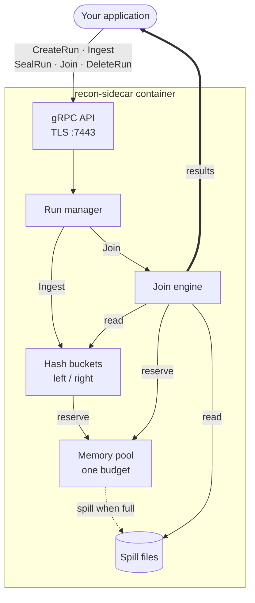
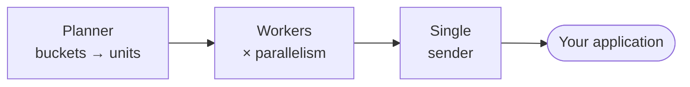
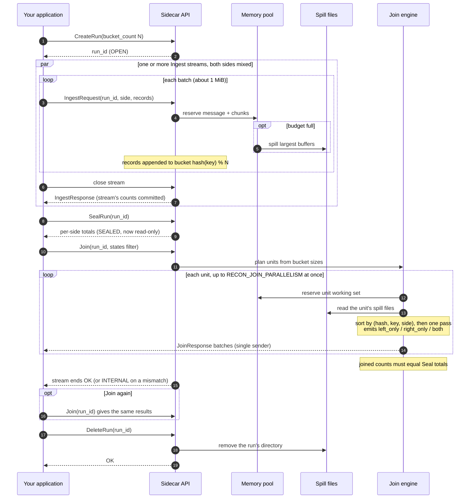
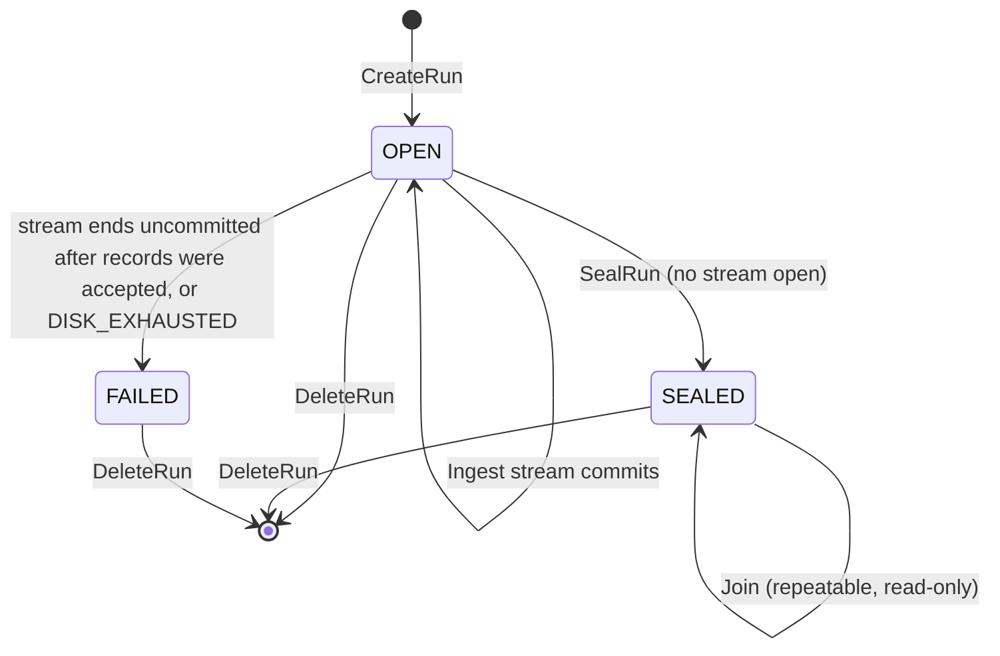
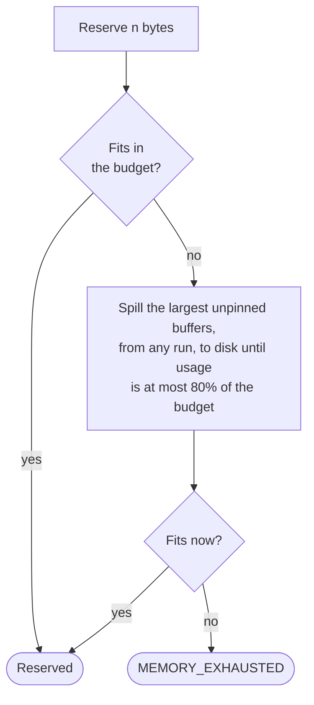

# recon-sidecar POC

This is a proof of concept of the reconciliation sidecar described in [PROPOSAL.md](PROPOSAL.md). It is written in Go on [humus](https://github.com/z5labs/humus), and [PLAN.md](PLAN.md) is the plan it was built from.

The sidecar accepts two sides of records over the `recon.v1` gRPC API (defined in [`proto/recon/v1/reconciler.proto`](proto/recon/v1/reconciler.proto)) and runs a full outer join on them. It returns each key as `left_only`, `right_only` or `both`, and checks the results against control totals. It holds to a fixed memory budget: when the data is larger than the budget it spills to disk, and it splits up skewed buckets. A key too large to join within limits fails with `HOT_KEY`.

The POC set out to answer two questions:

1. **Does the design hold?** Yes. It passes the full end-to-end suite of PLAN.md §8.4, run against the container image. Its output is identical under tiny and huge memory budgets, at every bucket count and parallelism tested.
2. **Can Go keep to a memory budget?** Yes, but only with `GOMEMLIMIT` set. See [Performance](#performance).

## High-level design

The sidecar runs next to your application, in the same pod. Your application streams records for a left and a right side into a **run**, seals it, then streams back the reconciled results. The sidecar never holds more than its memory budget. Anything that doesn't fit goes to spill files in its data directory, and the join reads it back one slice at a time.

### Components



Inside the join engine:



| Component | Code | Job |
|---|---|---|
| gRPC API | `internal/api` | Validates every request, checks the run's state, and maps every failure to a gRPC code plus a `ReconError` detail |
| Run manager | `internal/run` | Creates runs with UUIDv7 IDs, enforces `RECON_MAX_RUNS`, tracks each run's state and its per-side record totals, and cancels a run's streams on DeleteRun |
| Partitions and buffers | `internal/buffer` | Hashes each non-empty key with XXH3 and appends the record to bucket `hash % N` for its side. Buffers are lists of chunks (4 KiB doubling to 1 MiB) already in spill-file encoding, so a spill is one sequential write |
| Memory pool | `internal/mem` | Holds the single memory budget. Every chunk, decoded message, join unit and output batch reserves before it allocates. When a reservation doesn't fit, the goroutine asking for memory spills the largest unpinned buffers (of any run) to 80% of the budget and retries once. There is no background work |
| Spill files | `internal/spill` | Writes and tracks spill files against `RECON_DISK_LIMIT_BYTES`, and empties the data directory at startup |
| Join engine | `internal/join` | Plans units, runs them in parallel, handles skew, streams results through a single sender, and checks control totals |
| Health | `grpchealth` (humus) | Serves `grpc.health.v1` in plaintext on `:8081` for the startup and readiness probes |

### Lifecycle of a run



### Run states



A Join that fails, for example with `HOT_KEY` or a cancelled client, leaves the run `SEALED`, so it can be retried. A `FAILED` run can only be deleted.

### How the join works

- **Partitioning.** At ingest, every record with a non-empty key goes to bucket `xxh3(key) % N` for its side, so a key's left and right records always land in the same bucket number.
- **Planning.** At Join time, the planner estimates each bucket's working set as its record bytes times 2, and groups neighbouring buckets into **units** that fit in `budget / parallelism`. Small buckets are coalesced into one unit, and the plan depends only on the data, not on timing.
- **Joining a unit.** A worker reserves the unit's memory, pins its in-memory chunks so they can't be spilled from under it, and reads its spill files. It builds a 16-byte index entry per record, sorts the entries by (hash, key, side), and walks them once. A key with records on only one side is `left_only` or `right_only`, and a key with both is `both`. No hash map is needed, and the output order is deterministic.
- **Skew.** If a single bucket is too big for a unit, the worker counts records per hash. If one key alone is too big for the budget or for `RECON_MAX_MATCH_BYTES`, the Join fails with `HOT_KEY`, naming the key and its per-side counts. Otherwise it re-partitions the bucket with a new seed into a scratch directory (`runs/<id>/join-<n>/`), up to 3 levels deep, and removes the scratch directory when the Join ends.
- **Empty keys** never match one another. They are streamed back as one-sided results without sorting.
- **Output and backpressure.** Workers hand finished batches to a single sender, because gRPC allows one send at a time per stream. When your application reads slowly, gRPC flow control blocks the sender, which blocks the workers, so memory stays within budget.
- **Control totals.** The engine counts every record it joined on each side, including results removed by the `states` filter. The stream ends `OK` only if those counts equal the totals returned by SealRun.

### Memory and spilling

The sidecar has one memory pool with one budget (`RECON_MEMORY_LIMIT_BYTES`), shared by every run. Everything that takes real memory reserves from the pool before it allocates, and releases afterwards:

| What reserves | Released | Can the pool spill it? |
|---|---|---|
| An Ingest message, once decoded | As soon as its records are copied into buckets | No, but it lasts one message |
| Bucket chunks (the run's records) | When the buffer is spilled, or on DeleteRun. Not when Ingest or Seal finishes | **Yes**, unless a running Join has pinned it |
| A join unit's working set: its spill files read back, plus a 16-byte index entry per record | When the unit's results have been sent | No |
| Join output batches, one per worker | When the Join ends | No |
| Per-key counters while scanning an oversized bucket for hot keys | When the scan ends | No |

When a reservation doesn't fit, the goroutine that asked for it frees memory itself. There is no background spiller:



**During Ingest,** bucket chunks fill the pool. Once it is full, each new chunk forces a spill down to 80%, so the pool stays between about 80% and 100% full and everything beyond that goes to disk. In the 10 GiB run with a 128 MiB budget, the pool never went above 128 MiB, and 10.4 GiB was on disk by Seal.

**After Ingest,** the chunks that weren't spilled stay in memory and stay reserved, even after Seal. This isn't a leak: they are unpinned, so the pool can spill them whenever something else needs room. Delete runs when you are done with them, because only DeleteRun gives back their memory and their disk.

**At Join time,** the pool is usually still full of ingest chunks. The Join gets its memory the same way Ingest does: its reservations force those chunks to disk. If the chunks in the way belong to the unit it is about to join, the worker unpins them, reserves as if all the unit's records were on disk (which may spill them), then pins them again and reads them back. While a unit is being joined, its buffers are pinned, so nothing can spill them out from under it.

**The pool runs out** only when the memory that can't be spilled leaves no room: pinned buffers, units being joined, output batches and in-flight messages. In practice that means two Joins at once, a Join next to another run's heavy Ingest, or an Ingest message larger than the budget. The request then fails with `MEMORY_EXHAUSTED` instead of the container being OOM-killed.

#### Sizing: more memory means less spilling

Because the pool works as a cache in front of disk, a bigger budget changes how much is spilled, not just whether the sidecar survives. These are measured runs of Payment and BankLine records as protobuf, with `GOMEMLIMIT` at 90% of the container limit (see [Performance](#performance)):

| Data | Budget | Ingest | Join | Spill files at Seal | Spilled at Seal |
|---|---|---|---|---|---|
| 1 GiB | 128 MiB | 6.6 s | 2.7 s | 14,063 | 986 MiB |
| 1 GiB | 358 MiB | 4.9 s | 2.5 s | 4,707 | 861 MiB |
| 10 GiB | 128 MiB | 64.8 s | 22.3 s | 149,750 | 10,610 MiB |
| 10 GiB | 358 MiB | 61.1 s | 23.1 s | 51,782 | 10,465 MiB |

- **About 2.8 times the budget wrote about a third as many spill files.** Each spill frees about 20% of the budget at once, so a bigger budget means fewer, larger writes.
- **Ingest got faster at 1 GiB, but not at 10 GiB.** At 1 GiB it took 26% less time (43% less in a second run). At 10 GiB the difference was within the noise: 6% less time in one run and 3% more in the other.
- **The Join barely changed** in these runs, because with data 3 to 80 times the budget most of it has to be read back from disk either way. A bigger budget does give each unit more room (`budget / parallelism`), so fewer, larger units are planned.
- **A run that fits within the budget doesn't spill at all.** That case wasn't measured.
- **Raise three things together:** the container's memory limit, the budget (by default 70% of that limit) and `GOMEMLIMIT` (about 90% of it). Raising the budget without `GOMEMLIMIT` gets the container OOM-killed. Raising the container limit alone does nothing unless the budget follows it, which it does by default.
- **On slow or network-attached disks, the number of files may matter more than the bytes.** Spilling largest first across 2 × N buffers produces many small files: about 70 KiB each in the 10 GiB, 128 MiB run. A larger budget or a smaller `bucket_count` gives fewer, larger files.

## Repository layout

```
PROPOSAL.md        design proposal (§ references point here)
PLAN.md            implementation plan for this POC
proto/             recon.v1 API (shared with the proposal)
poc/               Go module "poc"
  cmd/recon-sidecar/   main
  internal/app/        Init, settings, telemetry
  internal/api/        gRPC server: validation, state checks, error mapping
  internal/run/        run manager and state machine
  internal/mem/        memory reservation pool and spill trigger
  internal/buffer/     per-(side, bucket) record buffers
  internal/spill/      spill files, disk accounting, startup wipe
  internal/join/       planner, loader, sort-based join, sub-partitioning
  internal/oracle/     naive full outer join used by tests
  gen/recon/v1/        generated gRPC code (committed)
  e2e/                 container tests, harness and data generator
  POC-RESULTS.md       full measurement report
```

## Requirements

- Go 1.27
- Podman or Docker. Rootless podman needs the `memory` cgroup controller delegated, otherwise the memory tests mean nothing. `make e2e` checks this before it runs.
- Only to regenerate the gRPC code: `protoc`, `protoc-gen-go` and `protoc-gen-go-grpc`
- Only to regenerate the test generator's reference code (`make reference`): `protoc`, able to find `google/protobuf/timestamp.proto`. A `protoc` built from source needs `PROTOBUF_INCLUDE` set to its `src` directory. The target installs its own pinned `avroc` and `avroc-gen-go` v0.3.0 and `protoc-gen-go` v1.36.6 into `poc/.local/tools`.

All commands below run from `poc/`.

## Running it

### Build and run the container

```sh
cd poc
make run
```

This builds `recon-sidecar:dev` and generates a test CA and server certificate into `poc/.local/tls/`. It then runs the container with a 1 GiB memory limit (change it with `RUN_MEMORY=2g`), publishing these ports on `127.0.0.1`:

| Port | Serves |
|---|---|
| 7443 | `recon.v1.Reconciler`, TLS only |
| 8081 | `grpc.health.v1.Health`, plaintext (the startup and readiness probe) |

The data directory is `poc/.local/data`. The sidecar empties it at startup.

### Call the API by hand

The server has no reflection, so pass [grpcurl](https://github.com/fullstorydev/grpcurl) the proto file:

```sh
grpcurl -cacert .local/tls/ca.pem -import-path ../proto -proto recon/v1/reconciler.proto \
  -d '{"bucket_count":64}' localhost:7443 recon.v1.Reconciler/CreateRun
```

A run goes `CreateRun` → one or more `Ingest` streams → `SealRun` → `Join` (repeatable) → `DeleteRun`.

### Configuration

The sidecar is configured through environment variables. A bad value stops it at startup with exit code 78 and a log record naming the variable. Byte values take a plain integer or an IEC suffix (`128MiB`, `4GiB`).

| Variable | Default | Meaning |
|---|---|---|
| `RECON_TLS_CERT_FILE`, `RECON_TLS_KEY_FILE` | required | PEM server certificate and key |
| `RECON_LISTEN` | `127.0.0.1:7443` (image: `:7443`) | API address |
| `RECON_HEALTH_ADDR` | `:8081` | Health probe address |
| `RECON_DATA_DIR` | `/var/lib/recon` | Spill directory. It must be writable and must not be a tmpfs. |
| `RECON_MEMORY_LIMIT_BYTES` | 70% of the cgroup's `memory.max` | Memory budget. Required when the cgroup has no limit. |
| `RECON_DISK_LIMIT_BYTES` | Free space in the data directory | Spill disk budget |
| `RECON_JOIN_PARALLELISM` | `min(GOMAXPROCS, 4)` | Join units run at once |
| `RECON_MAX_RUNS` | `8` | Runs that can exist at once |
| `RECON_MAX_BUCKETS` | `4096` | Largest `bucket_count` |
| `RECON_MAX_RECV_MESSAGE_BYTES` | `16MiB` | Largest Ingest message |
| `RECON_OUTPUT_BATCH_BYTES` | `1MiB` | Join output batch size |
| `RECON_MAX_MATCH_BYTES` | `3MiB` | Largest single `Match` before `HOT_KEY` |
| `RECON_LOG_KEYS` | `false` | Include keys in logs and `HOT_KEY` errors |
| `RECON_LOG_LEVEL` | `info` | `debug`, `info`, `warn` or `error`. Logs go to stdout as JSON. |
| `RECON_METRICS_EXPORTER` | `none` | `none`, `console` or `otlp` (OpenTelemetry) |

**Always set `GOMEMLIMIT` to about 90% of the container's memory limit** when you run the sidecar at the default budget. Without it the container is OOM-killed under load (see below).

### Tests

| Command | Runs |
|---|---|
| `make test` | Unit, property-based (against the oracle) and in-process gRPC tests, with `-race` |
| `make e2e` | Builds the image, then runs every container test in PLAN.md §8.4, and `TestRealisticSpill`, which joins realistic records of varying size under a 4 MiB budget. About 4 minutes on the machine below. |
| `make e2e-short` | The same, skipping the multi-GiB tests |
| `make proto` | Regenerates `gen/` from `../proto` |
| `make reference` | Re-emits the test generator's reference `.proto` and `.avdl` schemas and regenerates the Go code the byte-exact tests in `e2e/gen/reference` compare values against |

The e2e tests drive the image through the engine's CLI. Set `RECON_E2E_ENGINE` to choose `podman` or `docker`, and `RECON_E2E_IMAGE` to choose the image (the Makefile sets both). Set `RECON_E2E_DATA_ROOT` to choose where the containers' data directories go (`/var/tmp` by default; not a tmpfs). Every container runs with swap disabled (`--memory-swap` equal to `--memory`), so an OOM kill can't be hidden by swapping.

The test data comes from `e2e/gen`, which marshals realistic records as protobuf, Avro or JSON. To see how large and how compressible its profiles are, or to check them against a file of your own values, run `go run ./e2e/gen/cmd/datastats` (`-h` lists the options).

To reproduce the performance numbers, use a data root the filesystem doesn't compress. On btrfs, make an empty directory and run `chattr +m` on it before anything is written there. A pass takes about 12 minutes and needs about 11 GiB of free disk in the data root:

```sh
mkdir /var/tmp/recon-e2e-nocomp && chattr +m /var/tmp/recon-e2e-nocomp
make image
RECON_E2E_IMAGE=recon-sidecar:dev RECON_E2E_DATA_ROOT=/var/tmp/recon-e2e-nocomp go test -tags e2e,measure -run TestMeasure -timeout 3h -v ./e2e/
```

## Performance

Measured on an AMD Ryzen 9 5950X (32 CPUs, 31 GB RAM, NVMe, Fedora 44) under rootless podman. The container had `--memory=512m` with no swap, and `bucket_count` was 1024. The data was marshaled records, the way a client sends them. Unless a row says otherwise, the left side was Payment records and the right side BankLine records, both as protobuf, with 18-byte keys. Their values averaged 226 bytes and compress about 1.8 times with zstd. About 93% of keys had one record on each side. The spill directory was on btrfs with compression turned off. Every result was checked by a streaming verifier. The full method and tables, and the other profiles, are in [poc/POC-RESULTS.md](poc/POC-RESULTS.md).

Earlier versions of these numbers used 1000-byte values that compress 52 times, on a directory that compressed the spill files, and a test client that slowed the join. POC-RESULTS compares them.

### Throughput

| Data | Scenario | Records | Ingest | Join | Ingest + join | Disk peak |
|---|---|---|---|---|---|---|
| Payment/BankLine, protobuf | 1 GiB, 128 MiB budget, `GOMEMLIMIT` unset | 4.4 M | 7.7 s (133 MiB/s) | 2.2 s (472 MiB/s) | 9.9 s | 1,032 MiB |
| Payment/BankLine, protobuf | 1 GiB, 128 MiB budget, `GOMEMLIMIT` 90% | 4.4 M | 6.6 s (155 MiB/s) | 2.7 s (381 MiB/s) | 9.3 s | 1,032 MiB |
| Payment/BankLine, protobuf | 1 GiB, 358 MiB budget (default), `GOMEMLIMIT` 90% | 4.4 M | 4.9 s (210 MiB/s) | 2.5 s (405 MiB/s) | 7.4 s | 965 MiB |
| Payment/BankLine, protobuf | 10 GiB, 128 MiB budget, `GOMEMLIMIT` unset | 43.9 M | 70.7 s (145 MiB/s) | 23.4 s (437 MiB/s) | 94.1 s | 10,633 MiB |
| Payment/BankLine, protobuf | 10 GiB, 128 MiB budget, `GOMEMLIMIT` 90% | 43.9 M | 64.8 s (158 MiB/s) | 22.3 s (458 MiB/s) | 87.1 s | 10,635 MiB |
| Payment/BankLine, protobuf | 10 GiB, 358 MiB budget (default), `GOMEMLIMIT` 90% | 43.9 M | 61.1 s (167 MiB/s) | 23.1 s (444 MiB/s) | 84.1 s | 10,581 MiB |
| Payment/BankLine, Avro | 10 GiB, 358 MiB budget (default), `GOMEMLIMIT` 90% | 53.1 M | 65.9 s (155 MiB/s) | 24.5 s (417 MiB/s) | 90.5 s | 10,664 MiB |
| Payment/BankLine, JSON | 10 GiB, 358 MiB budget (default), `GOMEMLIMIT` 90% | 20.3 M | 49.3 s (208 MiB/s) | 15.9 s (645 MiB/s) | 65.1 s | 10,337 MiB |
| CardSettlement, protobuf | 10 GiB, 358 MiB budget (default), `GOMEMLIMIT` 90% | 66.3 M | 73.1 s (140 MiB/s) | 28.8 s (356 MiB/s) | 101.9 s | 10,833 MiB |
| Envelope, protobuf | 10 GiB, 358 MiB budget (default), `GOMEMLIMIT` 90% | 17.9 M | 46.0 s (223 MiB/s) | 15.3 s (670 MiB/s) | 61.3 s | 10,317 MiB |
| Tiny, protobuf | 275 MiB, 128 MiB budget, `GOMEMLIMIT` unset | 7.0 M | 2.5 s (111 MiB/s) | 2.3 s (120 MiB/s) | 4.8 s | 314 MiB |
| Tiny, protobuf | 275 MiB, 128 MiB budget, `GOMEMLIMIT` 90% | 7.0 M | 2.5 s (109 MiB/s) | 2.2 s (125 MiB/s) | 4.7 s | 310 MiB |
| Old generator, 1000-byte values | 10 GiB, 358 MiB budget (default), `GOMEMLIMIT` 90% | 10.5 M | 36.3 s (281 MiB/s) | 12.1 s (844 MiB/s) | 48.3 s | 10,171 MiB |

Times are wall-clock as the client saw them, and throughput is the key and value bytes sent over that time. Ingest + join is the sidecar's share of a run. SealRun, which runs between the two, wasn't timed, and neither were CreateRun and DeleteRun. The client generated the data and verified every result on the same machine, and the join time includes that verification, so these times are upper bounds for the sidecar.

- **The client can be the limit.** On the old 1000-byte values, a client that verified each result on the goroutine reading the Join stream measured the join at 544 and 554 MiB/s. The client used here verifies on 8 goroutines, and measured 771 and 844 MiB/s with the same data, image and data directory. Whether it limits the joins of realistic records wasn't measured.
- **Smaller records cost more per byte.** The join ran at 1.2 to 2.3 M records/s for the realistic profiles. With Tiny records of 41 bytes of key and value, the cost per record dominates, at about 3 M records/s.
- **The sidecar doesn't compress its spill files,** and the data directory here didn't either, so the disk peak is the space they took: 0.94 to 1.06 times the key and value bytes, and 1.13 to 1.14 times for Tiny records.

In a real pipeline, reading the source can overlap with Ingest, and processing results can overlap with Join, because both stream in batches. Each step then takes about as long as the slower of the two sides.

### Memory

| Scenario | Budget | Pool peak | Peak RSS (VmHWM) | RSS / container limit |
|---|---|---|---|---|
| 1 GiB, 128 MiB budget, `GOMEMLIMIT` unset | 128 MiB | 128.0 MiB | 314 MiB | 61% |
| 10 GiB, 128 MiB budget, `GOMEMLIMIT` unset | 128 MiB | 128.0 MiB | 366 MiB | 71% |
| 1 GiB, default budget, `GOMEMLIMIT` unset | 358 MiB | **OOM-killed 1.6 s into ingest** | | |
| 10 GiB, default budget, `GOMEMLIMIT` unset | 358 MiB | **OOM-killed 1.0 s into ingest** | | |
| 1 GiB, default budget, `GOMEMLIMIT` 90% | 358 MiB | 358.4 MiB | 454 MiB | 89% |
| 10 GiB, default budget, `GOMEMLIMIT` 90% | 358 MiB | 358.4 MiB | 458 MiB | 89% |

- **The reservation accounting holds.** The pool's peak reached the budget in every run and never went over it.
- **Go's garbage collector is the gap.** With `GOMEMLIMIT` unset, the peak resident set was 2.4 to 2.9 times the pool peak. That is the GC's default heap headroom (`GOGC=100`), and it makes the proposal's default budget of 70% of the container limit unworkable.
- **`GOMEMLIMIT` at 90% of the limit closes the gap,** with no measurable loss of throughput. The runtime holds the process at about the soft limit, and about 10% of the container is left for stacks, the binary and gRPC buffers. Every default-budget run with it completed, for every profile and encoding, at 88 to 91% of the container limit. The POC doesn't set `GOMEMLIMIT` itself.
- **Backpressure works.** A client reading at 5 MiB/s pulled 1.1 GiB of results from a 256 MiB container with a 64 MiB budget, over 3 min 40 s. The container was never OOM-killed.

### Expansion factor

A join unit's working set was 1.03 to 1.17 times its record bytes for the realistic profiles, 1.02 times for the old 1000-byte values, and up to 1.40 times for Tiny records of about 51 encoded bytes. The smaller the records, the larger the factor, because each record costs a 16-byte index entry. The planner's factor of 2 is therefore safe but conservative for these records. Records under about 16 encoded bytes would exceed it on the per-record index alone.

## Known limitations

- **Spill compression is not implemented.** The proposal chooses the codec by benchmark in a later milestone.
- **Joins of different runs share one pool,** and each plans for the whole budget, so two Joins at once can fail with `MEMORY_EXHAUSTED`. That is retryable, and the run stays `SEALED`. A Join holding most of the pool can also fail another run's ingest, which marks that run `FAILED` (seen in 1 of about 700 stress repetitions). Clients should join one run at a time; the proposal sizes join memory for a single Join.
- **Parallelism above 1 needs more headroom at very tight budgets,** because the pinned chunks of units running at once can't be spilled.
- **A Join blocked by a client that stopped reading** is aborted by `DeleteRun` only once the client reads again or disconnects.

## Deviations from the proposal

These are listed in [PLAN.md §2](PLAN.md#2-deviations-from-the-proposal). In short: the API uses TCP with TLS instead of a Unix socket, metrics go to OpenTelemetry instead of Prometheus, the test oracle is in Go instead of DuckDB, and spill blocks are uncompressed.
